# TrackVa en Google Cloud: despliegue del ambiente develop

**Proyecto final · Computación en la nube**
Steven Fierro Jaramillo · Profesor: Juan Guillermo Gomez · 23 y 24 de noviembre de 2026

Este documento reporta el despliegue real de la arquitectura propuesta en
[proyecto-final-cloud-grupo-08.docx](referencia/proyecto-final-cloud-grupo-08.docx). Cubre
qué se desplegó, **qué cambió frente al diseño y por qué**, y cómo se verificó cada pieza. El detalle de cada servicio, con todos sus comandos y capturas, está en la
carpeta [servicios/](servicios/).

---

## 1. Resumen

TrackVa es una plataforma SaaS multiempresa para courier y última milla. Tiene una web
(Next.js), una API (NestJS) y un servicio interno de integraciones, sobre una base PostgreSQL
administrada en Supabase.

En dos días se desplegó el ambiente develop completo en Google Cloud, región `us-east4`:

| | |
|---|---|
| Dirección | `https://app-dev.trackva.com.co` |
| Proyecto | `trackva-dev`, separado de producción |
| Servicios configurados | 14, del proyecto al pipeline |
| Estado | En funcionamiento: se inicia sesión, se usa la app y cada cambio en `main` se despliega solo |

Resultado frente al diseño: **la arquitectura se desplegó como se propuso**. Las trece
decisiones de arquitectura (ADR) se mantuvieron; ninguna se revirtió. Lo que cambió fue el
alcance de tres de ellas, y aparecieron piezas que el diseño no contemplaba. La sección 3 lo
detalla.

---

## 2. Arquitectura desplegada

```
                         Internet
                            │ HTTPS  app-dev.trackva.com.co
                            ▼
              ┌──────────────────────────────┐
              │ Balanceador global (IP fija)  │  certificado administrado por Google
              │ + Cloud Armor                 │  límite por IP y reglas contra ataques web
              └───────┬──────────────┬───────┘
              /api/*  │              │  lo demás
                      ▼              ▼
              ┌────────────┐   ┌────────────┐
              │ trackva-api│   │ trackva-web│      Cloud Run, us-east4, 0 a 3 instancias
              └──┬───┬─────┘   └─────┬──────┘      ingress: solo balanceador y red interna
                 │   │               │
                 │   └──▶ trackva-integrations     Cloud Run, ingress interno
                 │                                  (404 desde internet)
                 ▼
        VPC trackva-vpc · firewall de salida (443, 5432, 6543)
                 │
                 ▼
          Cloud NAT · IP fija 136.70.79.227
                 │
                 ▼
     Supabase (PostgreSQL, Auth, Storage) · Resend · Sentry
     └─ PostgreSQL solo acepta conexiones desde la IP del NAT

  Apoyo:  Artifact Registry (imágenes) · Secret Manager (6 secretos) · Cloud Tasks (cola)
          Cloud Monitoring (comprobaciones y alertas) · GitHub Actions sin llaves (despliegue)
```

---

## 3. Qué cambió frente al documento de diseño y por qué

### 3.1 Las trece decisiones de arquitectura

| ADR | Decisión del diseño | Cómo quedó | Qué cambió y por qué |
|---|---|---|---|
| 01 | Monolito modular; servicio de integraciones **planeado** | Monolito desplegado **y** servicio de integraciones desplegado | Entre el diseño y el despliegue se construyó el servicio de integraciones. Se desplegó con ingress interno. No tiene aún transportadoras reales conectadas |
| 02 | Cloud Run para la web y la API | Igual | Dos hallazgos de implementación: la imagen de la web **es distinta por ambiente** (Next.js fija sus variables públicas al compilar), y la API tuvo que pasar de Node 20 a Node 22 para arrancar |
| 03 | Supabase para datos, autenticación y archivos | Igual | Develop usa el plan gratuito de Supabase; el diseño presupuestaba el plan Pro, que corresponde a producción |
| 04 | Cloud Tasks para el trabajo asíncrono | Cola creada y probada | **Alcance reducido.** La infraestructura está y entrega tareas, pero la API todavía no encola: falta el código (contrato de la cola, adaptador y el punto que recibe la tarea). Las notificaciones siguen con el mecanismo anterior |
| 05 | Sin caché en memoria | Igual | Se confirmó en la práctica la consecuencia que el ADR anticipaba: el límite de peticiones de la API cuenta por instancia |
| 06 | Aislamiento por `tenant_id` + RLS | Igual | El pipeline incorporó el chequeo automático de aislamiento, que encontró 5 consultas por revisar |
| 07 | JWT de Supabase validado por la API | Igual | Sin cambios |
| 08 | Pub/Sub para eventos de dominio (propuesto) | No desplegado | Sigue como propuesta: hoy hay un solo consumidor |
| 09 | Región `us-east4` | Igual | Se comprobó que la base de Supabase está en `us-east-1` (Virginia), que es la razón de la decisión |
| 10 | Balanceador global como único punto de entrada | Igual | Usa el subdominio `app-dev.trackva.com.co` en vez del dominio principal. No se configuró la ruta `/webhooks/*`: integraciones no recibe webhooks todavía |
| 11 | Cloud Armor con límite por IP y reglas administradas | Igual, con más reglas | **De 2 reglas a 5.** Se separó el límite de la API y el de la web, se dividieron inyección SQL y XSS, y se agregó una excepción para el tráfico de los propios servicios (ver 3.2). Las reglas de ataques web están en modo de solo registro |
| 12 | VPC, firewall de salida y Cloud NAT con IP fija | Igual | Dos matices: PostgreSQL acepta también la IP del equipo de desarrollo, y las llamadas a las API de Google no pasan por el NAT (ver 3.2) |
| 13 | Ingress restringido y verificación OIDC para Cloud Tasks | Ingress hecho y probado; OIDC pendiente | El ingress cerrado funciona: las URL `run.app` responden 404 y Cloud Tasks sí entra. La verificación del token OIDC es código de la API que va junto con el ADR-04 |

### 3.2 Lo que el diseño no preveía

Estos puntos no estaban en el documento de diseño. Aparecieron al desplegar.

| Hallazgo | Qué se hizo | Por qué importa |
|---|---|---|
| **El tráfico entre los propios servicios pasa por el balanceador.** Cuando la web arma una página en el servidor, consulta la API por el dominio público, y todas esas consultas salen de la IP del NAT | Regla de Cloud Armor que deja pasar esa IP (prioridad 900) | Sin ella, el límite por IP habría tratado a la web entera como un solo visitante |
| **Detrás del balanceador la API no veía la IP del visitante.** Con la configuración heredada, todos los visitantes compartían un solo contador del límite de peticiones | Se midió con los contadores reales y se corrigió el número de saltos de confianza (`TRUST_PROXY=2`), aplicado por el pipeline | Un límite de 30 por minuto por persona se habría convertido en 30 por minuto para todos |
| **Las llamadas a las API de Google no salen por el NAT.** La subred tiene acceso privado a Google | La llave de Maps del servidor se restringió por API y no por IP | Una restricción por IP fija habría roto la geocodificación |
| **Una sola llave de Google Maps, pública y sin restricciones,** compartida por la web y la API | Cuatro llaves: navegador y servidor, para develop y para desarrollo local, cada una restringida | La llave del servidor viajaba en el JavaScript de la web |
| **Las imágenes no construían o no arrancaban.** El `Dockerfile` de la API no generaba el cliente de base de datos y usaba una versión de Node que una librería ya no soporta | Tres correcciones en los repositorios, cada una probada arrancando la imagen | El diseño daba por hecho que los contenedores existentes funcionaban |
| **La imagen de la web depende del ambiente** | Argumentos de compilación en su `Dockerfile` y valores públicos como variables del repositorio | Obliga a compilar una imagen por ambiente |
| **Un proyecto de Google Cloud por ambiente** | `trackva-dev` contiene solo develop | Permisos, secretos y facturación separados de producción |
| **Una cuenta de servicio por cada servicio** | Tres cuentas de ejecución, una para Cloud Tasks y una para el despliegue | La web no puede leer los secretos de la API |
| **La protección de rama de GitHub exige un plan de pago** en repositorios privados | El pipeline no despliega si las comprobaciones fallan, pero GitHub no impide fusionar | El diseño suponía comprobaciones obligatorias |
| **Las migraciones no pueden correr en el pipeline** | Se aplican desde el equipo de desarrollo, antes de fusionar | La base solo acepta la IP del NAT, y los corredores de GitHub no tienen IP fija |

### 3.3 Balance

- **Decisiones mantenidas sin cambios de fondo:** 10 de 13.
- **Decisiones con alcance reducido:** 2 (ADR-04 y la parte OIDC del ADR-13), las dos por código pendiente en la API y no por la infraestructura.
- **Decisiones ampliadas:** 1 (ADR-11, de 2 a 5 reglas).
- **Decisiones revertidas:** ninguna.

El diseño se sostuvo. Los cambios vinieron de dos fuentes: el producto avanzó entre el diseño y
el despliegue, y hubo detalles que solo aparecen al conectar las piezas de verdad, sobre todo
cómo circula el tráfico entre servicios detrás de un balanceador.

---

## 4. Objetivos específicos frente al resultado

| # | Objetivo del diseño | Resultado | Estado |
|---|---|---|---|
| 1 | Web y rastreo público en Cloud Run tras un balanceador global con TLS y Cloud Armor; p95 menor de 500 ms en el rastreo | Desplegado y funcionando. Respuestas observadas de 0,3 a 0,8 s en pruebas sueltas | Infraestructura cumplida. **El p95 no se midió** con una prueba de carga |
| 2 | API en Cloud Run de 0 a 3 instancias; p95 menor de 300 ms en lecturas | Desplegada con ese escalado. Lecturas observadas de 0,23 a 0,58 s | Infraestructura cumplida. **El p95 no se midió** |
| 3 | Notificaciones por Cloud Tasks con 3 reintentos y retroceso exponencial | Cola con 3 intentos y espera de 1 a 10 s; una tarea de prueba se entregó al primer intento | Parcial: la API aún no encola |
| 4 | Aislamiento por empresa con RLS; PostgreSQL restringido a la IP del NAT | PostgreSQL restringido a la IP del NAT y a la del equipo de desarrollo; comprobado desde las dos | Cumplido para la restricción de red. El RLS ya existía y no se volvió a auditar aquí |
| 5 | Costo menor de US$70 al mes; 0 secretos en el repositorio; despliegue automatizado en menos de 10 minutos, sin llaves | Costo estimado de US$30 a 35 al mes. 0 secretos en los repositorios y en GitHub. Despliegue sin llaves en los tres servicios | Costo y secretos, cumplidos. Tiempo: integraciones 5 min y web 9 min 54 s cumplen; **la API tardó 12 min 35 s** en su primer despliegue |

---

## 5. Servicios configurados

Cada servicio tiene su documento con el propósito, los pasos, los comandos con su salida, la
verificación, las capturas y cómo deshacerlo.

### 00 · Proyecto y APIs · [detalle](servicios/00-proyecto-y-apis/README.md)

Proyecto `trackva-dev` (número `1082495364`) dentro de la organización, con facturación propia
y una alerta de presupuesto. Se habilitaron las 13 API que usan los demás servicios.

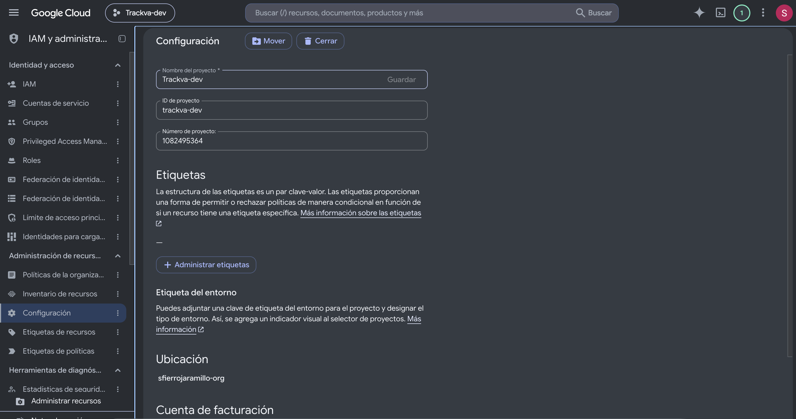

### 01 · IAM · [detalle](servicios/01-iam/README.md)

Cinco cuentas de servicio, ninguna con llaves:

| Cuenta | Para qué | Permisos |
|---|---|---|
| `trackva-api-cloud-run` | Ejecutar la API | Leer sus 6 secretos; encolar en la cola `notifications` |
| `trackva-web-cloud` | Ejecutar la web | Ninguno |
| `trackva-integraciones-cloud-ru` | Ejecutar integraciones | Leer el secreto compartido con la API |
| `trackva-tasks-invoker` | Firma con la que Cloud Tasks llama a la API | Ninguno |
| `trackva-github-deploy` | Desplegar desde GitHub Actions | Subir imágenes y crear revisiones |

Los permisos se dieron por recurso (por secreto, por cola), no en el proyecto.

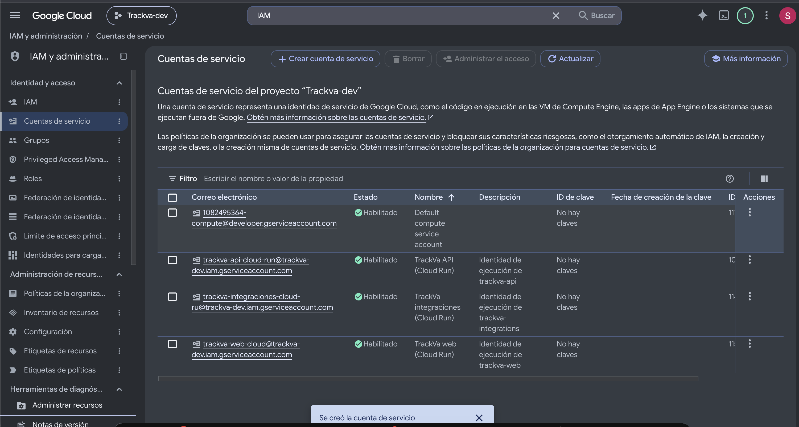

### 02 · Artifact Registry · [detalle](servicios/02-artifact-registry/README.md)

Repositorio Docker `trackva-dev` en `us-east4`. Imágenes etiquetadas con el SHA del commit:
`trackva-api` (206 MiB), `trackva-web` (82 MiB) y `trackva-integrations` (56 MiB).

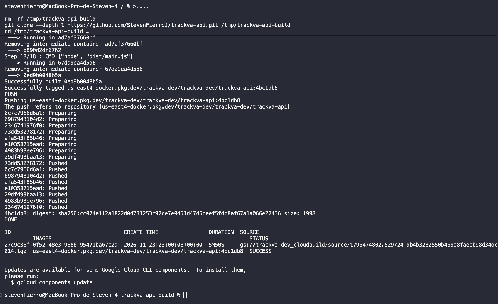

### 03 · Secret Manager · [detalle](servicios/03-secret-manager/README.md)

Seis secretos: la conexión a la base, la llave de servicio de Supabase, el secreto compartido
entre la API e integraciones, y las llaves de Resend, Google Maps y Sentry. Solo van aquí los
valores que dan acceso a algo; la configuración que no es secreta vive en el repositorio.

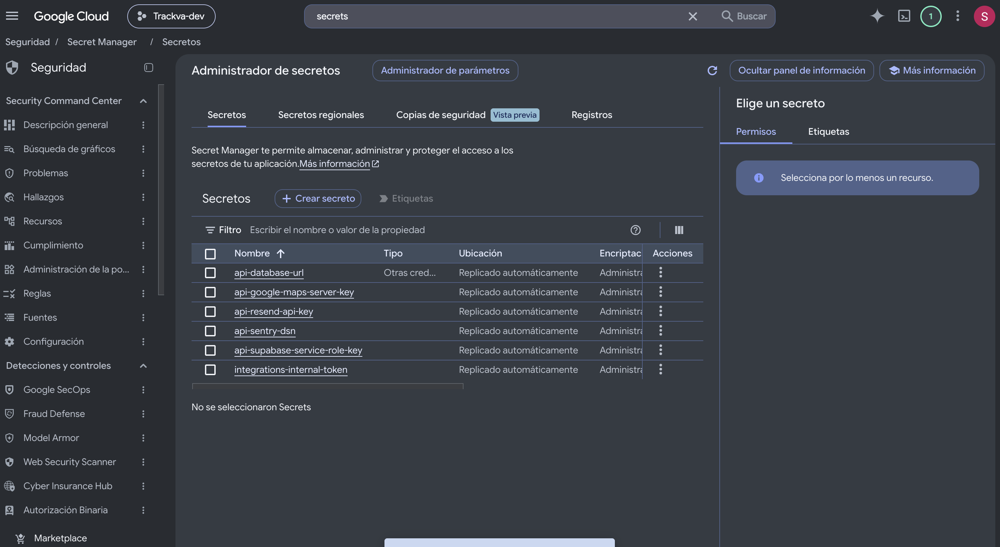

### 04 · Red · [detalle](servicios/04-red/README.md)

| Pieza | Valor |
|---|---|
| VPC y subred | `trackva-vpc` · `trackva-run-us-east4` · `10.10.0.0/24` · acceso privado a Google |
| IP de salida | `trackva-nat-ip` = `136.70.79.227` |
| Cloud NAT | `trackva-nat`, con esa IP en modo manual |
| Firewall de salida | Permite TCP 443, 5432 y 6543; rechaza lo demás; aplica a la etiqueta `trackva-run` |

Verificado desde Cloud Run: el NAT asigna esa IP a las instancias de los tres servicios.

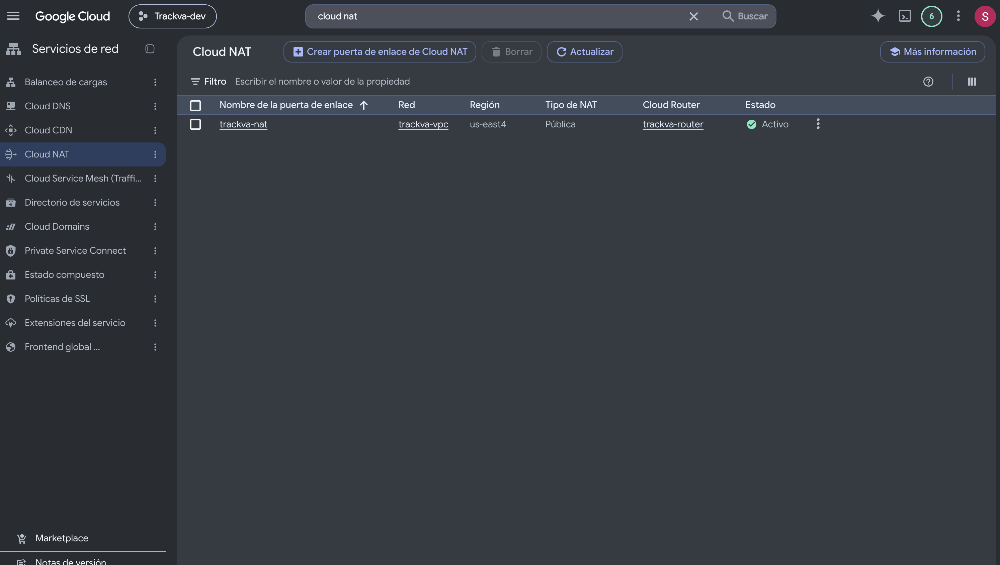
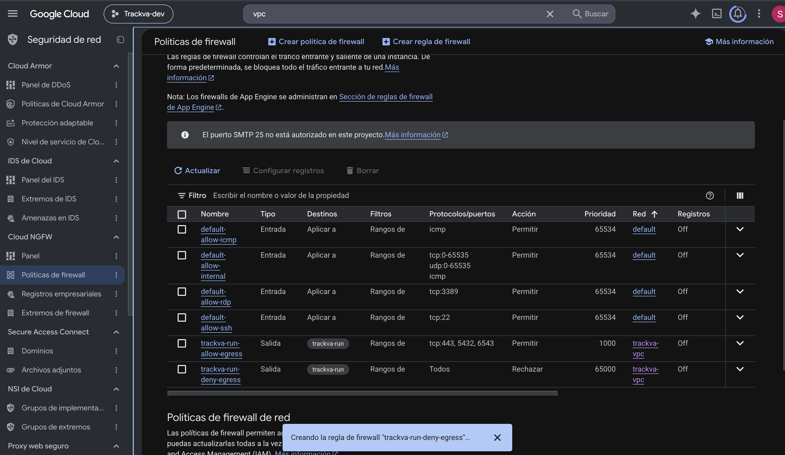

### 05 · Cloud Run: integraciones · [detalle](servicios/05-cloud-run-integraciones/README.md)

`trackva-integrations` con ingress interno. Desde internet responde 404; la API lo alcanza por
la VPC y se autentica con un secreto compartido.

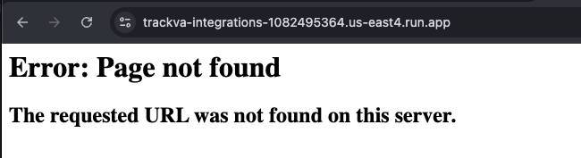
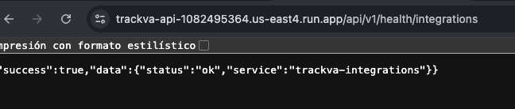

### 06 · Cloud Run: API · [detalle](servicios/06-cloud-run-api/README.md)

`trackva-api`, de 0 a 3 instancias, 1 CPU y 1 GiB. Corre con su propia cuenta, recibe sus
secretos de Secret Manager y saca todo su tráfico por la VPC.

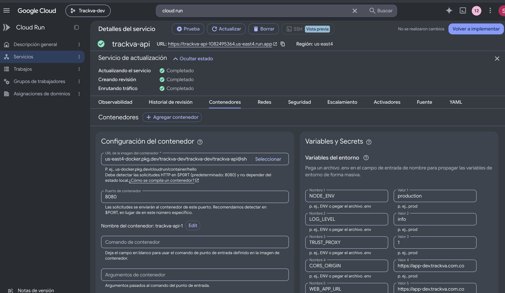
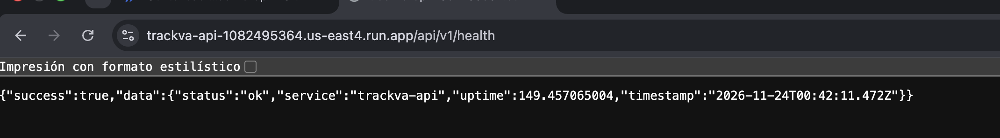

### 07 · Cloud Run: web · [detalle](servicios/07-cloud-run-web/README.md)

`trackva-web` (Next.js con renderizado en servidor), 1 CPU y 512 MiB. No lleva variables ni
secretos en ejecución: todo lo que usa es público y quedó dentro de la imagen al compilar.

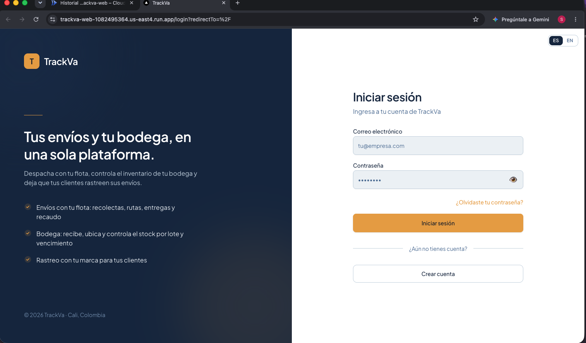

### 08 · Balanceador, certificado y DNS · [detalle](servicios/08-balanceador/README.md)

| Pieza | Valor |
|---|---|
| IP global | `trackva-lb-ip` = `136.68.113.157` |
| DNS | Registro A `app-dev` en el proveedor del dominio |
| Certificado | Administrado por Google, activo, renovación automática |
| Rutas | `/api/*` a la API; el resto a la web |
| HTTP | Redirige a HTTPS |

Después de comprobar el dominio se cerró Cloud Run: las URL `run.app` de los tres servicios
responden 404 desde internet.

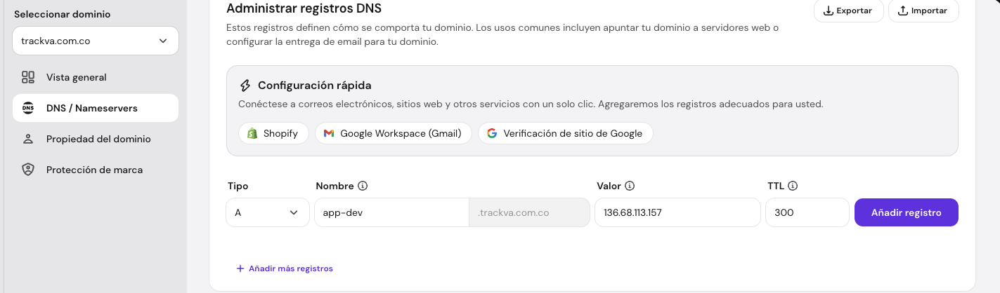
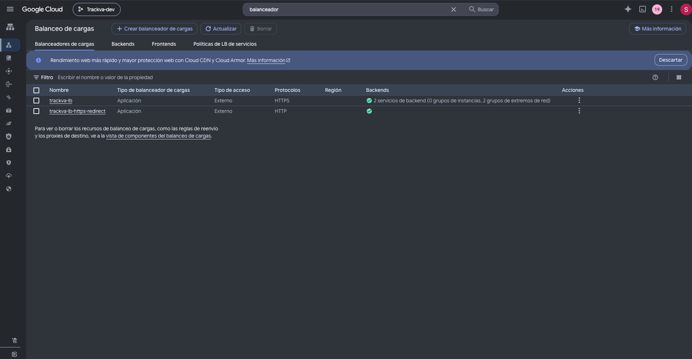

### 09 · Cloud Armor · [detalle](servicios/09-cloud-armor/README.md)

Una política, `trackva-armor`, aplicada a los dos backends:

| Prioridad | Regla | Acción |
|---|---|---|
| 900 | Tráfico de los propios servicios | Permitir |
| 1000 | Rutas públicas de la API | Máximo 120 por minuto por IP |
| 1100 | Rastreo y widgets de la web | Máximo 120 por minuto por IP |
| 2000 | Inyección SQL | Denegar, en solo registro |
| 2100 | XSS | Denegar, en solo registro |

Probado con ráfagas reales: Cloud Armor rechazó 50 de 170 peticiones a una ruta pública de la
API y 20 de 140 al rastreo, y registró una inyección SQL de prueba.

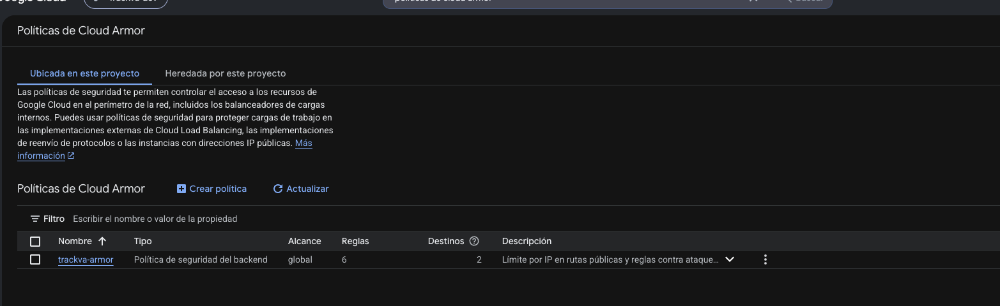
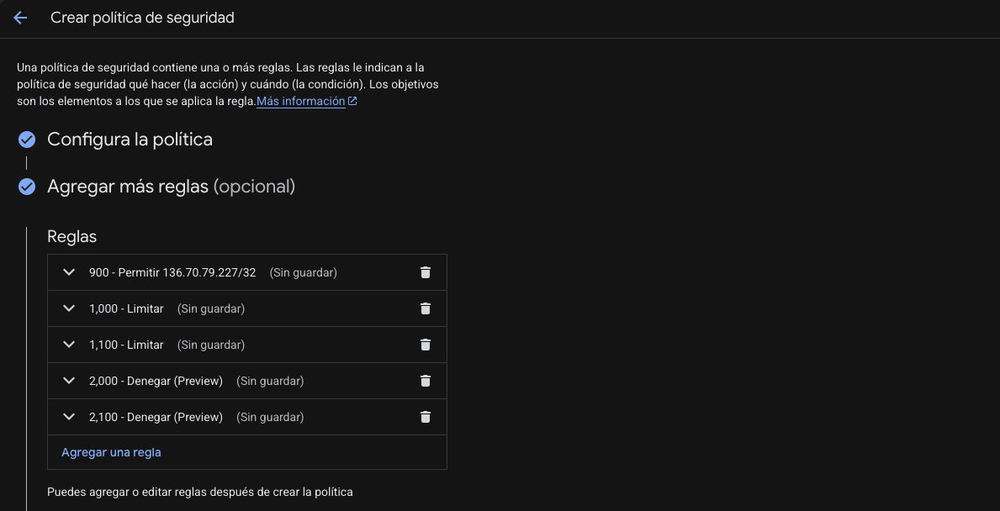

### 10 · Cloud Tasks · [detalle](servicios/10-cloud-tasks/README.md)

Cola `notifications`: 10 envíos por segundo, 10 simultáneos, 3 intentos con espera de 1 a 10 s.
Una tarea de prueba firmada con OIDC se entregó al primer intento, con el ingress de la API
cerrado a internet.

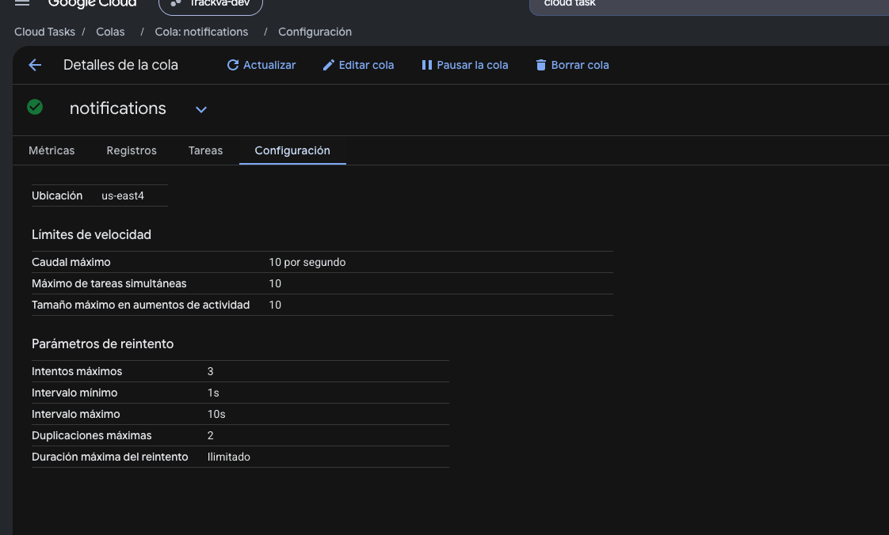
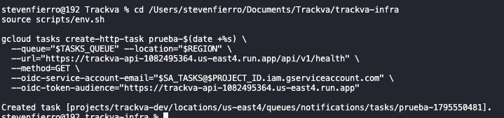

### 11 · Supabase: restricción de red · [detalle](servicios/11-supabase-red/README.md)

PostgreSQL y su agrupador de conexiones solo aceptan dos orígenes: la IP del NAT y el equipo de
desarrollo. Antes aceptaban cualquier dirección. La captura del después está en la carpeta del
servicio y no se incluye aquí porque muestra una IP personal.

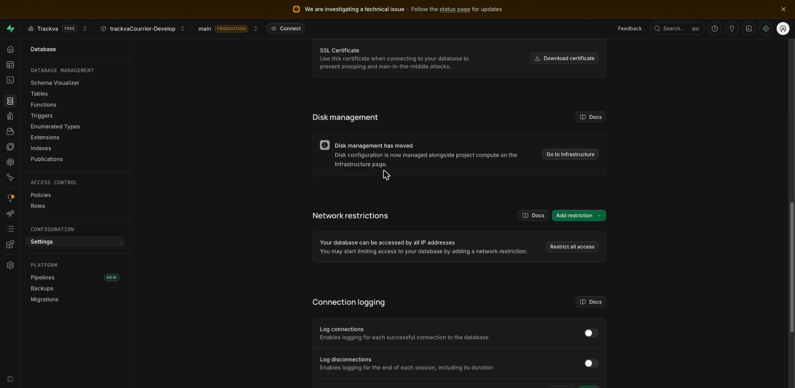

### 12 · Observabilidad · [detalle](servicios/12-observabilidad/README.md)

Dos comprobaciones de disponibilidad desde varias regiones (la API y la web) y tres alertas por
correo: API caída, web caída y más de 5 errores 5xx en 5 minutos.

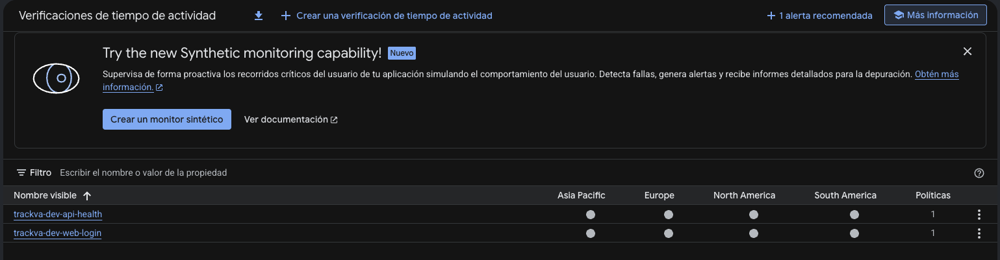
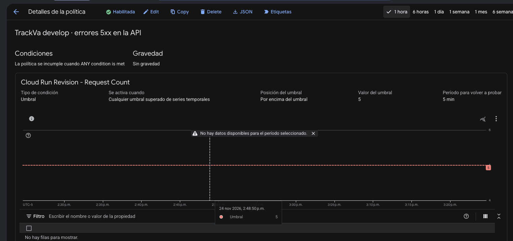

### 13 · CI/CD · [detalle](servicios/13-ci-cd/README.md)

GitHub Actions en los tres repositorios, autenticado con Workload Identity Federation: GitHub
presenta un token de corta duración y Google lo cambia por credenciales temporales. No existe
ninguna llave de cuenta de servicio.

| Flujo | Cuándo | Qué hace |
|---|---|---|
| CI | En cada pull request y en cada push a `main` | Formato, lint, tipos y pruebas unitarias |
| Despliegue | En cada push a `main` que pasa el CI | Compila, sube la imagen, crea la revisión, prueba por el dominio y, si falla, vuelve a la revisión anterior |

Solo los tres repositorios, y solo desde la rama `main`, pueden usar la cuenta de despliegue.

---

## 6. Seguridad en capas

El diseño proponía cuatro capas. Las cuatro están en funcionamiento.

| Capa | Mecanismo | Comprobación |
|---|---|---|
| Borde | Cloud Armor en el balanceador | Rechazos con 429 en las pruebas de ráfaga |
| Entrada a los servicios | Ingress restringido en Cloud Run | Las URL `run.app` responden 404 desde internet |
| Identidad | Una cuenta por servicio, permisos por recurso, sin llaves, OIDC en Cloud Tasks y en el despliegue | Las cuentas no tienen llaves; el pipeline no usa ninguna |
| Salida | VPC, firewall de salida y NAT con IP fija autorizada en PostgreSQL | El NAT asigna la IP a las instancias; la base solo acepta esa IP y la de desarrollo |

---

## 7. Incidencias

Lo que falló en el camino y cómo se resolvió.

| Incidencia | Causa | Solución |
|---|---|---|
| La imagen de la API no construía | El `Dockerfile` no generaba el cliente de base de datos | Paso agregado al `Dockerfile` |
| La primera compilación en la nube fue rechazada | La cuenta que compila no tenía permisos en un proyecto nuevo | Rol de compilación para esa cuenta |
| La primera revisión de la API no arrancó | Una librería exige Node 22 y la imagen usaba Node 20 | `Dockerfile` a Node 22. **Cloud Run no le dio tráfico a la revisión rota** |
| Las rutas del balanceador aparecían cruzadas en la revisión previa | Una regla redundante en el asistente | Se dejó una sola regla antes de crear |
| La comprobación de disponibilidad falló y disparó una alerta | Una comilla de más en el texto esperado | Corregida; la alerta se cerró sola |
| La suite de integración se quedó sin memoria en el pipeline | Corre 101 archivos en un solo proceso | Un proceso que se recicla; salió del camino del despliegue |
| El CI detuvo una corrección | Un arreglo introdujo un error de lint | Corregido antes de fusionar |

Dos de ellas muestran el valor de la plataforma: la revisión que no arrancó nunca recibió
tráfico, y el error de lint fue detenido por el pipeline el mismo día en que se encendió.

---

## 8. Costo

Estimado mensual de develop, sin tráfico real. No son cifras medidas en la factura.

| Servicio | US$ al mes |
|---|---|
| Balanceador global | ~18 |
| Cloud Armor (1 política, 5 reglas) | ~9 |
| IP fija y Cloud NAT | ~4 a 8 |
| Cloud Run, Cloud Tasks, Secret Manager, Artifact Registry, Monitoring | ~0, dentro de los niveles gratuitos |
| Supabase (plan gratuito en develop) | 0 |
| **Total** | **~30 a 35** |

El gasto es casi todo fijo: tres piezas que cobran por hora aunque no haya tráfico. El plan es
que, cuando exista producción, develop pase a una variante sin balanceador, sin Cloud Armor y
sin NAT, y quede en un costo cercano a cero.

---

## 9. Cómo se trabajó

La mayoría de los servicios se configuraron a mano en la consola de Google Cloud; la identidad
del pipeline, las llaves de Maps y algunos ajustes se hicieron por línea de comandos. Cada
servicio se verificó con comandos de lectura (`describe`, `list`, `curl`) y se documentó con sus
capturas. Ningún secreto aparece en esta
carpeta: ni en documentos, ni en capturas, ni en las salidas copiadas.

| Recurso | Dónde |
|---|---|
| Plan, estado y decisiones | [README.md](README.md) |
| Un documento por servicio, con cómo deshacerlo | [servicios/](servicios/) |
| Nombres y región compartidos | [scripts/env.sh](scripts/env.sh) |
| Documento de diseño | [referencia/](referencia/proyecto-final-cloud-grupo-08.docx) |
