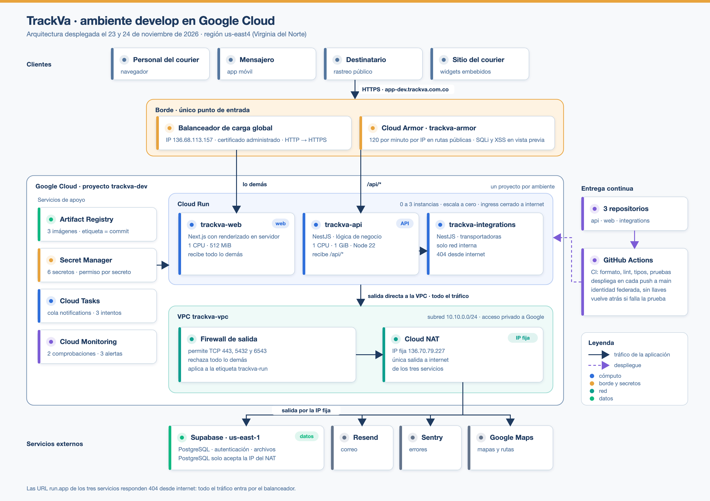

# trackva-infra · Despliegue de TrackVa en Google Cloud

Bitácora y documentación del despliegue del ambiente **develop** de TrackVa en Google Cloud.
Cada servicio se configura por línea de comandos (`gcloud`), se captura el resultado en la
consola web y se documenta en su propia carpeta.

- **Documento de entrega:** [ENTREGA.md](ENTREGA.md): resumen del despliegue, qué cambió frente
  al diseño y por qué, resultados y pendientes.
- **Diseño de referencia:** [referencia/proyecto-final-cloud-grupo-08.docx](referencia/proyecto-final-cloud-grupo-08.docx)
  (arquitectura, ADR-01 a ADR-13 y costo estimado). Es copia del original en `documentación/Infra/`.
- **Ambiente:** develop. No es producción: no sirve a clientes reales.
- **Región:** `us-east4` (ADR-09), junto a la base de datos de Supabase (`us-east-1`).
- **Inicio:** 23-nov-2026.

## Qué se despliega



Datos, autenticación y archivos siguen en Supabase (ADR-03); no se despliegan aquí. La imagen
sale de [diagramas/generar.py](diagramas/generar.py).

## Cómo se trabaja cada servicio

1. El documento del servicio trae la guía del paso: pantalla, campos y valores exactos.
2. Steven ejecuta el paso en la consola de Google Cloud y toma la captura.
3. Claude verifica con un comando de lectura (`describe`, `list` o `curl`) y pega la salida en el documento.
4. La captura se guarda en `servicios/NN-nombre/capturas/` y **se incrusta dentro del paso al que pertenece**.
5. Se actualiza la tabla de estado de abajo.

Cada documento de servicio sigue [servicios/_plantilla.md](servicios/_plantilla.md):

| Sección | Contenido |
|---|---|
| 1. Para qué sirve | Qué hace el servicio en TrackVa |
| 2. Requisitos previos | Qué debe existir antes |
| 3. Paso a paso | Un apartado por paso, con sus valores o comandos y **su captura incrustada** |
| 4. Verificación | Comandos de lectura con su salida real |
| 5. Índice de capturas | Tabla con todas las capturas del servicio |
| 6. Cómo deshacerlo | Comandos para borrar lo creado |
| 7. Diferencias con el diseño y pendientes | Lo que se hizo distinto y por qué |

Reglas:

- Ningún secreto en esta carpeta: ni en documentos, ni en capturas, ni en la salida pegada.
  Los valores se reemplazan por `<oculto>`.
- Capturas con nombre `NN-que-muestra.png`, numeradas en el orden del documento.
- Lo que se haga distinto al diseño se anota en la sección 7 del documento del servicio.

## Orden y estado

| # | Servicio | Qué se configura | ADR | Estado |
|---|---|---|---|---|
| [00](servicios/00-proyecto-y-apis/README.md) | Proyecto y APIs | Proyecto, facturación, alerta de presupuesto, APIs habilitadas | — | Configurado 23-nov. Por corregir: importe del presupuesto |
| [01](servicios/01-iam/README.md) | IAM | Cuentas de servicio por servicio, con permisos mínimos | ADR-13 | Configurado 23-nov (cuentas de ejecución) |
| [02](servicios/02-artifact-registry/README.md) | Artifact Registry | Repositorio Docker y primera imagen de cada servicio | — | Configurado: imágenes de la API (`02b700f`), integraciones (`089413e`) y web (`39e568d`) |
| [03](servicios/03-secret-manager/README.md) | Secret Manager | Secretos de la API, la web e integraciones | — | En curso: 6 secretos de la API con su permiso; faltan web e integraciones |
| [04](servicios/04-red/README.md) | Red | VPC, subred, firewall de salida, Cloud Router, Cloud NAT e IP estática | ADR-12 | Configurado 23-nov; salida comprobada por `136.70.79.227` |
| [05](servicios/05-cloud-run-integraciones/README.md) | Cloud Run · integraciones | `trackva-integrations` con ingress interno | ADR-02 | Configurado 24-nov: cerrado a internet y conectado con la API |
| [06](servicios/06-cloud-run-api/README.md) | Cloud Run · API | `trackva-api`, 0 a 3 instancias, salida por la VPC | ADR-02 | Configurado 23-nov: responde en `run.app`, lee la base y sale por la IP fija |
| [07](servicios/07-cloud-run-web/README.md) | Cloud Run · web | `trackva-web` (Next.js, SSR) | ADR-02 | Configurado 24-nov: sirve sus páginas en `run.app`; el inicio de sesión espera el dominio |
| [08](servicios/08-balanceador/README.md) | Balanceador | IP global, NEG sin servidor, mapa de URL, certificado administrado y DNS | ADR-10 | Configurado 24-nov: dominio con HTTPS, inicio de sesión y Cloud Run cerrado a internet |
| [09](servicios/09-cloud-armor/README.md) | Cloud Armor | Límite por IP en rutas públicas y reglas contra ataques web | ADR-11 | Configurado 24-nov: límites probados; reglas de ataques web en vista previa |
| [10](servicios/10-cloud-tasks/README.md) | Cloud Tasks | Cola `notifications` y cuenta que invoca con OIDC | ADR-04 | Configurado 24-nov: cola probada con una tarea; la API la usa desde R-45 (desplegado 27-nov) |
| [11](servicios/11-supabase-red/README.md) | Supabase | Restricción de red de PostgreSQL a la IP del NAT | ADR-12 | Configurado 24-nov: solo entran la IP del NAT y el equipo de desarrollo |
| [12](servicios/12-observabilidad/README.md) | Observabilidad | Comprobación de disponibilidad y alertas por correo | — | Configurado 24-nov: dos comprobaciones cada 15 min y seis alertas por correo (disponibilidad, errores y uso de CPU, memoria e instancias) |
| [13](servicios/13-ci-cd/README.md) | CI/CD | Workload Identity Federation y GitHub Actions | — | Configurado 24-nov: CI y despliegue automático en los tres repositorios; sin protección de rama |
| [14](servicios/14-cloud-scheduler/README.md) | Cloud Scheduler | Tic de cada hora, cola `jobs` y regla de Cloud Armor para las rutas internas | ADR-04, ADR-13 | Activo desde 27-nov: tic cada hora, probado de punta a punta (correo y trabajo diario por la cola) |

El orden respeta las dependencias: las cuentas, las imágenes, los secretos y la red van antes de
Cloud Run; el balanceador necesita los servicios; Cloud Armor necesita el balanceador; la
restricción de Supabase necesita la IP del NAT ya en uso.

## Punto de partida (revisado el 23-nov-2026)

- `gcloud` 592.0.0 instalado y con sesión iniciada. Docker instalado. Terraform no: todo va con `gcloud`.
- No existe un proyecto de Google Cloud para TrackVa. `seo-trackva` es de Search Console y Analytics, no se usa aquí.
- Hay una cuenta de facturación abierta y una organización.
- Los tres repositorios tienen `Dockerfile`. Ninguno tiene flujos de GitHub Actions.
- El DNS de `trackva.com.co` lo sirve `dns-parking.com` (Hostinger); la landing está en Firebase Hosting.

## Cosas del código que afectan el despliegue

| Tema | Qué pasa | Dónde se resuelve |
|---|---|---|
| `Dockerfile` de la API | No generaba el cliente de Prisma y la imagen no construía (probado en local el 23-nov). Arreglado en `main` de `trackva-api` (PR #113, `4bc1db8`), que además agrega `.dockerignore` | 02 |
| Variables `NEXT_PUBLIC_*` de la web | Next.js las fija al **construir** la imagen, no al arrancar. El `Dockerfile` de la web no declara argumentos de construcción | 02 y 07 |
| `trackva-integrations` | El documento de diseño lo da como planeado; ya existe (R-25) y se despliega con ingress interno | 05 |
| `TRUST_PROXY` de la API | Aplicado `2` por el pipeline y comprobado. Queda el caso de las consultas de la web desde el servidor, que comparten el contador de la IP del NAT (revisar `visitor-ip.ts`) | 08 y 13 |
| Cloud Tasks | La cola se crea, pero la API todavía no la usa: `TaskQueuePort` no está implementado. Las notificaciones siguen con el outbox | 10 |
| Cargo diario de almacenamiento del WMS | `npm run wms:storage-charges` hoy se corre a mano; pide Cloud Scheduler o un job de Cloud Run | Después del 13 |
| Migraciones | La base de dev de Supabase ya está migrada; el despliegue no corre migraciones | — |

## Decisiones

| # | Decisión | Estado |
|---|---|---|
| D1 | Proyecto de Google Cloud | `trackva-dev` (número `1082495364`), creado por Steven en la consola el 23-nov |
| D2 | Cuenta de facturación | «Trackva» (`…6A96C9`), en pesos colombianos; enlazada por Steven el 23-nov |
| D3 | Subdominio de develop | `app-dev.trackva.com.co`: la web en `/` y la API en `/api/*`. El registro A lo crea Steven en Hostinger |
| D4 | Capturas | Las toma Steven; cada documento indica qué pantalla capturar y con qué nombre guardarla |
| D5 | Alerta de presupuesto | «Presupuesto Develop», avisos al 80, 90 y 100 %. **Por corregir:** quedó en 10 COP, no US$10, y cubre toda la cuenta |

## Estructura

```
trackva-infra/
├── README.md                 # este archivo: plan, reglas y estado
├── ENTREGA.md                # documento final de entrega
├── diagramas/                # diagrama de arquitectura (PNG, SVG y su generador)
├── referencia/               # documento de diseño
├── scripts/
│   ├── env.sh                # nombres y región compartidos (sin secretos)
│   ├── build-web.sh          # compila la imagen de la web con sus variables públicas
│   ├── crear-alertas-uso.sh  # crea las alertas de uso de CPU, memoria e instancias
│   └── cloudbuild-web.yaml   # configuración de Cloud Build que usa build-web.sh
└── servicios/
    ├── _plantilla.md         # formato de cada documento
    └── NN-nombre/
        ├── README.md         # comandos, verificación, capturas, cómo deshacer
        └── capturas/
```
