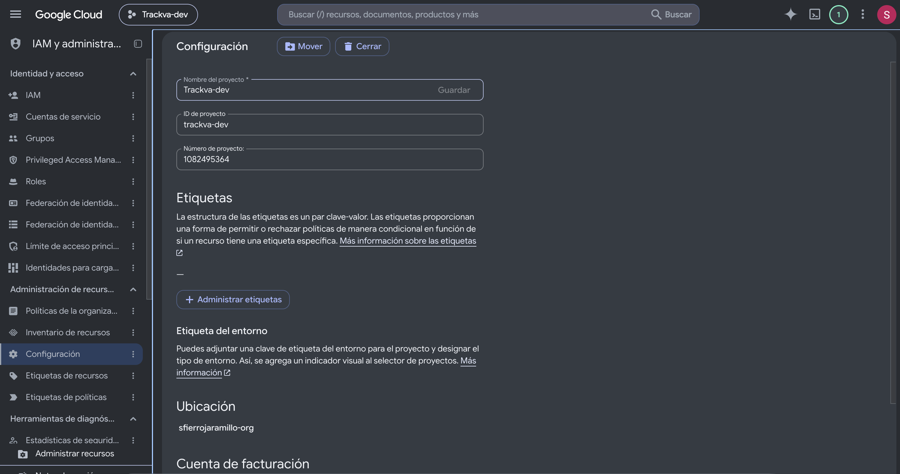
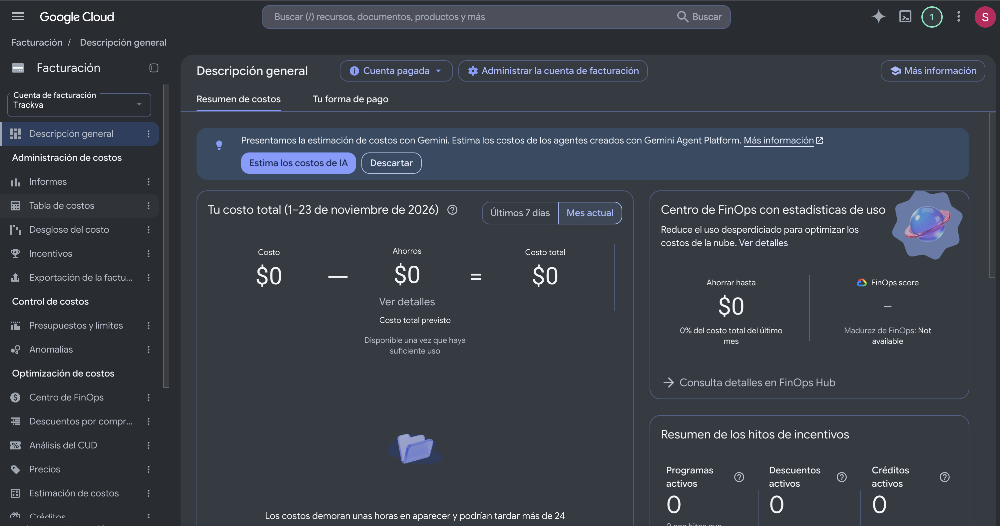
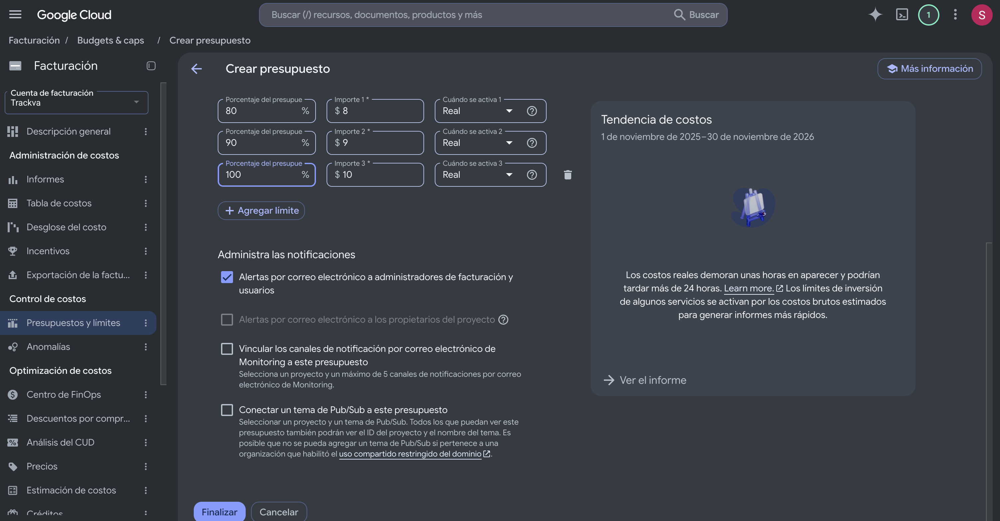

# 00 · Proyecto y APIs

| | |
|---|---|
| **Estado** | Configurado el 23-nov-2026 |
| **Proyecto** | `trackva-dev` (número `1082495364`), nombre «Trackva-dev», en la organización `sfierrojaramillo-org` |
| **Región** | `us-east4` (el proyecto en sí es global) |
| **ADR del diseño** | — |
| **Costo estimado** | US$0 (el proyecto, las APIs habilitadas y el presupuesto no cobran) |

## 1. Para qué sirve en TrackVa

El proyecto es el contenedor de todo el ambiente develop: recursos, permisos y facturación.
Va separado de producción para que los permisos, los secretos y el gasto de cada ambiente no se mezclen.
Aquí también se habilitan las APIs que usan los demás servicios y se pone una alerta de presupuesto.

## 2. Requisitos previos

- Sesión en la consola con la cuenta dueña de la organización y de la cuenta de facturación.
- Cuenta de facturación abierta. Hay dos: «Trackva» (termina en `6A96C9`, creada el 23-nov) y «Mi cuenta de facturación» (termina en `E20C19`).

## 3. Paso a paso

### 3.1 Crear el proyecto (a mano, en la consola)

Hecho por Steven el 23-nov-2026 en <https://console.cloud.google.com/projectcreate>:
nombre «Trackva-dev», ID `trackva-dev`, dentro de la organización. Captura 1.

**Captura — Proyecto creado: nombre, ID, número y organización**



### 3.2 Apuntar `gcloud` al proyecto

La configuración activa del equipo apunta a otros proyectos, así que TrackVa usa una
configuración propia de `gcloud`. `scripts/env.sh` la selecciona con
`CLOUDSDK_ACTIVE_CONFIG_NAME`, sin cambiar la activa.

```bash
gcloud config configurations create trackva-dev --no-activate
gcloud config set account <cuenta> --configuration=trackva-dev
gcloud config set project trackva-dev --configuration=trackva-dev
gcloud config set run/region us-east4 --configuration=trackva-dev

source scripts/env.sh
gcloud projects describe "$PROJECT_ID"
gcloud billing projects describe "$PROJECT_ID"
```

```text
createTime: '2026-11-23T21:26:55.232Z'
lifecycleState: ACTIVE
name: Trackva-dev
parent:
  id: '66557275788'
  type: organization
projectId: trackva-dev
projectNumber: '1082495364'

billingAccountName: ''
billingEnabled: false
name: projects/trackva-dev/billingInfo
projectId: trackva-dev
```

El proyecto nace sin facturación (`billingEnabled: false`) y sin ella no se habilitan Cloud Run,
Compute, Artifact Registry ni Secret Manager. Steven lo enlazó a mano a la cuenta «Trackva» en
Facturación › Administración de cuentas › Tus proyectos (captura 4). Comprobación:

```bash
gcloud billing projects describe "$PROJECT_ID"
```

```text
billingAccountName: billingAccounts/01B40F-71E1AA-6A96C9
billingEnabled: true
name: projects/trackva-dev/billingInfo
projectId: trackva-dev
```

**Captura — Cuenta de facturación «Trackva» a la que se enlazó el proyecto**



### 3.3 Habilitar las APIs

```bash
gcloud services enable \
  run.googleapis.com \
  artifactregistry.googleapis.com \
  cloudbuild.googleapis.com \
  secretmanager.googleapis.com \
  compute.googleapis.com \
  cloudtasks.googleapis.com \
  iam.googleapis.com \
  iamcredentials.googleapis.com \
  sts.googleapis.com \
  cloudresourcemanager.googleapis.com \
  logging.googleapis.com \
  monitoring.googleapis.com \
  billingbudgets.googleapis.com
```

| API | La usa |
|---|---|
| `run` | Cloud Run: API, web e integraciones (05 a 07) |
| `artifactregistry`, `cloudbuild` | Guardar y construir las imágenes (02) |
| `secretmanager` | Secretos (03) |
| `compute` | VPC, firewall, NAT, balanceador y Cloud Armor (04, 08, 09) |
| `cloudtasks` | Cola de trabajo en segundo plano (10) |
| `iam`, `iamcredentials`, `sts` | Cuentas de servicio y Workload Identity Federation (01, 13) |
| `cloudresourcemanager` | Permisos a nivel de proyecto |
| `logging`, `monitoring` | Registros, métricas y alertas (12) |
| `billingbudgets` | Alerta de presupuesto (3.4) |

**Primera tanda (23-nov), las que no exigen facturación:**

```bash
gcloud services enable iam.googleapis.com iamcredentials.googleapis.com sts.googleapis.com \
  cloudresourcemanager.googleapis.com logging.googleapis.com monitoring.googleapis.com \
  billingbudgets.googleapis.com
```

```text
Operation "operations/acat.p2-1082495364-cb27b9e3-822e-4554-863a-22ccd581537c" finished successfully.
```

**Segunda tanda (23-nov), con la facturación ya enlazada:**

```bash
gcloud services enable run.googleapis.com artifactregistry.googleapis.com cloudbuild.googleapis.com \
  secretmanager.googleapis.com compute.googleapis.com cloudtasks.googleapis.com
```

```text
Operation "operations/acf.p2-1082495364-0df10859-8b2d-4e2a-a8ec-af1ff4fae52d" finished successfully.
```

### 3.4 Alerta de presupuesto (a mano, en la consola)

Creada por Steven el 23-nov-2026 en Facturación › Presupuestos y límites, sobre la cuenta
«Trackva»: presupuesto «Presupuesto Develop» con avisos al 80 %, 90 % y 100 % del gasto real,
por correo a los administradores y usuarios de facturación. Avisa; **no detiene** el gasto. Captura 3.

**Por corregir:** la cuenta «Trackva» factura en pesos colombianos, así que el importe quedó en
**10 COP** (menos de un centavo de dólar), no en US$10. Además el presupuesto no filtra por
proyecto: cubre toda la cuenta. Con el primer cargo saltarán los tres avisos. El diseño estima
unos US$30 a 35 al mes con todo desplegado (del orden de 130.000 a 150.000 COP; la tasa hay que
confirmarla), así que el importe debe subirse a esa escala.

**Captura — Presupuesto con avisos al 80, 90 y 100 %**



## 4. Verificación

```bash
gcloud services list --enabled --format="value(config.name)" | sort     # filtrado a las que se pidieron
gcloud billing budgets list --billing-account="$BILLING_ACCOUNT" \
  --format="yaml(displayName,amount,budgetFilter.projects,thresholdRules)"
```

```text
artifactregistry.googleapis.com
billingbudgets.googleapis.com
cloudbuild.googleapis.com
cloudresourcemanager.googleapis.com
cloudtasks.googleapis.com
compute.googleapis.com
iam.googleapis.com
iamcredentials.googleapis.com
logging.googleapis.com
monitoring.googleapis.com
run.googleapis.com
secretmanager.googleapis.com
sts.googleapis.com

amount:
  specifiedAmount:
    currencyCode: COP
    units: '10'
displayName: Presupuesto Develop
thresholdRules:
- spendBasis: CURRENT_SPEND
  thresholdPercent: 0.8
- spendBasis: CURRENT_SPEND
  thresholdPercent: 0.9
- spendBasis: CURRENT_SPEND
  thresholdPercent: 1.0
```

El proyecto trae además APIs que Google habilita por defecto (BigQuery, Cloud Storage, Datastore
y otras). No se usan y no cobran si no se usan.

## 5. Índice de capturas

| # | Qué muestra | Dónde | Archivo |
|---|---|---|---|
| 1 | Nombre, ID, número y organización del proyecto | IAM y administración › Configuración | `capturas/01-configuracion-proyecto.png` |
| 2 | Cuenta de facturación «Trackva», costo del mes en US$0 | Facturación › Descripción general | `capturas/02-facturacion-descripcion-general.png` |
| 3 | Presupuesto: umbrales de 80, 90 y 100 % sobre US$10 y aviso por correo | Facturación › Presupuestos y límites › Crear presupuesto | `capturas/03-presupuesto-umbrales.png` |
| 4 | Proyecto enlazado a la cuenta de facturación | Facturación › Administración de cuentas | `capturas/04-facturacion-enlazada.png` (tomada; falta guardar el archivo) |
| 5 | APIs habilitadas | APIs y servicios › APIs y servicios habilitados | `capturas/05-apis-habilitadas.png` (pendiente) |

## 6. Cómo deshacerlo

```bash
gcloud billing budgets list --billing-account="$BILLING_ACCOUNT"   # tomar el ID del presupuesto
gcloud billing budgets delete <ID> --billing-account="$BILLING_ACCOUNT"
gcloud projects delete "$PROJECT_ID"     # borra todo lo del proyecto; se puede recuperar durante 30 días
```

## 7. Diferencias con el diseño y pendientes

- El proyecto y el presupuesto se crearon a mano en la consola y no por `gcloud`, por decisión de Steven (23-nov).
- El ID quedó `trackva-dev` (se había propuesto `trackva-develop`).
- El documento de diseño no fija nombre de proyecto ni alerta de presupuesto; los dos se agregan aquí.
- La cuenta de facturación es «Trackva» (`…6A96C9`), en pesos colombianos, no «Mi cuenta de facturación».
- Pendiente: corregir el importe del presupuesto (3.4), guardar la captura 4 y tomar la 5.
