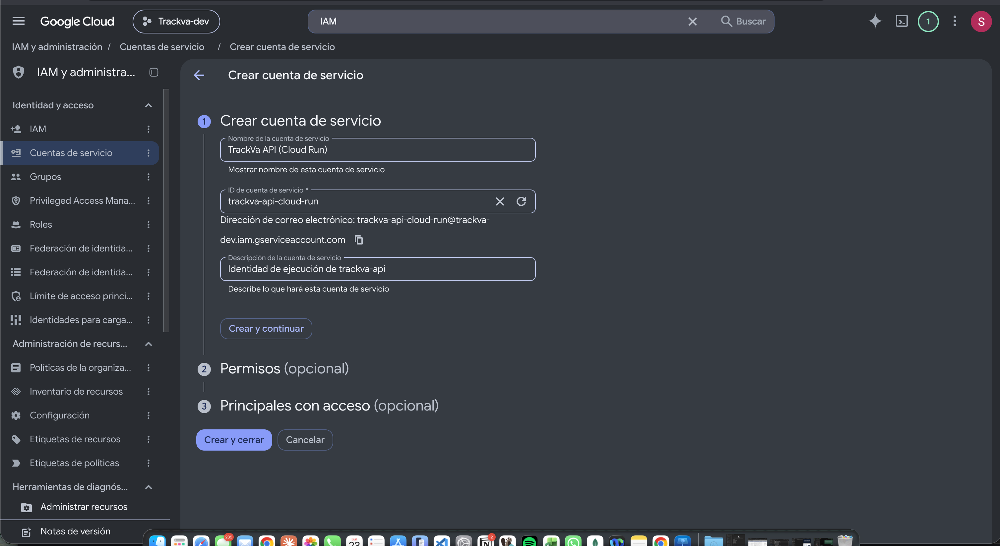
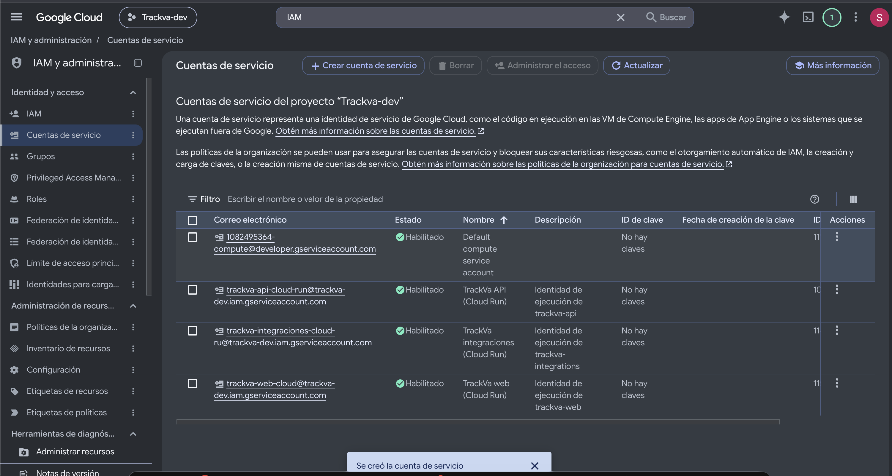
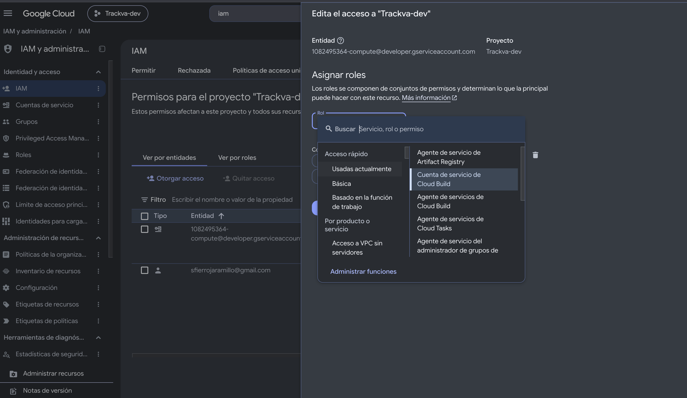

# 01 · IAM: cuentas de servicio

| | |
|---|---|
| **Estado** | Configurado el 23-nov-2026 (cuentas de ejecución). Los permisos se dan en cada servicio |
| **Proyecto** | `trackva-dev` |
| **Región** | global |
| **ADR del diseño** | ADR-13 |
| **Costo estimado** | US$0 |

## 1. Para qué sirve en TrackVa

Cada servicio de Cloud Run corre con su propia cuenta de servicio en lugar de la cuenta por
defecto de Compute. Así cada uno recibe solo los permisos que necesita: por ejemplo, la web no
puede leer los secretos de la API.

## 2. Requisitos previos

Servicio 00 (proyecto y API de IAM habilitada).

## 3. Paso a paso

En IAM y administración › Cuentas de servicio › **Crear cuenta de servicio**, con el proyecto
`trackva-dev` seleccionado, tres veces (captura 1):

| # | Nombre de la cuenta | ID de la cuenta | Descripción |
|---|---|---|---|
| 1 | TrackVa API (Cloud Run) | `trackva-api-cloud-run` | Identidad de ejecución de trackva-api |
| 2 | TrackVa web (Cloud Run) | `trackva-web-cloud` | Identidad de ejecución de trackva-web |
| 3 | TrackVa integraciones (Cloud Run) | `trackva-integraciones-cloud-ru` | Identidad de ejecución de trackva-integrations |

En cada una: «Crear y continuar», ningún rol en «Permisos», nada en «Principales con acceso»
y «Listo». Sin llaves.

Los ID son los que propuso la consola a partir del nombre. El ID admite 30 caracteres como
máximo, por eso el de integraciones quedó recortado en `-ru`. No se puede cambiar después; los
tres valores están en `scripts/env.sh` (`SA_API`, `SA_WEB`, `SA_INTEGRATIONS`).

Equivalente por línea de comandos:

```bash
gcloud iam service-accounts create trackva-api-cloud-run --display-name="TrackVa API (Cloud Run)" \
  --description="Identidad de ejecución de trackva-api"
```

Las cuentas nacen **sin ningún rol**. Los permisos se agregan donde se usan:

| Cuenta | Permiso | Se da en |
|---|---|---|
| `trackva-api-cloud-run` | Leer sus secretos (`secretAccessor`, por secreto) | 03 |
| `trackva-api-cloud-run` | Invocar `trackva-integrations` (`run.invoker`) | 05 |
| `trackva-api-cloud-run` | Encolar tareas (`cloudtasks.enqueuer`) | 10 |
| `trackva-web-cloud` | Leer sus secretos | 03 |
| `trackva-integraciones-cloud-ru` | Leer sus secretos | 03 |
| `trackva-tasks-invoker` (por crear) | Cuenta con la que Cloud Tasks llama a la API con OIDC | 10 |
| `trackva-github-deploy` (por crear) | Desplegar desde GitHub Actions sin llaves | 13 |

No se crean llaves de cuenta de servicio en ningún caso.

**Captura — Formulario de creación de la cuenta de la API**



**Captura — Las tres cuentas creadas, habilitadas y sin llaves**



### 3.1 Rol para Cloud Build (agregado el 23-nov)

La primera compilación falló con `403 … does not have storage.objects.get`: en los proyectos
nuevos Cloud Build corre con la cuenta por defecto de Compute, y en este proyecto esa cuenta no
tiene roles. Steven le dio el rol en IAM y administración › IAM › **Otorgar acceso**:

| Campo | Valor |
|---|---|
| Principal | `1082495364-compute@developer.gserviceaccount.com` |
| Rol | Cloud Build › **Cuenta de servicio de Cloud Build** (`roles/cloudbuild.builds.builder`) |

El rol permite leer el código subido al bucket de Cloud Build, escribir los registros y subir
la imagen a Artifact Registry. Comprobado: `gcloud projects get-iam-policy` devuelve ese único
rol para la cuenta.

**Captura — Rol «Cuenta de servicio de Cloud Build» para la cuenta que compila**



## 4. Verificación

```bash
gcloud iam service-accounts list --format="table(email,displayName,description,disabled)"
gcloud projects get-iam-policy "$PROJECT_ID" --flatten="bindings[].members" \
  --filter="bindings.members~trackva-" --format="table(bindings.role,bindings.members)"
```

```text
EMAIL                                                               DISPLAY NAME                       DESCRIPTION                                     DISABLED
trackva-web-cloud@trackva-dev.iam.gserviceaccount.com               TrackVa web (Cloud Run)            Identidad de ejecución de trackva-web           False
1082495364-compute@developer.gserviceaccount.com                    Default compute service account                                                    False
trackva-integraciones-cloud-ru@trackva-dev.iam.gserviceaccount.com  TrackVa integraciones (Cloud Run)  Identidad de ejecución de trackva-integrations  False
trackva-api-cloud-run@trackva-dev.iam.gserviceaccount.com           TrackVa API (Cloud Run)            Identidad de ejecución de trackva-api           False
```

El segundo comando no devuelve filas: ninguna de las tres cuentas tiene roles en el proyecto.
La cuenta por defecto de Compute la crea Google al habilitar la API; no tiene el rol de editor
y solo la usa Cloud Build (3.1).

## 5. Índice de capturas

| # | Qué muestra | Dónde | Archivo |
|---|---|---|---|
| 1 | Formulario de creación de la cuenta de la API | Cuentas de servicio › Crear cuenta de servicio | `capturas/01-crear-cuenta-de-servicio.png` |
| 2 | Las tres cuentas creadas, habilitadas y sin llaves | IAM y administración › Cuentas de servicio | `capturas/02-cuentas-de-servicio.png` |

## 6. Cómo deshacerlo

```bash
for sa in "$SA_API" "$SA_WEB" "$SA_INTEGRATIONS"; do
  gcloud iam service-accounts delete "$sa@$PROJECT_ID.iam.gserviceaccount.com" --quiet
done
```

## 7. Diferencias con el diseño y pendientes

- El diseño habla de IAM y OIDC en general; la separación en una cuenta por servicio se agrega aquí.
- El 23-nov las tres cuentas se crearon por `gcloud` por error y se borraron el mismo día, sin haberse usado, para que las cree Steven en la consola.
- Los ID quedaron con el nombre que generó la consola, no con el esquema `trackva-<servicio>-run` propuesto.
- La cuenta por defecto de Compute sí se usa: es la identidad de Cloud Build (3.1). En el servicio 13 la reemplaza una cuenta propia para el despliegue.
- Pendiente: las cuentas de Cloud Tasks (10) y de GitHub Actions (13), y la captura del rol de Cloud Build (`capturas/03-rol-cloud-build.png`).
