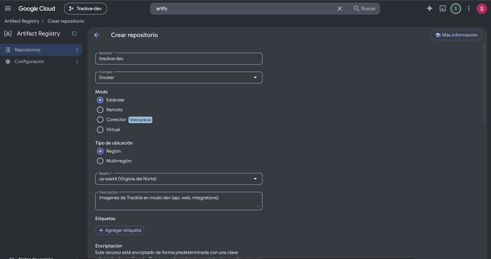
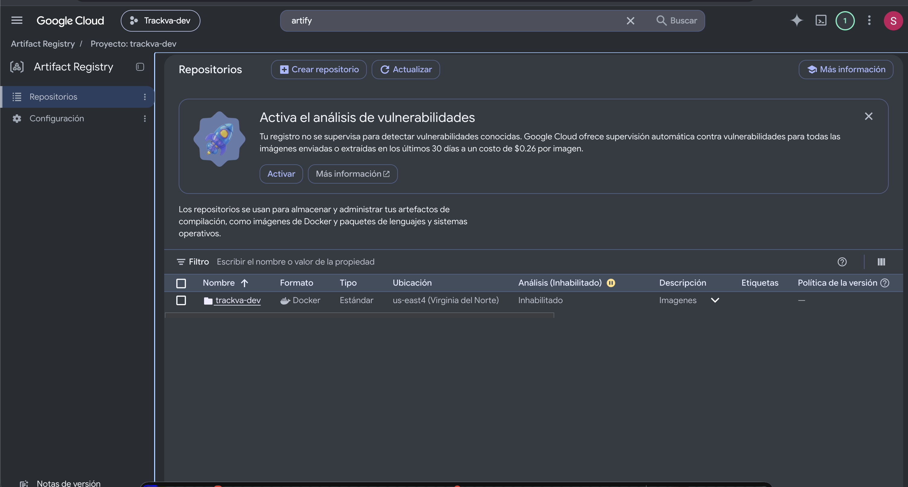
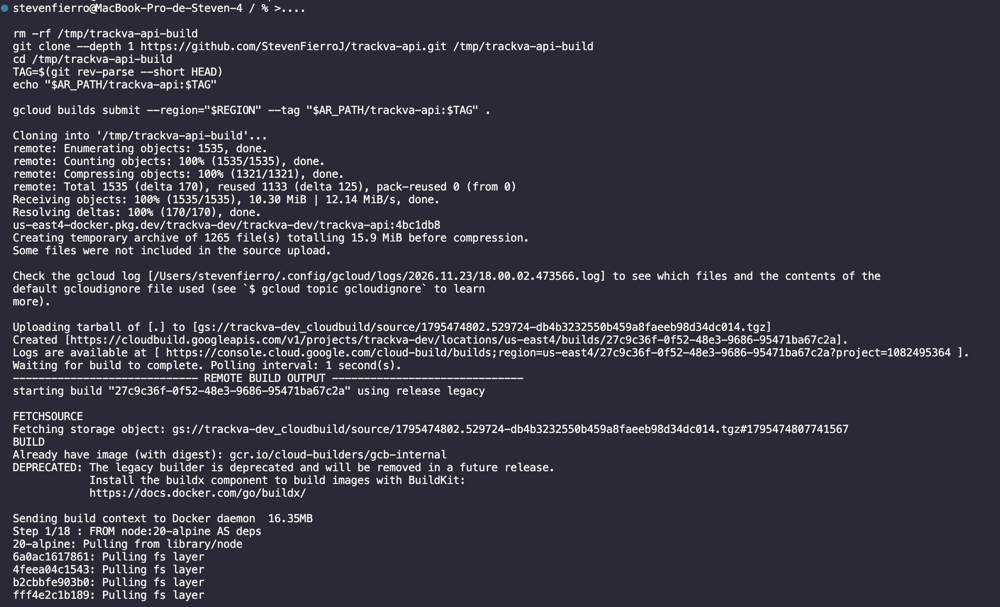
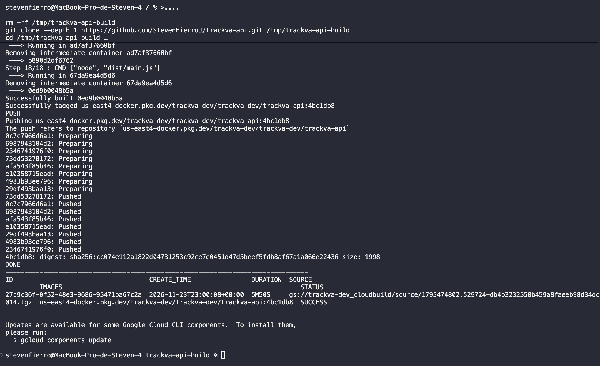
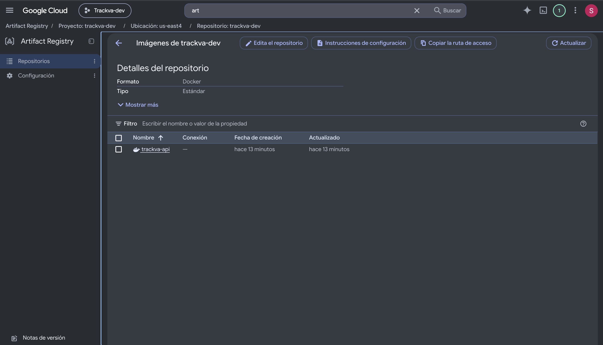

# 02 · Artifact Registry

| | |
|---|---|
| **Estado** | En curso: repositorio e imagen de la API listos (23-nov-2026); faltan integraciones y web |
| **Proyecto** | `trackva-dev` |
| **Región** | `us-east4` |
| **ADR del diseño** | — (capa 6 del diseño: DevOps) |
| **Costo estimado** | < US$1/mes (0,5 GB gratis; después US$0,10 por GB al mes) |

## 1. Para qué sirve en TrackVa

Guarda las imágenes Docker de `trackva-api`, `trackva-web` y `trackva-integrations`. Cloud Run
las lee de aquí al desplegar. Está en la misma región que Cloud Run para que la descarga sea
rápida y no cobre tráfico entre regiones.

## 2. Requisitos previos

Servicio 00 (API de Artifact Registry y de Cloud Build habilitadas).

## 3. Paso a paso

### 3.1 Repositorio (ejecutado por Steven en la consola)

En Artifact Registry › Repositorios › **Crear repositorio**, con el proyecto `trackva-dev`:

| Campo | Valor |
|---|---|
| Nombre | `trackva-dev` |
| Formato | Docker |
| Modo | Estándar |
| Tipo de ubicación | Región |
| Región | `us-east4 (Virginia del Norte)` |
| Descripción | Imagenes de TrackVa en modo dev (api, web, integrations) |
| Encriptación | Clave administrada por Google |
| Etiquetas inmutables | Inhabilitado |
| Políticas de limpieza | Ensayo (sin reglas por ahora) |
| Análisis de vulnerabilidades | Inhabilitado |

Las imágenes quedan en `us-east4-docker.pkg.dev/trackva-dev/trackva-dev/<servicio>:<etiqueta>`
(el primer `trackva-dev` es el proyecto y el segundo el repositorio). La ruta está en
`scripts/env.sh` como `AR_PATH`.

**Producción no lleva repositorio en este proyecto.** Cuando exista, producción irá en un
proyecto propio con su repositorio, para que sus permisos y su facturación no se mezclen con develop.

Equivalente por línea de comandos:

```bash
gcloud artifacts repositories create trackva-dev --repository-format=docker --location=us-east4 \
  --description="Imagenes de TrackVa en modo dev (api, web, integrations)"
```

**Captura — Formulario del repositorio: Docker, estándar, us-east4**



**Captura — Repositorio creado, con el análisis de vulnerabilidades inhabilitado**



### 3.2 Imagen de la API (ejecutada por Steven en su terminal)

Requisito cumplido el 23-nov: el `Dockerfile` de `trackva-api` no generaba el cliente de Prisma
y la imagen no construía. Arreglado en `main` (PR #113, commit `4bc1db8`), que también agrega
`.dockerignore`. Probado con `docker build` en local antes de fusionar.

Se construye con Cloud Build, desde una copia limpia de `main` para no subir nada local, y se
etiqueta con el SHA corto del commit:

```bash
cd /Users/stevenfierro/Documents/Trackva/trackva-infra
source scripts/env.sh

rm -rf /tmp/trackva-api-build
git clone --depth 1 https://github.com/StevenFierroJ/trackva-api.git /tmp/trackva-api-build
cd /tmp/trackva-api-build
TAG=$(git rev-parse --short HEAD)
echo "$AR_PATH/trackva-api:$TAG"

gcloud builds submit --region="$REGION" --tag "$AR_PATH/trackva-api:$TAG" .
```

```text
us-east4-docker.pkg.dev/trackva-dev/trackva-dev/trackva-api:4bc1db8
Creating temporary archive of 1265 file(s) totalling 15.9 MiB before compression.
Uploading tarball of [.] to [gs://trackva-dev_cloudbuild/source/1795474802.529724-db4b3232550b459a8faeeb98d34dc014.tgz]
Created [https://cloudbuild.googleapis.com/v1/projects/trackva-dev/locations/us-east4/builds/27c9c36f-0f52-48e3-9686-95471ba67c2a].
...
Step 18/18 : CMD ["node", "dist/main.js"]
Successfully built 0ed9b0048b5a
Successfully tagged us-east4-docker.pkg.dev/trackva-dev/trackva-dev/trackva-api:4bc1db8
PUSH
4bc1db8: digest: sha256:cc074e112a1822d04731253c92ce7e0451d47d5beef5fdb8af67a1a066e22436 size: 1998
DONE
ID                                    CREATE_TIME                DURATION  STATUS
27c9c36f-0f52-48e3-9686-95471ba67c2a  2026-11-23T23:00:08+00:00  5M50S     SUCCESS
```

Incidencias de la primera compilación:

- **Primer intento, error 403.** La cuenta con la que compila Cloud Build no tenía permisos.
  Se resolvió dándole el rol «Cuenta de servicio de Cloud Build» (servicio 01, sección 3.1).
- **Avisos `EBADENGINE`.** `undici` y `@prisma/streams-local` piden Node 22 y el `Dockerfile`
  de la API usaba `node:20-alpine`. La imagen construye, pero **no arranca**: `supabase-js`
  necesita Node 22. La imagen `4bc1db8` quedó inservible; el `Dockerfile` pasó a Node 22
  (PR #114, `02b700f`) y hay que compilar de nuevo con el mismo bloque de comandos.

Cloud Build construye en `linux/amd64`, que es lo que exige Cloud Run (este equipo es ARM).

**Captura — Comandos y arranque de la compilación**



**Captura — Imagen subida y compilación en SUCCESS**



**Captura — Imagen trackva-api dentro del repositorio**



### 3.3 Imágenes de integraciones y de la web

Pendiente. La de la web necesita antes un cambio en `trackva-web`: Next.js fija las variables
`NEXT_PUBLIC_*` al construir y su `Dockerfile` no declara argumentos de construcción.

## 4. Verificación

```bash
gcloud artifacts repositories describe "$AR_REPO" --location="$REGION"
```

```text
Encryption: Google-managed key
Repository Size: 0.000MB
cleanupPolicyDryRun: true
createTime: '2026-11-23T22:33:58.294417Z'
description: Imagenes de TrackVa en modo dev (api, web, integrations)
format: DOCKER
mode: STANDARD_REPOSITORY
name: projects/trackva-dev/locations/us-east4/repositories/trackva-dev
registryUri: us-east4-docker.pkg.dev/trackva-dev/trackva-dev
vulnerabilityScanningConfig:
  enablementConfig: DISABLED
  enablementState: SCANNING_DISABLED
```

```bash
gcloud artifacts docker images list "$AR_PATH" --include-tags
```

```text
IMAGE        TAGS     DIGEST            SIZE       CREATE_TIME
trackva-api  4bc1db8  sha256:cc074e11…  194.1 MiB  2026-11-23 23:05
```

El escaneo de vulnerabilidades queda apagado: cobra por imagen escaneada.

## 5. Índice de capturas

| # | Qué muestra | Dónde | Archivo |
|---|---|---|---|
| 1 | Formulario: nombre, formato Docker, modo estándar, región `us-east4` | Artifact Registry › Crear repositorio | `capturas/01-crear-repositorio.png` |
| 2 | Repositorio `trackva-dev` creado, análisis inhabilitado | Artifact Registry › Repositorios | `capturas/02-repositorio.png` |
| 3 | Comandos y arranque de la compilación | Terminal | `capturas/03-cloud-build-inicio.png` |
| 4 | Fin de la compilación: imagen subida y `SUCCESS` en 5 min 50 s | Terminal | `capturas/04-cloud-build-exito.png` |
| 5 | Imagen `trackva-api` dentro del repositorio | Artifact Registry › `trackva-dev` | `capturas/05-imagen-api.png` |

## 6. Cómo deshacerlo

```bash
gcloud artifacts repositories delete "$AR_REPO" --location="$REGION" --quiet   # borra también las imágenes
```

## 7. Diferencias con el diseño y pendientes

- El 23-nov el repositorio se creó por `gcloud` por error y se borró vacío el mismo día, para que lo cree Steven en la consola.
- El repositorio se llama `trackva-dev`, no `trackva` como se había propuesto.
- Pendiente: las imágenes de integraciones y de la web (3.3) y una política de limpieza que conserve solo las últimas versiones.
