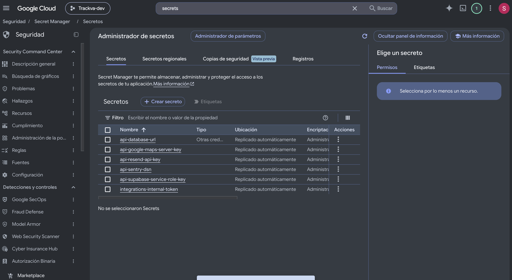
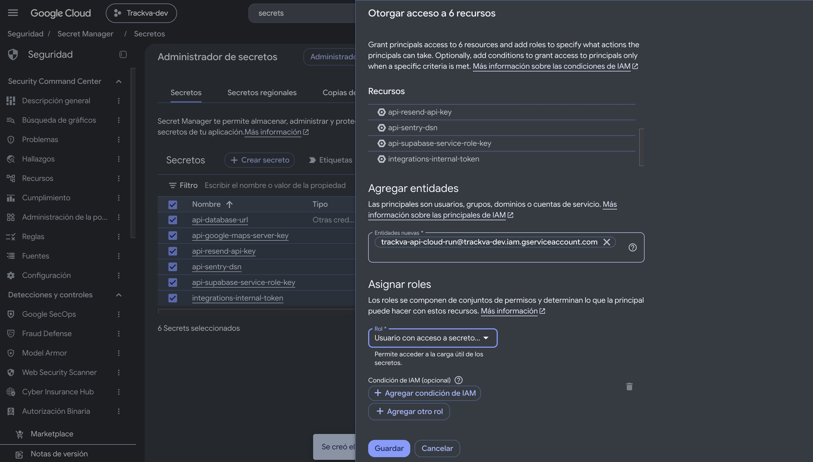

# 03 · Secret Manager

| | |
|---|---|
| **Estado** | En curso: secretos de la API configurados el 23-nov-2026; faltan los de la web e integraciones |
| **Proyecto** | `trackva-dev` |
| **Región** | replicación automática (global) |
| **ADR del diseño** | — (objetivo 3.2: 0 secretos en el repositorio) |
| **Costo estimado** | US$0 (6 versiones activas gratis; después US$0,06 por versión al mes) |

## 1. Para qué sirve en TrackVa

Guarda los valores que dan acceso a algo: la conexión a la base de datos, la llave de servicio
de Supabase y las llaves de terceros. Cloud Run los inyecta como variables de entorno al
arrancar, así que no quedan en el repositorio, ni en la imagen, ni a la vista en la consola.

Solo van aquí los valores secretos. La configuración que no da acceso a nada (dominios, nivel de
registro, URL pública de Supabase) va como variable normal de Cloud Run en el servicio 06, donde
se puede leer y cambiar sin pasos extra. Decisión del 23-nov.

## 2. Requisitos previos

- Servicio 00 (API de Secret Manager habilitada) y 01 (cuenta `trackva-api-cloud-run`).
- Los valores de develop: están en el `.env` local de `trackva-api`.

## 3. Paso a paso

### 3.1 Secretos de la API

En Seguridad › Secret Manager › **Crear secreto**, uno por fila:

| # | Nombre del secreto | Variable de la API | De dónde sale el valor |
|---|---|---|---|
| 1 | `api-database-url` | `DATABASE_URL` | `.env` de `trackva-api`: la URL del pooler de Supabase dev (puerto 6543, con `pgbouncer=true`) |
| 2 | `api-supabase-service-role-key` | `SUPABASE_SERVICE_ROLE_KEY` | `.env` de `trackva-api` |
| 3 | `integrations-internal-token` | `INTEGRATIONS_INTERNAL_TOKEN` | **Nuevo**, no reutilizar el local: `openssl rand -hex 32`. Lo comparten la API e integraciones |
| 4 | `api-resend-api-key` | `RESEND_API_KEY` | `.env` de `trackva-api` |
| 5 | `api-google-maps-server-key` | `GOOGLE_MAPS_SERVER_KEY` | `.env` de `trackva-api` |
| 6 | `api-sentry-dsn` | `SENTRY_DSN` | `.env` de `trackva-api`. Si no hay DSN de develop, no crear este secreto |

En cada uno:

1. **Nombre:** el de la tabla.
2. **Valor del secreto:** pegar el valor, sin comillas, sin espacios y sin salto de línea al final.
3. **Replicación:** dejar «Automática».
4. Sin rotación, sin vencimiento, sin etiquetas. Pulsar «Crear secreto».

`DIRECT_URL`, `REDIS_URL` y `POSTHOG_API_KEY` no se crean: la API no los lee al ejecutarse
(`DIRECT_URL` es solo para las migraciones, que se corren desde el equipo de desarrollo).

**Captura — Los seis secretos, con replicación automática**



### 3.2 Permiso de lectura para la cuenta de la API

En la lista de Secret Manager, marcar las casillas de los secretos de la API; en el panel
derecho «Permisos» pulsar **Agregar principal**:

| Campo | Valor |
|---|---|
| Principales nuevas | `trackva-api-cloud-run@trackva-dev.iam.gserviceaccount.com` |
| Rol | Secret Manager › **Usuario con acceso a secretos de Secret Manager** (`roles/secretmanager.secretAccessor`) |

El permiso se da **por secreto**, no en el proyecto: así la cuenta de la API no puede leer los
secretos que después se creen para la web o para integraciones.

Equivalente por línea de comandos (el valor se lee de la entrada, no queda en el historial):

```bash
printf '%s' "$VALOR" | gcloud secrets create api-database-url --replication-policy=automatic --data-file=-
gcloud secrets add-iam-policy-binding api-database-url \
  --member="serviceAccount:trackva-api-cloud-run@trackva-dev.iam.gserviceaccount.com" \
  --role="roles/secretmanager.secretAccessor"
```

**Captura — Permiso de lectura para la cuenta de la API sobre los seis secretos**



### 3.3 Secretos de la web y de integraciones

Pendiente; se agregan al llegar a los servicios 05 y 07.

## 4. Verificación

Solo nombres, versiones y permisos; nunca el valor.

```bash
gcloud secrets list --format="table(name,replication.automatic.yesno(yes=automatica),createTime)"
for s in $(gcloud secrets list --format="value(name)"); do
  echo "== $s"; gcloud secrets versions list "$s" --format="table(name,state)"
  gcloud secrets get-iam-policy "$s" --format="table(bindings.role,bindings.members.flatten())"
done
```

```text
api-database-url               1 versión activa   secretAccessor → trackva-api-cloud-run
api-google-maps-server-key     1 versión activa   secretAccessor → trackva-api-cloud-run
api-resend-api-key             1 versión activa   secretAccessor → trackva-api-cloud-run
api-sentry-dsn                 1 versión activa   secretAccessor → trackva-api-cloud-run
api-supabase-service-role-key  1 versión activa   secretAccessor → trackva-api-cloud-run
integrations-internal-token    1 versión activa   secretAccessor → trackva-api-cloud-run
```

Seis secretos, cada uno con una versión activa y con un único permiso: la cuenta de la API
como `roles/secretmanager.secretAccessor`. Salida resumida del 23-nov.

## 5. Índice de capturas

Tomarlas **después** de crear, desde la lista o desde la pestaña de permisos. No capturar el
formulario con el valor escrito ni la pantalla «Ver valor del secreto».

| # | Qué muestra | Dónde | Archivo |
|---|---|---|---|
| 1 | Los seis secretos, con replicación automática | Seguridad › Secret Manager | `capturas/01-secretos.png` |
| 2 | Permiso de lectura a la cuenta de la API sobre los seis secretos | Secret Manager › Otorgar acceso | `capturas/02-otorgar-acceso.png` |

## 6. Cómo deshacerlo

```bash
gcloud secrets delete <nombre> --quiet     # borra el secreto y todas sus versiones
```

## 7. Diferencias con el diseño y pendientes

- El diseño dice «todos los secretos en Secret Manager». Se cumple; lo que queda fuera es configuración no secreta.
- Se crearon seis versiones activas, justo el tope gratuito; los secretos de la web y de integraciones ya cobrarán US$0,06 por versión al mes.
- Pendiente: los secretos de la web y de integraciones, y dar a la cuenta de integraciones lectura de `integrations-internal-token`.
