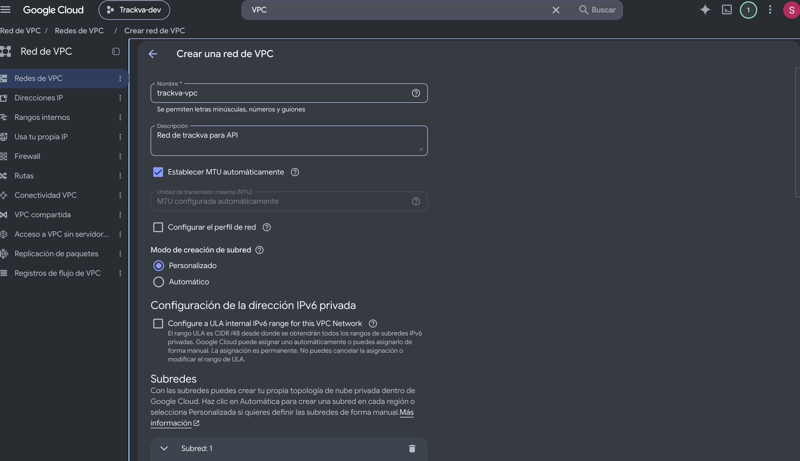
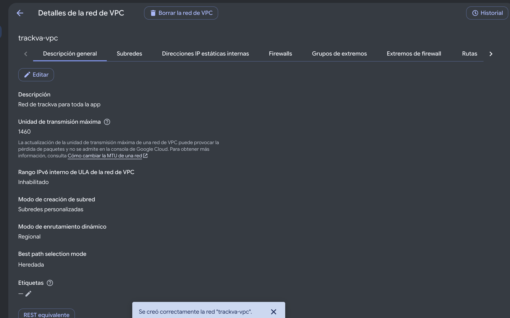
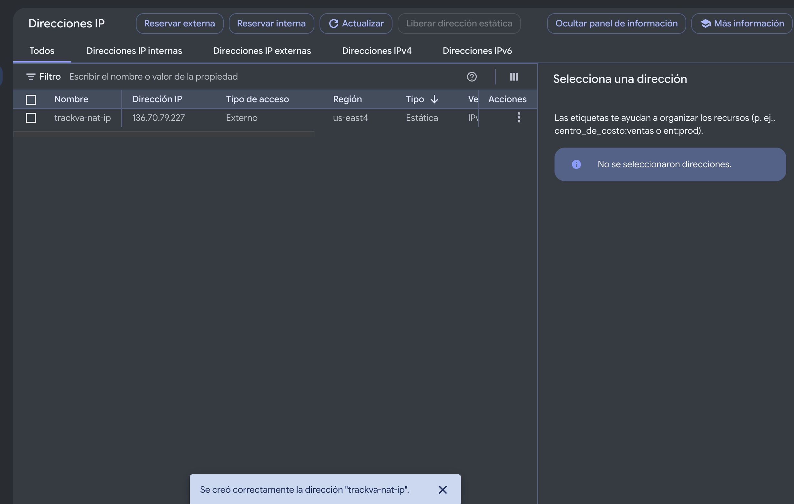
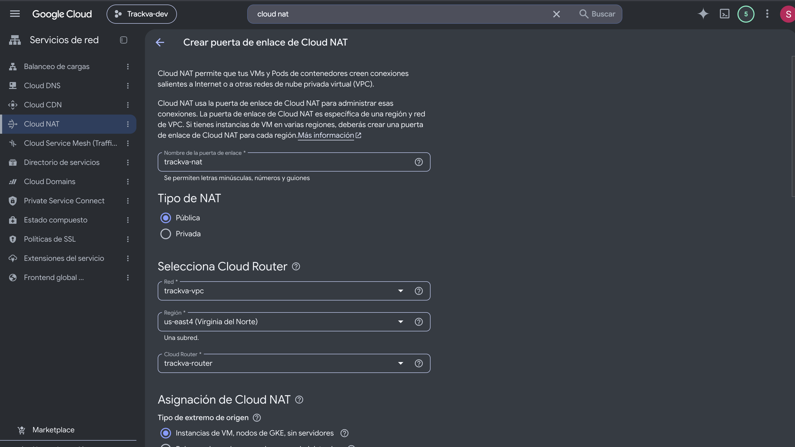
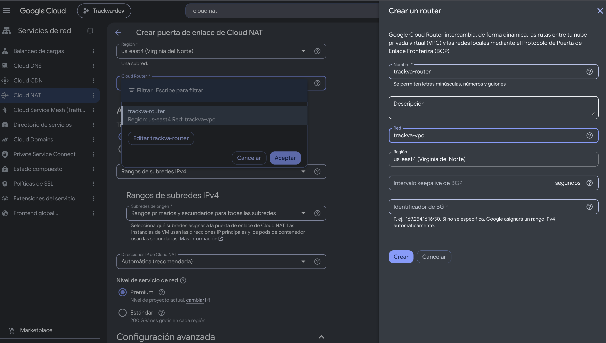
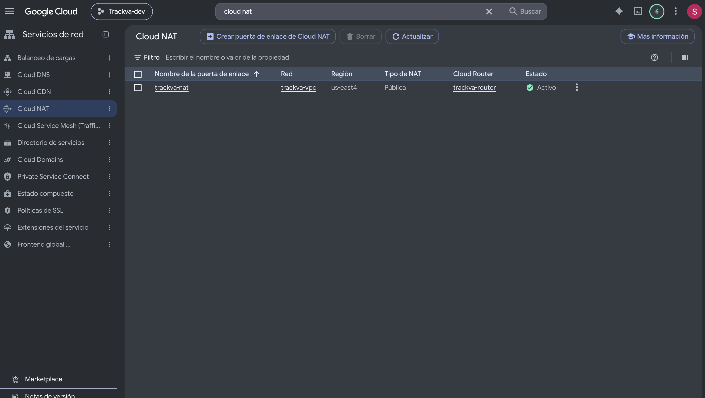
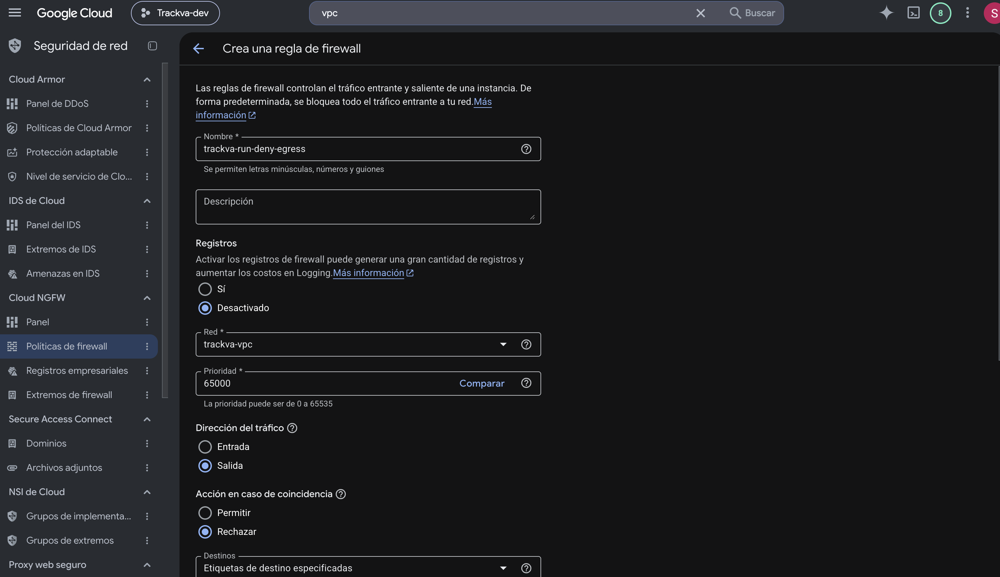
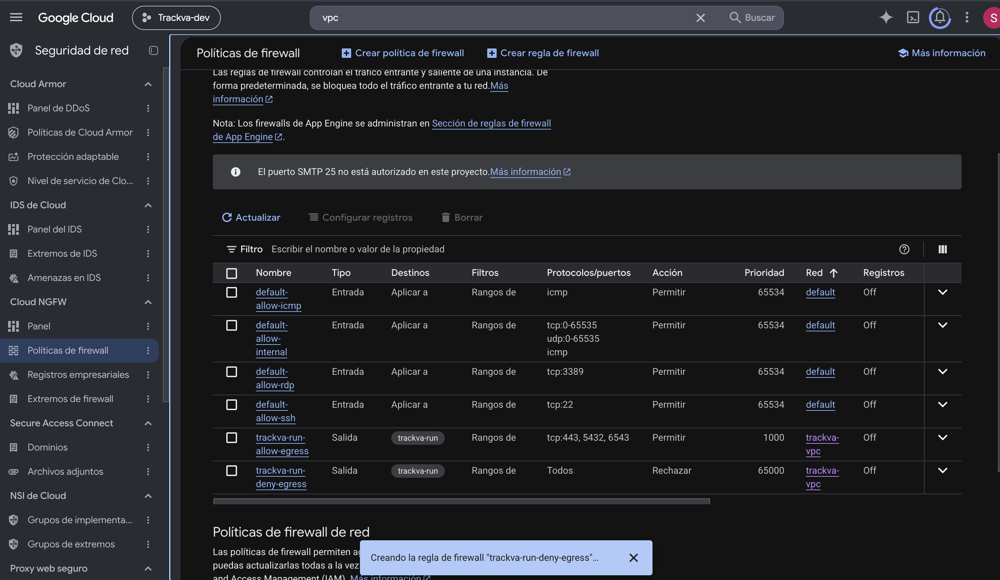

# 04 · Red: VPC, Cloud NAT e IP estática

| | |
|---|---|
| **Estado** | Configurado el 23-nov-2026. Salida por la IP fija comprobada desde Cloud Run (servicio 06) |
| **Proyecto** | `trackva-dev` |
| **Región** | `us-east4` |
| **ADR del diseño** | ADR-12 |
| **Costo estimado** | US$4 a 8/mes (IP estática ~US$3,65 + US$0,045 por GiB que pase por el NAT) |

## 1. Para qué sirve en TrackVa

Cloud Run sale a internet desde direcciones de Google que cambian. Con esta red, toda la salida
de la API pasa por una VPC propia y un Cloud NAT con **una sola IP fija**. Esa IP es la única
que después se autoriza en PostgreSQL de Supabase (servicio 11): una contraseña robada no basta
para entrar a la base desde otro lugar. El firewall limita además a qué puertos puede salir.

```
Cloud Run (API) ──Direct VPC egress──▶ subred trackva-run-us-east4 ──▶ Cloud NAT ──IP fija──▶ Supabase, Resend, Sentry
```

## 2. Requisitos previos

Servicio 00 (API de Compute habilitada).

## 3. Paso a paso

Se crean cinco cosas, en este orden. Los nombres deben quedar exactos: están en `scripts/env.sh`
y los usan los pasos de Cloud Run.

### 3.1 VPC y subred

Red de VPC › Redes de VPC › **Crear red de VPC**:

| Campo | Valor |
|---|---|
| Nombre | `trackva-vpc` |
| Descripción | Red de trackva para toda la app |
| Modo de creación de subredes | **Personalizado** |
| Subred · Nombre | `trackva-run-us-east4` |
| Subred · Región | `us-east4` |
| Subred · Tipo de pila IP | IPv4 (pila única) |
| Subred · Rango IPv4 | `10.10.0.0/24` |
| Subred · Acceso privado a Google | **Activado** (se activó después de crear, editando la subred) |
| Subred · Registros de flujo | Desactivado |
| Reglas de firewall | No marcar ninguna de las propuestas |
| Modo de enrutamiento dinámico | Regional |

El rango `/24` da 256 direcciones. Cloud Run con Direct VPC egress toma varias direcciones por
instancia, así que no conviene uno más pequeño.

**Captura — Formulario de la VPC en modo personalizado**



**Captura — VPC creada: subredes personalizadas y enrutamiento regional**



### 3.2 IP estática

Red de VPC › Direcciones IP › **Reservar dirección IP estática externa**:

| Campo | Valor |
|---|---|
| Nombre | `trackva-nat-ip` |
| Descripción | IP de salida de TrackVa develop (autorizada en Supabase) |
| Nivel de servicio de red | Premium |
| Versión de IP | IPv4 |
| Tipo | **Regional** |
| Región | `us-east4` |
| Conectado a | Ninguno |

Dirección asignada: **`136.70.79.227`**. Es la que se autoriza en Supabase en el servicio 11.

**Captura — IP estática externa reservada en us-east4**



### 3.3 Cloud Router y Cloud NAT

Servicios de red › Cloud NAT › **Crear puerta de enlace de Cloud NAT**:

| Campo | Valor |
|---|---|
| Nombre de la puerta de enlace | `trackva-nat` |
| Tipo de NAT | Pública |
| Red | `trackva-vpc` |
| Región | `us-east4` |
| Cloud Router | **Crear router nuevo** → nombre `trackva-router` |
| Tipo de extremo de origen | Instancias de VM, nodos de GKE, sin servidores |
| Subredes de origen | Rangos primarios y secundarios de todas las subredes (la VPC solo tiene `trackva-run-us-east4`) |
| Direcciones IP de Cloud NAT | **Manual** → `trackva-nat-ip` |
| Nivel de servicio de red | Premium |

Lo demás, por defecto. Lo que importa es «Manual» con `trackva-nat-ip`: si queda en
«Automático», Google asigna direcciones que pueden cambiar y la restricción de Supabase se rompe.
El router solo es el soporte que exige el NAT: no hace enrutamiento dinámico y no cobra.

**Nivel de servicio de red: Premium.** Estándar es más barato por GiB de salida (y regala 200 GB
al mes por región), pero la diferencia con el tráfico de develop son centavos, Cloud Run y
Supabase están los dos en Virginia y el balanceador global del servicio 08 exige Premium. Se
revisa si el tráfico de salida llega a pesar en la factura.

**Captura — Formulario del NAT: red, región y router**



**Captura — Creación del router desde el formulario del NAT**



**Captura — NAT activo con su router**



### 3.4 Reglas de firewall de salida

Red de VPC › Firewall › **Crear regla de firewall**, dos veces:

| Campo | Regla 1 | Regla 2 |
|---|---|---|
| Nombre | `trackva-run-allow-egress` | `trackva-run-deny-egress` |
| Red | `trackva-vpc` | `trackva-vpc` |
| Prioridad | `1000` | `65000` |
| Dirección del tráfico | Salida | Salida |
| Acción en caso de coincidencia | **Permitir** | **Rechazar** |
| Destinos | Etiquetas de destino especificadas | Etiquetas de destino especificadas |
| Etiquetas de destino | `trackva-run` | `trackva-run` |
| Filtro de destino · Rangos IPv4 | `0.0.0.0/0` | `0.0.0.0/0` |
| Protocolos y puertos | TCP: `443, 5432, 6543` | Rechazar todo |

La regla 1 deja salir solo por HTTPS (443) y por los dos puertos de PostgreSQL de Supabase
(5432 directo, 6543 agrupador). La regla 2, con prioridad más baja, rechaza todo lo demás.
Las dos aplican solo a lo que lleve la etiqueta de red `trackva-run`, que se le pone a cada
servicio de Cloud Run al desplegarlo.

**Captura — Formulario de la regla de rechazo**



**Captura — Las dos reglas de salida con su etiqueta y prioridad**



## 4. Verificación

```bash
source scripts/env.sh
gcloud compute networks describe "$VPC_NAME" --format="yaml(name,autoCreateSubnetworks,routingConfig)"
gcloud compute networks subnets describe "$SUBNET_NAME" --region="$REGION" \
  --format="yaml(name,ipCidrRange,privateIpGoogleAccess,network.basename())"
gcloud compute addresses describe "$NAT_IP_NAME" --region="$REGION" --format="yaml(name,address,status,addressType)"
gcloud compute routers nats describe "$NAT_NAME" --router="$ROUTER_NAME" --region="$REGION" \
  --format="yaml(name,natIpAllocateOption,natIps.basename(),sourceSubnetworkIpRangesToNat,subnetworks)"
gcloud compute firewall-rules list --filter="network~$VPC_NAME" \
  --format="table(name,direction,priority,targetTags.list(),allowed[].map().firewall_rule().list(),denied[].map().firewall_rule().list())"
```

```text
autoCreateSubnetworks: false
name: trackva-vpc
routingConfig:
  routingMode: REGIONAL

name: trackva-run-us-east4
ipCidrRange: 10.10.0.0/24
privateIpGoogleAccess: true

address: 136.70.79.227
networkTier: PREMIUM
status: IN_USE
users:
- trackva-router

name: trackva-nat
natIpAllocateOption: MANUAL_ONLY
natIps:
- trackva-nat-ip
sourceSubnetworkIpRangesToNat: LIST_OF_SUBNETWORKS   (trackva-run-us-east4, ALL_IP_RANGES)

NAME                      DIRECTION  PRIORITY  TARGET_TAGS  DESTINATION_RANGES  ALLOW                      DENY
trackva-run-allow-egress  EGRESS     1000      trackva-run  0.0.0.0/0           tcp:443,tcp:5432,tcp:6543
trackva-run-deny-egress   EGRESS     65000     trackva-run  0.0.0.0/0                                      all
```

La prueba de verdad llega con Cloud Run (servicio 06): desde la API, la IP con la que sale a
internet debe ser `trackva-nat-ip`.

## 5. Índice de capturas

| # | Qué muestra | Dónde | Archivo |
|---|---|---|---|
| 1 | Formulario de la VPC en modo personalizado | Red de VPC › Crear red de VPC | `capturas/01-crear-vpc.png` |
| 2 | VPC creada: subredes personalizadas, enrutamiento regional | Red de VPC › `trackva-vpc` | `capturas/02-vpc-creada.png` |
| 3 | IP estática externa, regional, `us-east4` | Red de VPC › Direcciones IP | `capturas/03-ip-estatica.png` |
| 4 | Formulario del NAT: red, región y router | Servicios de red › Cloud NAT › Crear | `capturas/04-crear-cloud-nat.png` |
| 5 | Creación del router desde el formulario del NAT | Cloud NAT › Crear un router | `capturas/05-crear-router.png` |
| 6 | NAT activo con su router | Servicios de red › Cloud NAT | `capturas/06-cloud-nat-activo.png` |
| 7 | Formulario de la regla de rechazo | Seguridad de red › Políticas de firewall › Crear regla | `capturas/07-crear-regla-firewall.png` |
| 8 | Las dos reglas de salida con su etiqueta y prioridad | Seguridad de red › Políticas de firewall | `capturas/08-reglas-firewall.png` |

La captura 4 se tomó antes de cambiar «Direcciones IP de Cloud NAT» a Manual; la asignación
manual consta en la verificación (`natIpAllocateOption: MANUAL_ONLY`).

## 6. Cómo deshacerlo

En orden inverso; el NAT y la IP son lo único que cobra.

```bash
gcloud compute firewall-rules delete trackva-run-allow-egress trackva-run-deny-egress --quiet
gcloud compute routers nats delete "$NAT_NAME" --router="$ROUTER_NAME" --region="$REGION" --quiet
gcloud compute routers delete "$ROUTER_NAME" --region="$REGION" --quiet
gcloud compute addresses delete "$NAT_IP_NAME" --region="$REGION" --quiet
gcloud compute networks subnets delete "$SUBNET_NAME" --region="$REGION" --quiet
gcloud compute networks delete "$VPC_NAME" --quiet
```

## 7. Diferencias con el diseño y pendientes

- El diseño no fija el rango de la subred ni los nombres de las reglas; se definen aquí.
- **Por comprobar al desplegar Cloud Run:** que la regla de rechazo no bloquee la resolución de
  nombres (DNS) de los contenedores. Si la API no resuelve dominios, se agrega una regla de
  salida para DNS.
- En la consola las reglas se crean en Seguridad de red › Políticas de firewall › «Crear regla de firewall». El aviso de permisos `compute.organizations.listAssociations` no impide crearlas.
- **Red `default`:** Google la creó sola al habilitar Compute, con reglas que permiten entrar por SSH (22) y escritorio remoto (3389) desde cualquier parte. El proyecto no tiene máquinas virtuales y Cloud Run no la usa, pero conviene borrarla con sus cuatro reglas.
- Comprobado desde Cloud Run: el NAT asigna `136.70.79.227` a la instancia de la API y la resolución de nombres funciona con la regla de rechazo.
- Pendiente: borrar la red `default`.
