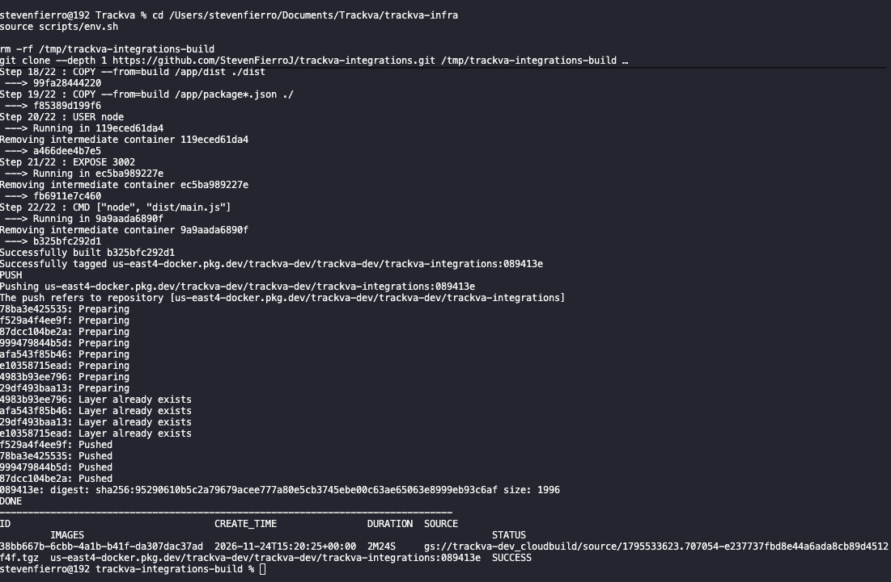
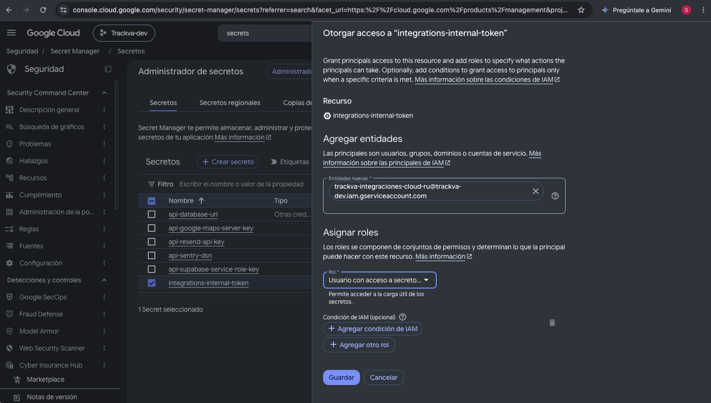
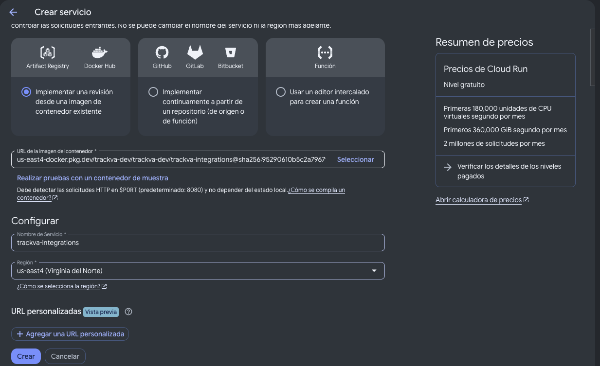
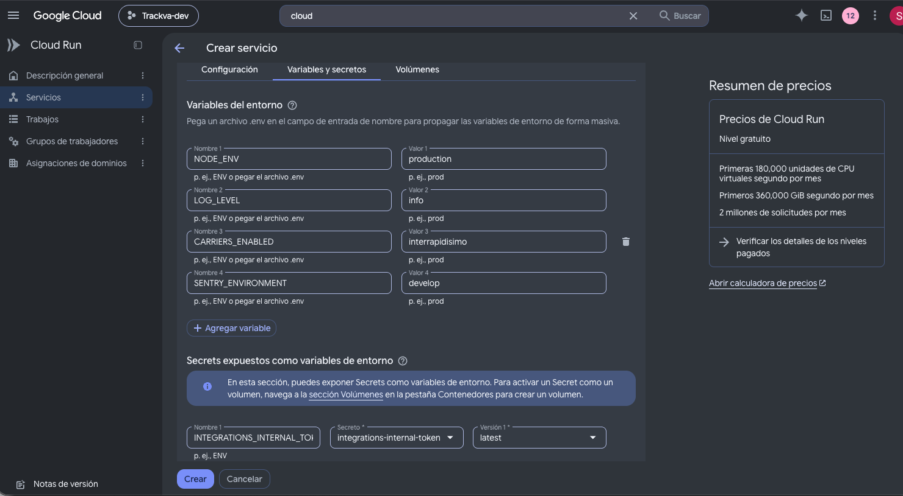
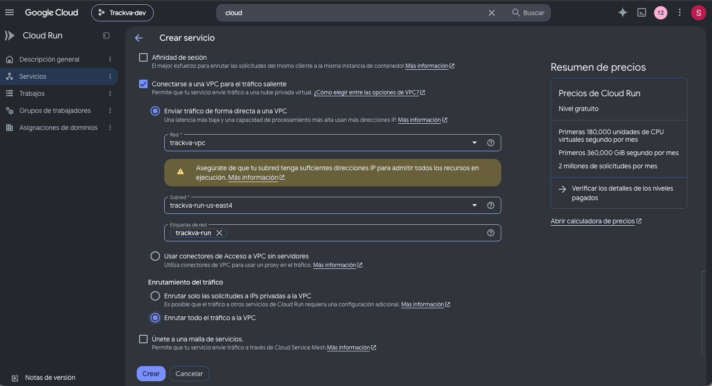
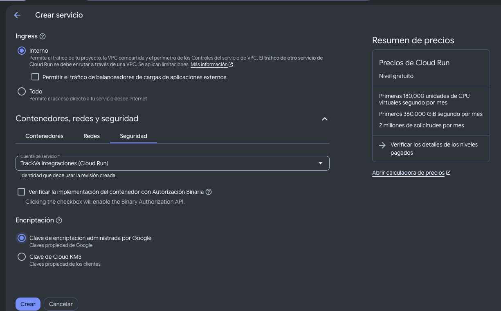
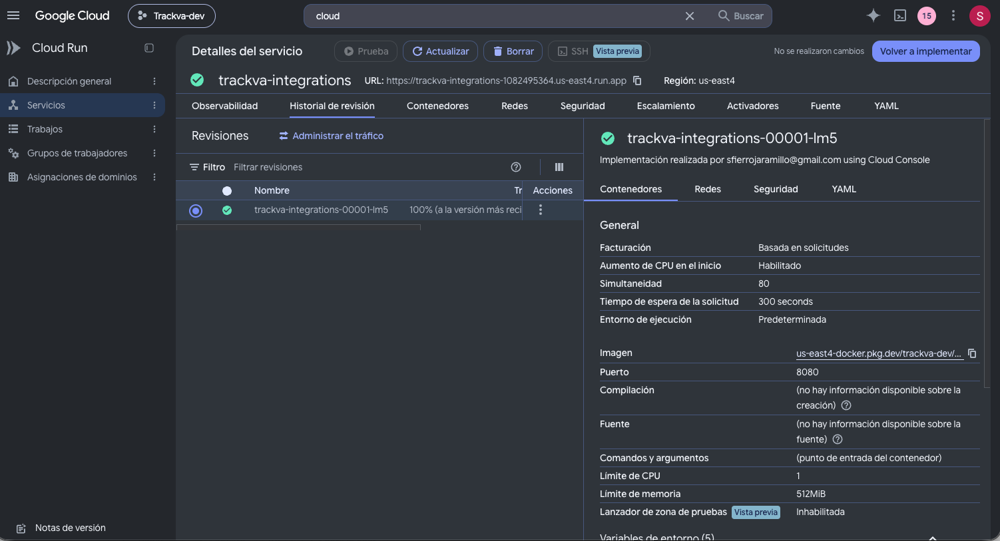
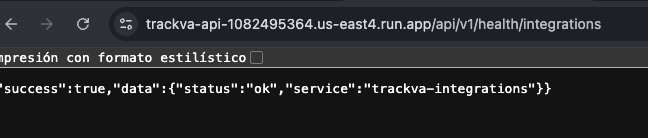
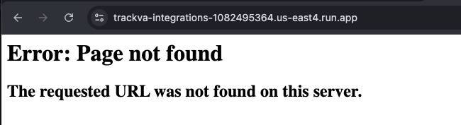

# 05 · Cloud Run: integraciones

| | |
|---|---|
| **Estado** | Configurado el 24-nov-2026: cerrado a internet y conectado con la API |
| **Proyecto** | `trackva-dev` |
| **Región** | `us-east4` |
| **ADR del diseño** | ADR-01, ADR-02 |
| **Costo estimado** | ~US$0 (0 instancias mínimas) |

## 1. Para qué sirve en TrackVa

`trackva-integrations` es el único servicio que habla con transportadoras y otros terceros.
No se expone a internet: solo lo llama la API, por la red interna, con un secreto compartido en
la cabecera `X-Internal-Auth`. El documento de diseño lo daba como planeado; ya existe (R-25).

Hoy no tiene ninguna transportadora real conectada: la de prueba (`mock`) no se activa en modo
producción e `interrapidisimo` responde «contrato pendiente». Se despliega para dejar lista la
pieza y la conexión API → integraciones.

## 2. Requisitos previos

| Servicio | Qué aporta |
|---|---|
| 01 | Cuenta `trackva-integraciones-cloud-ru` |
| 02 | Repositorio `trackva-dev` |
| 03 | Secreto `integrations-internal-token` (ya lo lee la API) |
| 04 | VPC, subred con acceso privado a Google, NAT y reglas con la etiqueta `trackva-run` |
| 06 | API desplegada, que es quien lo llama |

## 3. Paso a paso

### 3.1 Imagen (terminal)

El `Dockerfile` de este repositorio no necesita cambios: se probó en local el 23-nov en modo
producción y arranca (`/internal/health` 200; sin secreto, 401; con secreto, 200).

```bash
cd /Users/stevenfierro/Documents/Trackva/trackva-infra
source scripts/env.sh

rm -rf /tmp/trackva-integrations-build
git clone --depth 1 https://github.com/StevenFierroJ/trackva-integrations.git /tmp/trackva-integrations-build
cd /tmp/trackva-integrations-build
TAG=$(git rev-parse --short HEAD)
echo "$AR_PATH/trackva-integrations:$TAG"

gcloud builds submit --region="$REGION" --tag "$AR_PATH/trackva-integrations:$TAG" .
```

```text
Successfully tagged us-east4-docker.pkg.dev/trackva-dev/trackva-dev/trackva-integrations:089413e
089413e: digest: sha256:95290610b5c2a79679acee777a80e5cb3745ebe00c63ae65063e8999eb93c6af size: 1996
DONE
ID                                    CREATE_TIME                DURATION  STATUS
38bb667b-6cbb-4a1b-b41f-da307dac37ad  2026-11-24T15:20:25+00:00  2M24S     SUCCESS
```

**Captura — Compilación de la imagen en SUCCESS**



### 3.2 Permiso sobre el secreto (consola)

Seguridad › Secret Manager › marcar **solo** `integrations-internal-token` › panel «Permisos» ›
**Agregar principal**:

| Campo | Valor |
|---|---|
| Principal | `trackva-integraciones-cloud-ru@trackva-dev.iam.gserviceaccount.com` |
| Rol | Usuario con acceso a secretos de Secret Manager |

Es el único secreto que lee este servicio. El valor es el mismo que usa la API: por eso es un
solo secreto con dos lectores.

**Captura — Permiso de la cuenta de integraciones sobre el secreto compartido**



### 3.3 Servicio (consola)

Cloud Run › **Implementar contenedor** › Servicio:

| Sección | Campo | Valor |
|---|---|---|
| Servicio | Imagen | Artifact Registry › `trackva-dev` › `trackva-integrations` › `089413e` |
| | Nombre | `trackva-integrations` |
| | Región | `us-east4` |
| | Autenticación | Permitir invocaciones sin autenticar |
| | Escalamiento | Automático · mínimo `0` · máximo `2` |
| | Ingress | **Interno** (sin marcar la casilla de balanceadores externos) |
| Contenedor | Puerto | `8080` |
| | Memoria y CPU | `512 MiB` · `1` |
| Variables | `NODE_ENV` | `production` |
| | `LOG_LEVEL` | `info` |
| | `CARRIERS_ENABLED` | `interrapidisimo` |
| | `SENTRY_ENVIRONMENT` | `develop` |
| Secretos | `INTEGRATIONS_INTERNAL_TOKEN` | `integrations-internal-token` · `latest` |
| Redes | VPC | Directa: `trackva-vpc` · `trackva-run-us-east4` · etiqueta `trackva-run` · enrutar todo el tráfico |
| Seguridad | Cuenta de servicio | `TrackVa integraciones (Cloud Run)` |

Dos decisiones que se explican:

- **Ingress interno + sin autenticar.** «Interno» hace que el servicio solo acepte tráfico que
  venga de la VPC del proyecto: desde internet responde 404 aunque se conozca la URL. «Sin
  autenticar» se refiere a IAM de Google; la autenticación la hace el propio servicio con
  `X-Internal-Auth`, y todas sus rutas salvo `/internal/health` la exigen.
- **También sale por la VPC.** Cuando llame a transportadoras lo hará desde la IP fija
  `136.70.79.227`, que es la que ellas suelen pedir para autorizar.

**Captura — Imagen, nombre del servicio y región**



**Captura — Variables de entorno y secreto**



**Captura — VPC, subred, etiqueta y todo el tráfico por la VPC**



**Captura — Ingress «Interno» y cuenta de servicio**



**Captura — Servicio en verde con su primera revisión**



### 3.4 Conectar la API (consola)

Cloud Run › `trackva-api` › **Editar e implementar una revisión nueva** › Variables y secretos ›
agregar una variable:

| Nombre | Valor |
|---|---|
| `INTEGRATIONS_SERVICE_URL` | La URL que muestre el servicio `trackva-integrations` (termina en `.run.app`), sin barra final ni puerto |

La API llega al servicio interno porque toda su salida va por la VPC y la subred tiene acceso
privado a Google.

**Captura — La API alcanza a integraciones: estado «ok»**



## 4. Verificación

```bash
source scripts/env.sh
INT=$(gcloud run services describe trackva-integrations --region="$REGION" --format="value(status.url)")
curl -s -o /dev/null -w "desde internet: HTTP %{http_code}\n" "$INT/internal/health"       # esperado: 404
curl -s https://trackva-api-1082495364.us-east4.run.app/api/v1/health/integrations          # esperado: "status":"ok"
gcloud run services describe trackva-integrations --region="$REGION" \
  --format="yaml(metadata.annotations,spec.template.spec.serviceAccountName,spec.template.metadata.annotations)"
```

```text
desde internet: HTTP 404

metadata.annotations:
  run.googleapis.com/ingress: internal
  run.googleapis.com/maxScale: '2'
  run.googleapis.com/urls: '["https://trackva-integrations-1082495364.us-east4.run.app"]'
spec.template:
  network-interfaces: '[{"network":"trackva-vpc","subnetwork":"trackva-run-us-east4","tags":["trackva-run"]}]'
  vpc-access-egress: all-traffic
  resources.limits: cpu 1000m, memory 512Mi
  serviceAccountName: trackva-integraciones-cloud-ru@trackva-dev.iam.gserviceaccount.com
status: Ready True · revisión trackva-integrations-00001-lm5
```

El 404 desde internet es el resultado buscado: el servicio existe y está en verde, pero el
ingress interno no deja entrar a nadie de fuera.

Conexión desde la API (revisión `trackva-api-00005-fxn`, con `INTEGRATIONS_SERVICE_URL`):

```text
$ curl https://trackva-api-1082495364.us-east4.run.app/api/v1/health/integrations
{"success":true,"data":{"status":"ok","service":"trackva-integrations"}}

Registro de integraciones:  16:15:19  200  GET /internal/carriers
```

La API alcanza el servicio interno por la VPC y el secreto compartido coincide.

**Arranque en frío.** La primera consulta tras desplegar respondió `unreachable`: el registro de
la API dice `EXT_CARRIER_TIMEOUT`, `integrations_timeout`. Con 0 instancias mínimas,
integraciones tarda unos segundos en despertar y la comprobación de salud de la API espera poco.
La segunda consulta ya respondió `ok`. No es un fallo de red.

**Captura — Desde internet el servicio responde 404**



## 5. Índice de capturas

| # | Qué muestra | Dónde | Archivo |
|---|---|---|---|
| 1 | Fin de la compilación con `SUCCESS` | Terminal | `capturas/01-cloud-build.png` |
| 2 | Permiso de la cuenta de integraciones sobre el secreto | Secret Manager › Otorgar acceso | `capturas/02-permiso-secreto.png` |
| 3 | Imagen, nombre y región | Cloud Run › Crear servicio | `capturas/03-crear-servicio-imagen.png` |
| 4 | Variables y secreto | Crear servicio › Variables y secretos | `capturas/04-variables-secreto.png` |
| 5 | VPC, subred, etiqueta y todo el tráfico | Crear servicio › Redes | `capturas/05-red-vpc.png` |
| 6 | Ingress «Interno» y cuenta de servicio | Crear servicio › Seguridad | `capturas/06-ingress-interno-cuenta.png` |
| 7 | Servicio en verde | Cloud Run › `trackva-integrations` | `capturas/07-servicio.png` |
| 8 | La URL abierta desde el navegador responde 404 | Navegador | `capturas/08-bloqueado-desde-internet.png` |
| 9 | `/api/v1/health/integrations` de la API responde `ok` | Navegador | `capturas/09-conexion-api.png` |

## 6. Cómo deshacerlo

```bash
gcloud run services delete trackva-integrations --region="$REGION" --quiet
gcloud secrets remove-iam-policy-binding integrations-internal-token \
  --member="serviceAccount:$SA_INTEGRATIONS@$PROJECT_ID.iam.gserviceaccount.com" \
  --role="roles/secretmanager.secretAccessor"
```

## 7. Diferencias con el diseño y pendientes

- El diseño lo daba como planeado y con entrada por `/webhooks/*` del balanceador. Hoy no recibe
  webhooks: los webhooks de canales entran por la API (decisión del puerto de comercio).
- Comprobado: la API alcanza el servicio con ingress interno por la ruta VPC + acceso privado a Google.
- **Arranque en frío:** tras un rato sin uso, la primera llamada de la API puede agotar su tiempo de espera. Hoy no afecta porque no hay transportadoras reales; cuando las haya, se decide entre 1 instancia mínima (cuesta) o subir el tiempo de espera de la comprobación.
- Su `Dockerfile` usa Node 20. Arranca bien (no usa `supabase-js`), pero conviene igualarlo a
  Node 22 como la API.
- No tiene base de datos ni secretos de transportadoras todavía.
