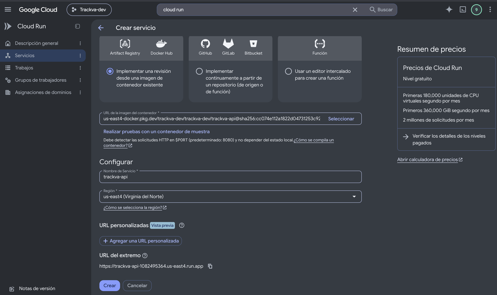
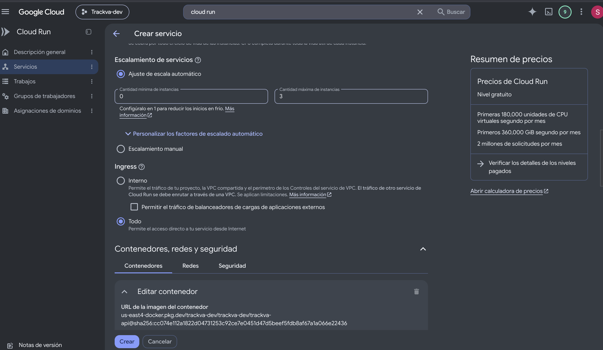
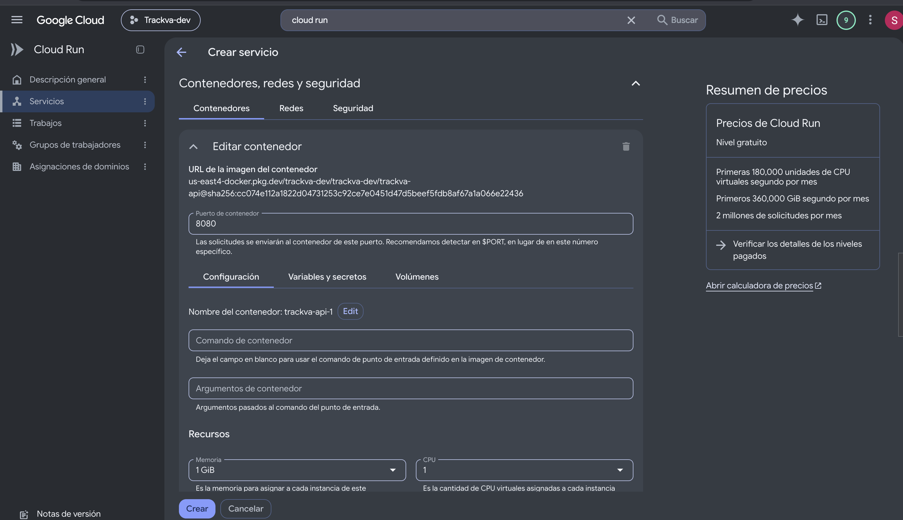
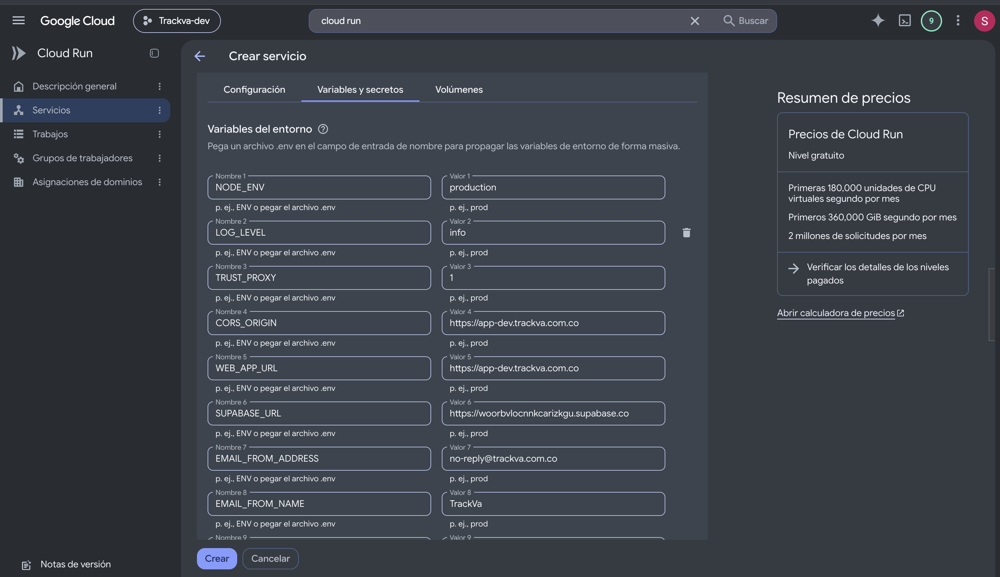
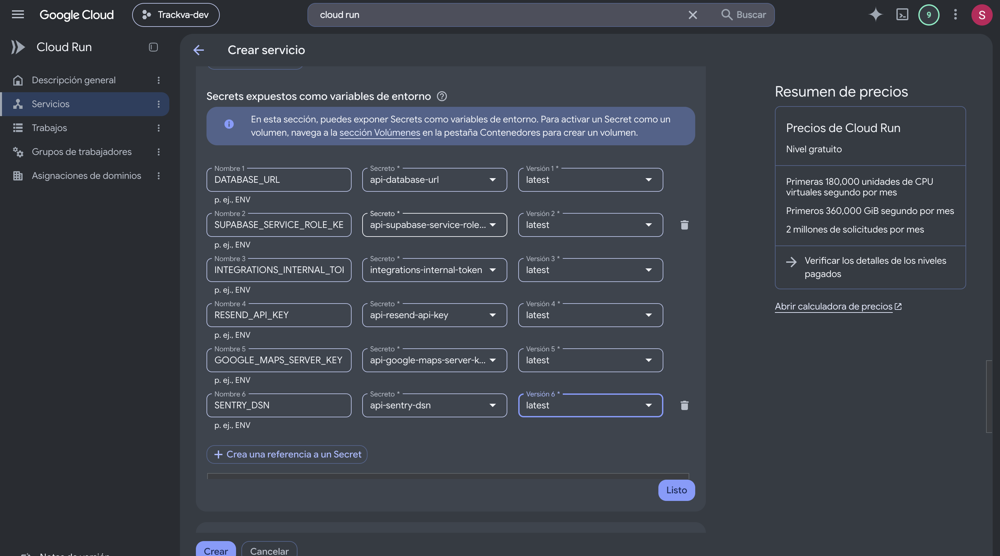
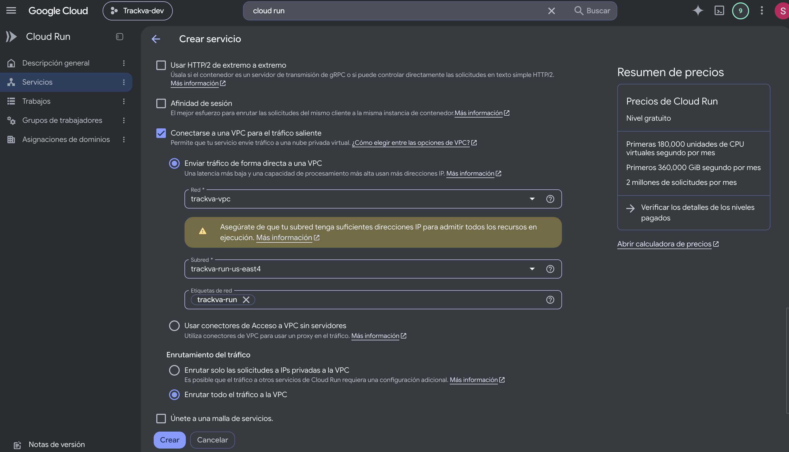
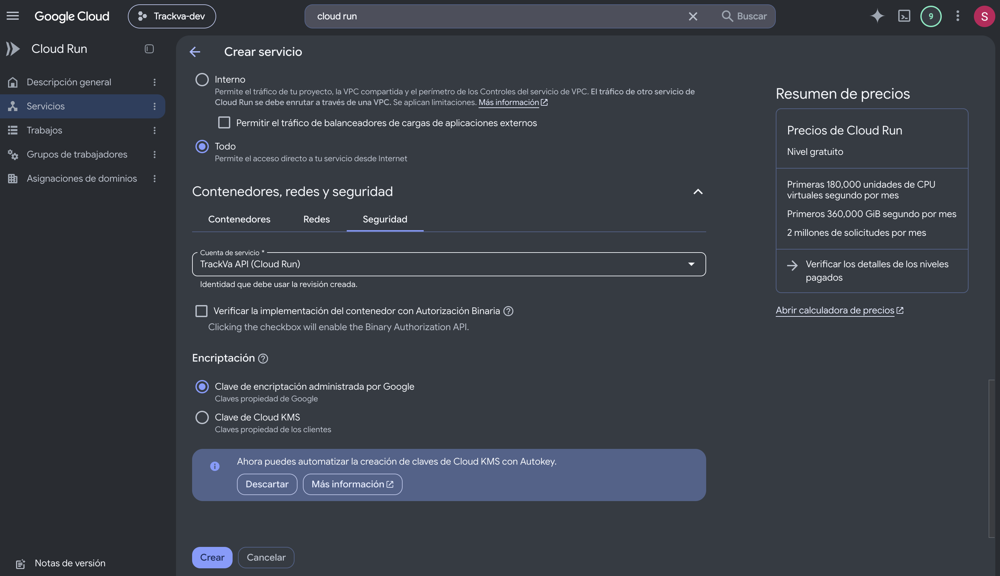
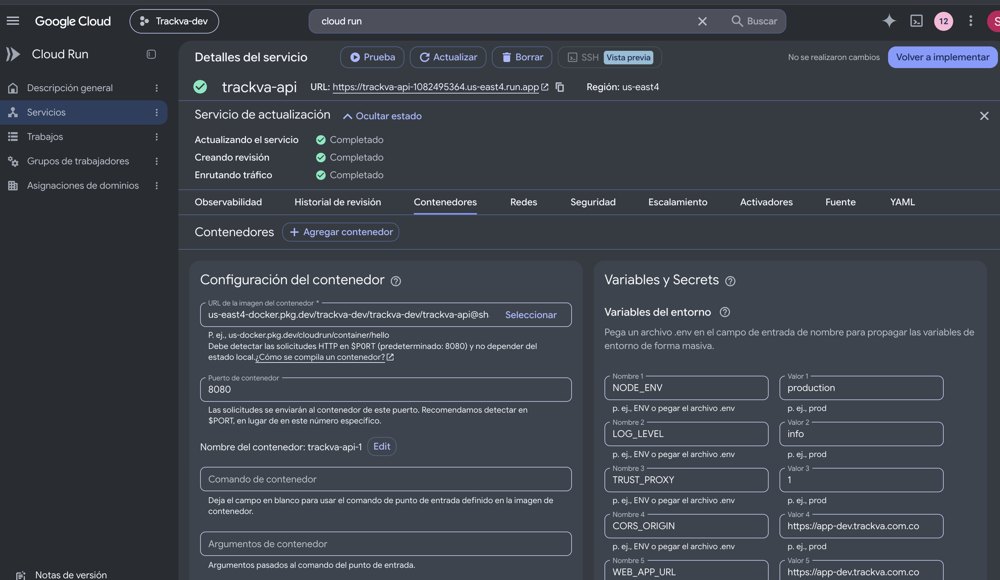
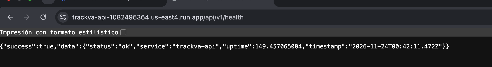

# 06 · Cloud Run: API

| | |
|---|---|
| **Estado** | Configurado el 23-nov-2026. URL: `https://trackva-api-1082495364.us-east4.run.app` |
| **Proyecto** | `trackva-dev` |
| **Región** | `us-east4` |
| **ADR del diseño** | ADR-02, ADR-12, ADR-13 |
| **Costo estimado** | ~US$0 (dentro del nivel gratuito con 0 instancias mínimas) |

## 1. Para qué sirve en TrackVa

Ejecuta `trackva-api`, el servicio con toda la lógica de negocio. Cloud Run arranca contenedores
de la imagen cuando llegan peticiones y baja a cero cuando no hay tráfico. La API corre con su
propia cuenta de servicio, lee sus secretos de Secret Manager y sale a internet por la VPC, con
la IP fija del NAT.

Se despliega antes que integraciones (05): la API arranca sin ese servicio y solo lo necesita al
cotizar con transportadoras.

## 2. Requisitos previos

| Servicio | Qué aporta |
|---|---|
| 01 | Cuenta `trackva-api-cloud-run` |
| 02 | Imagen `us-east4-docker.pkg.dev/trackva-dev/trackva-dev/trackva-api:4bc1db8` |
| 03 | Seis secretos con permiso de lectura para esa cuenta |
| 04 | VPC `trackva-vpc`, subred `trackva-run-us-east4`, NAT y reglas con la etiqueta `trackva-run` |

## 3. Paso a paso

Cloud Run › **Implementar contenedor** › Servicio.

### 3.1 Servicio

| Campo | Valor |
|---|---|
| Imagen del contenedor | «Seleccionar» → Artifact Registry › `trackva-dev` › `trackva-api` › etiqueta `4bc1db8` |
| Nombre del servicio | `trackva-api` |
| Región | `us-east4 (Virginia del Norte)` |
| Autenticación | **Permitir invocaciones sin autenticar** (acceso público) |
| Facturación | Basada en solicitudes |
| Escalamiento | Automático · mínimo `0` · máximo `3` |
| Ingress | **Todos** (temporal, ver nota) |

«Sin autenticar» se refiere a la autenticación de Google (IAM). La API es pública por diseño y
se protege sola: valida el JWT de Supabase en cada ruta privada.

**Ingress temporal.** El diseño pide «Interno + balanceador» (ADR-13), pero el balanceador aún
no existe. Se deja en «Todos» para poder probar por la URL `run.app` y se cierra en el servicio 08.

**Captura — Imagen, nombre del servicio y región**



**Captura — Escalamiento de 0 a 3 instancias e ingress**



### 3.2 Contenedor (pestaña «Contenedores»)

| Campo | Valor |
|---|---|
| Puerto del contenedor | `8080` |
| Memoria | `1 GiB` |
| CPU | `1` |
| Tiempo de espera de la solicitud | `60` segundos |
| Solicitudes simultáneas por instancia | `80` |
| Refuerzo de CPU al inicio | Activado |

Cloud Run entrega el puerto en la variable `PORT` y la API ya la lee; no hay que definirla.

**Captura — Puerto, memoria y CPU**



### 3.3 Variables y secretos (pestaña «Variables y secretos»)

Variables de entorno:

| Nombre | Valor |
|---|---|
| `NODE_ENV` | `production` |
| `LOG_LEVEL` | `info` |
| `TRUST_PROXY` | `1` |
| `CORS_ORIGIN` | `https://app-dev.trackva.com.co` |
| `WEB_APP_URL` | `https://app-dev.trackva.com.co` |
| `SUPABASE_URL` | El mismo valor del `.env` local de `trackva-api` (`https://<ref>.supabase.co`) |
| `EMAIL_FROM_ADDRESS` | `no-reply@trackva.com.co` |
| `EMAIL_FROM_NAME` | `TrackVa` |
| `SENTRY_ENVIRONMENT` | `develop` |
| `SENTRY_RELEASE` | `4bc1db8` |
| `SENTRY_TRACES_SAMPLE_RATE` | `0.1` |

Secretos, cada uno «expuesto como variable de entorno», versión `latest`:

| Nombre de la variable | Secreto |
|---|---|
| `DATABASE_URL` | `api-database-url` |
| `SUPABASE_SERVICE_ROLE_KEY` | `api-supabase-service-role-key` |
| `INTEGRATIONS_INTERNAL_TOKEN` | `integrations-internal-token` |
| `RESEND_API_KEY` | `api-resend-api-key` |
| `GOOGLE_MAPS_SERVER_KEY` | `api-google-maps-server-key` |
| `SENTRY_DSN` | `api-sentry-dsn` |

`INTEGRATIONS_SERVICE_URL` se agrega al desplegar integraciones (05). `TRUST_PROXY` vale `1`
mientras se entra por `run.app`; con el balanceador delante se revisa (servicio 08).

**Captura — Variables de entorno**



**Captura — Los seis secretos expuestos como variables**



### 3.4 Redes (pestaña «Herramientas de redes»)

| Campo | Valor |
|---|---|
| Conectarse a una VPC para el tráfico saliente | Marcado |
| Método | **Enviar tráfico directamente a una VPC** |
| Red | `trackva-vpc` |
| Subred | `trackva-run-us-east4` |
| Etiquetas de red | `trackva-run` |
| Enrutamiento del tráfico | **Enrutar todo el tráfico a la VPC** |

La etiqueta `trackva-run` es la que hace que apliquen las dos reglas de firewall. «Todo el
tráfico» es lo que obliga a salir por el NAT; con «solo IP privadas», la salida a Supabase no
usaría la IP fija.

**Captura — VPC, subred, etiqueta y enrutamiento de todo el tráfico**



### 3.5 Seguridad (pestaña «Seguridad»)

| Campo | Valor |
|---|---|
| Cuenta de servicio | `TrackVa API (Cloud Run)` — `trackva-api-cloud-run@trackva-dev.iam.gserviceaccount.com` |

Pulsar «Crear» y esperar a que la revisión quede en verde.

Equivalente por línea de comandos:

```bash
source scripts/env.sh
gcloud run deploy trackva-api --region="$REGION" \
  --image="$AR_PATH/trackva-api:4bc1db8" \
  --service-account="$SA_API@$PROJECT_ID.iam.gserviceaccount.com" \
  --allow-unauthenticated --ingress=all \
  --min-instances=0 --max-instances=3 --memory=1Gi --cpu=1 --timeout=60 --cpu-boost \
  --network="$VPC_NAME" --subnet="$SUBNET_NAME" --network-tags=trackva-run --vpc-egress=all-traffic \
  --set-env-vars="NODE_ENV=production,LOG_LEVEL=info,TRUST_PROXY=1,..." \
  --set-secrets="DATABASE_URL=api-database-url:latest,SUPABASE_SERVICE_ROLE_KEY=api-supabase-service-role-key:latest,..."
```

**Captura — Cuenta de servicio de la revisión**



### 3.6 Primera revisión fallida y su arreglo (23-nov)

La revisión `4bc1db8` quedó con error: «The user-provided container failed to start and listen
on the port defined provided by the PORT=8080 environment variable». El mensaje apunta al
puerto, pero la causa estaba en los registros:

```bash
gcloud logging read 'resource.type="cloud_run_revision" AND resource.labels.service_name="trackva-api"' \
  --limit=70 --freshness=30m --order=asc
```

```text
Error: Node.js 20 detected without native WebSocket support.
    at new SupabaseClient (/app/node_modules/@supabase/supabase-js/dist/index.cjs:1264:24)
    at SupabaseAuthAdminAdapter.onModuleInit (/app/dist/main.js:1545:54)
WARNING  Container called exit(0).
ERROR    Default STARTUP TCP probe failed 1 time consecutively for container "trackva-api-1" on port 8080.
```

`supabase-js` exige Node 22 y el `Dockerfile` usaba `node:20-alpine`: la API se cerraba al
iniciar. Era lo que anunciaban los avisos `EBADENGINE` de la compilación. Arreglo: `Dockerfile`
a `node:22-alpine` en `main` de `trackva-api` (PR #114, commit `02b700f`). Probado en local con
la configuración de dev: `/api/v1/health` responde 200.

Se aplicó compilando la imagen `trackva-api:02b700f` y, en Cloud Run › `trackva-api` ›
**Editar e implementar una revisión nueva**, cambiando la imagen y `SENTRY_RELEASE`. El resto
de la configuración se conservó. La revisión `trackva-api-00003-ll7` quedó sirviendo el 100 %.

## 4. Verificación

```bash
source scripts/env.sh
URL=$(gcloud run services describe trackva-api --region="$REGION" --format="value(status.url)")
curl -s "$URL/api/v1/health"
gcloud run services describe trackva-api --region="$REGION" \
  --format="yaml(status.url,status.conditions,spec.template.spec.serviceAccountName,spec.template.metadata.annotations)"
```

Resultado del 23-nov (revisión `trackva-api-00003-ll7`, imagen `02b700f`):

```text
$ curl https://trackva-api-1082495364.us-east4.run.app/api/v1/health
{"success":true,"data":{"status":"ok","service":"trackva-api","uptime":40.1,"timestamp":"2026-11-24T00:40:22.122Z"}}
HTTP 200

$ curl .../api/v1/public/geo/divisions?country=CO&q=cali        (lee la base de datos)
{"success":true,"data":[{"name":"Santiago de Cali","kind":"city","path":[{"kind":"region","name":"Valle del Cauca"}], ...
HTTP 200

$ curl .../api/v1/public/tracking/NOEXISTE123                    (lee la base de datos)
{"success":false,"error":{"code":"RESOURCE_NOT_FOUND", ...}}
HTTP 404 en 0.58 s

$ curl .../api/v1/auth/me                                        (sin token)
HTTP 401

$ curl .../api/v1/health/integrations
{"success":true,"data":{"status":"unreachable","service":"trackva-integrations"}}     (esperado: falta el servicio 05)
```

| Qué se comprobó | Resultado |
|---|---|
| La API arranca y responde | `Nest application successfully started`; `/health` 200 |
| Lee sus secretos y llega a la base de datos | Dos rutas públicas que consultan PostgreSQL responden bien |
| La resolución de nombres funciona con la regla de rechazo | Sí: resuelve el dominio de Supabase y conecta |
| Las rutas privadas exigen sesión | `/auth/me` sin token responde 401 |
| Cuenta de servicio | `trackva-api-cloud-run@trackva-dev.iam.gserviceaccount.com` |
| Red | `trackva-vpc` / `trackva-run-us-east4`, etiqueta `trackva-run`, salida `all-traffic` |
| **Sale por la IP fija** | El NAT asigna puertos de `136.70.79.227` a la instancia `10.10.0.18` |

```bash
gcloud compute routers get-nat-mapping-info "$ROUTER_NAME" --region="$REGION"
```

```text
interfaceNatMappings:
- natIpPortRanges:
  - 136.70.79.227:1024-1055
  sourceVirtualIp: 10.10.0.18
```

El primer `/health` tardó 6,7 s por el arranque en frío (0 instancias mínimas); con la instancia
ya arriba, las rutas responden en menos de 1 s.

Avisos en los registros que no impiden funcionar y quedan para `trackva-api`:
`Unsupported route path: "/api/v1/*"` (sintaxis antigua de rutas) y `Duplicate DTO detected:
"ItemStockDto"` (Swagger).

**Captura — Servicio en verde con su URL**



**Captura — Respuesta de /api/v1/health**



## 5. Índice de capturas

No capturar la pestaña de variables con valores sensibles a la vista (los secretos solo muestran
su nombre, así que esa pestaña sí se puede capturar).

| # | Qué muestra | Dónde | Archivo |
|---|---|---|---|
| 1 | Imagen, nombre del servicio y región | Cloud Run › Crear servicio | `capturas/01-crear-servicio-imagen.png` |
| 2 | Escalamiento 0 a 3 e ingress | Crear servicio | `capturas/02-escalamiento-ingress.png` |
| 3 | Puerto, memoria y CPU | Crear servicio › Contenedores | `capturas/03-contenedor-recursos.png` |
| 4 | Variables de entorno | Crear servicio › Variables y secretos | `capturas/04-variables-entorno.png` |
| 5 | Los seis secretos como variables | Crear servicio › Variables y secretos | `capturas/05-secretos.png` |
| 6 | VPC, subred, etiqueta y enrutamiento de todo el tráfico | Crear servicio › Redes | `capturas/06-red-vpc.png` |
| 7 | Cuenta de servicio de la revisión | Crear servicio › Seguridad | `capturas/07-cuenta-de-servicio.png` |
| 8 | Servicio en verde con su URL | Cloud Run › `trackva-api` | `capturas/08-servicio.png` |
| 9 | Respuesta de `/api/v1/health` | Navegador o terminal | `capturas/09-health.png` |

## 6. Cómo deshacerlo

```bash
gcloud run services delete trackva-api --region="$REGION" --quiet
```

## 7. Diferencias con el diseño y pendientes

- Ingress en «Todos» de forma temporal; el diseño pide «Interno + balanceador» (se cierra en el 08).
- Comprobado: la regla de rechazo no bloquea la resolución de nombres y la salida usa `136.70.79.227`.
- Pendiente: `INTEGRATIONS_SERVICE_URL` (servicio 05), cerrar el ingress y revisar `TRUST_PROXY` (servicio 08).
- `NODE_ENV=production` aunque el ambiente sea develop: es el modo de ejecución de Node, no el
  nombre del ambiente (ese va en `SENTRY_ENVIRONMENT`).
- El `Dockerfile` de la API usaba Node 20; se pasó a Node 22 tras el fallo de la primera revisión (3.6).
