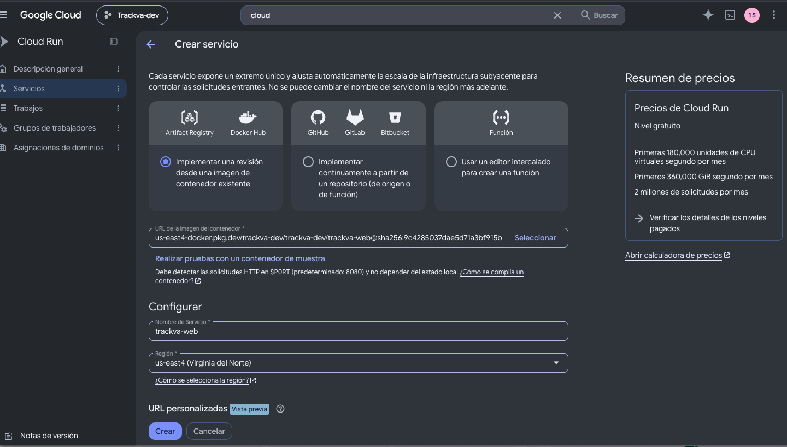
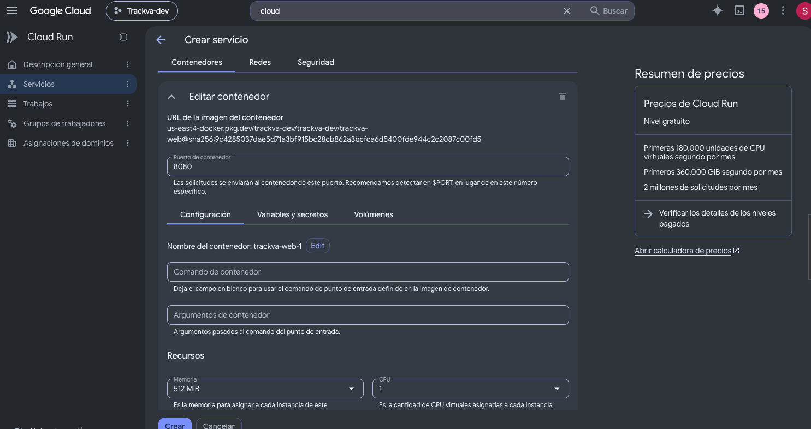
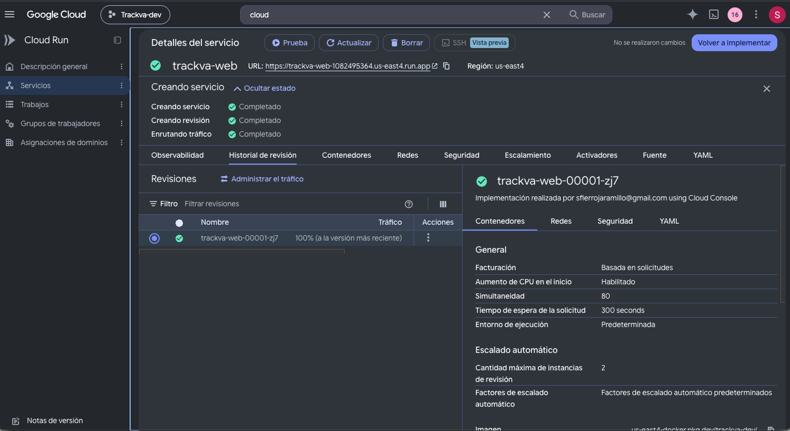
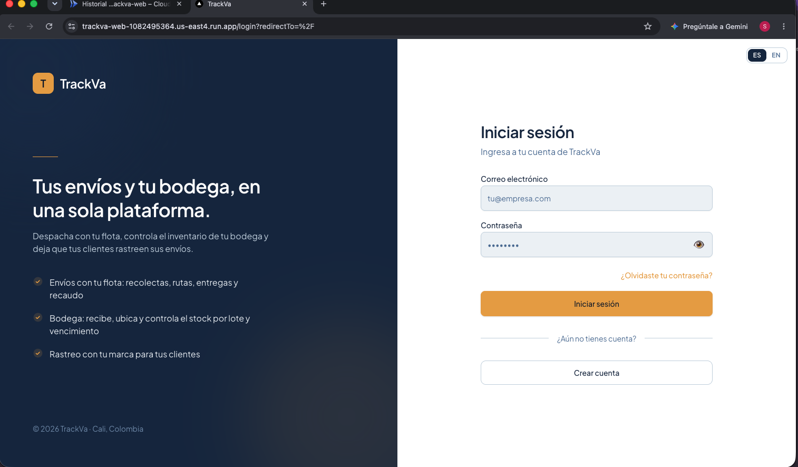

# 07 · Cloud Run: web

| | |
|---|---|
| **Estado** | Configurado el 24-nov-2026. URL: `https://trackva-web-1082495364.us-east4.run.app`. Inicio de sesión pendiente del dominio (servicio 08) |
| **Proyecto** | `trackva-dev` |
| **Región** | `us-east4` |
| **ADR del diseño** | ADR-02 |
| **Costo estimado** | ~US$0 (0 instancias mínimas) |

## 1. Para qué sirve en TrackVa

Ejecuta `trackva-web`: la aplicación del courier, el portal del cliente, el rastreo público y
los widgets. Es Next.js con renderizado en servidor, por eso va en un contenedor y no como
sitio estático (ADR-02).

## 2. Requisitos previos

| Servicio | Qué aporta |
|---|---|
| 01 | Cuenta `trackva-web-cloud` |
| 02 | Repositorio `trackva-dev` |
| 04 | VPC y etiqueta `trackva-run` |
| 06 | API desplegada |

**Cambio en `trackva-web`.** Next.js fija las variables `NEXT_PUBLIC_*` al construir: quedan
dentro del JavaScript y de las cabeceras de seguridad (CSP). El `Dockerfile` no podía
recibirlas, así que una imagen construida fuera del equipo de desarrollo salía apuntando a
`localhost`. Se agregaron argumentos de construcción y un `.dockerignore` (en `main`:
PR #111, commit `39e568d`). Probado en local el 24-nov:
`/login`, `/track` y `/register` responden 200, `/` redirige a `/login`, y la CSP y el
JavaScript llevan `https://app-dev.trackva.com.co`.

Consecuencia: **cada ambiente necesita su propia imagen de la web.** La de develop no sirve
para producción.

## 3. Paso a paso

### 3.1 Imagen (terminal)

`gcloud builds submit --tag` no acepta argumentos de construcción, así que la web se compila
con un archivo de configuración de Cloud Build y un guion que arma los valores:

| Archivo | Qué hace |
|---|---|
| `scripts/cloudbuild-web.yaml` | Pasa cada variable como `--build-arg` a `docker build` |
| `scripts/build-web.sh` | Clona `main`, calcula la etiqueta, toma los valores y lanza Cloud Build |

Valores que quedan dentro de la imagen de develop:

| Variable | Valor | Origen |
|---|---|---|
| `NEXT_PUBLIC_API_URL` | `https://app-dev.trackva.com.co` | `scripts/env.sh` (la web le agrega `/api/v1/...`) |
| `NEXT_PUBLIC_TRACKING_URL` | `https://app-dev.trackva.com.co/track` | `scripts/env.sh` |
| `NEXT_PUBLIC_WIDGETS_URL` | `https://app-dev.trackva.com.co/w` | `scripts/env.sh` |
| `NEXT_PUBLIC_SUPABASE_URL` | URL del Supabase de dev | `trackva-web/.env.local` |
| `NEXT_PUBLIC_SUPABASE_ANON_KEY` | Llave anónima de Supabase | `trackva-web/.env.local` |
| `NEXT_PUBLIC_GOOGLE_MAPS_KEY` | Llave de Maps del navegador | `trackva-web/.env.local` |

Ninguna es secreta: todas viajan al navegador. Por eso no van a Secret Manager. La llave
anónima solo permite lo que dejen las políticas RLS; la de Maps se protege restringiéndola por
dominio en la consola de Google Maps.

```bash
cd /Users/stevenfierro/Documents/Trackva/trackva-infra
bash scripts/build-web.sh
```

Resultado: compilación `813ef397-b2e5-455c-8615-d56ea7065596` en `SUCCESS`; imagen
`trackva-web:39e568d` en Artifact Registry (24-nov, 17:50 UTC).

### 3.2 Servicio (consola)

Cloud Run › **Implementar contenedor** › Servicio:

| Sección | Campo | Valor |
|---|---|---|
| Servicio | Imagen | Artifact Registry › `trackva-dev` › `trackva-web` › la etiqueta que muestre el guion |
| | Nombre | `trackva-web` |
| | Región | `us-east4` |
| | Autenticación | Permitir acceso público |
| | Escalamiento | Automático · mínimo `0` · máximo `3` |
| | Ingress | **Todo** (temporal, se cierra en el servicio 08) |
| Contenedor | Puerto | `8080` |
| | Memoria y CPU | `512 MiB` · `1` |
| Variables | — | Ninguna |
| Secretos | — | Ninguno |
| Redes | VPC | Directa: `trackva-vpc` · `trackva-run-us-east4` · etiqueta `trackva-run` · enrutar todo el tráfico |
| Seguridad | Cuenta de servicio | `TrackVa web (Cloud Run)` |

No lleva variables ni secretos en Cloud Run: todo lo que necesita quedó dentro de la imagen.

**Captura — Imagen, nombre del servicio y región**



**Captura — Puerto, memoria y CPU**



**Captura — Servicio en verde con su URL y revisión**



## 4. Verificación

```bash
source scripts/env.sh
WEB=$(gcloud run services describe trackva-web --region="$REGION" --format="value(status.url)")
for p in /login /track /register /; do curl -s -o /dev/null -w "$p → %{http_code}\n" "$WEB$p"; done
curl -sI "$WEB/login" | grep -i content-security-policy | tr ';' '\n' | grep connect-src
```

Esperado: 200 en `/login`, `/track` y `/register`; 307 en `/`; y `connect-src` con
`https://app-dev.trackva.com.co`.

```text
/login    → 200 (0.71 s)
/track    → 200 (0.34 s)
/register → 200 (0.73 s)
/         → 307 …/login?redirectTo=%2F
/portal   → 307 …/login?redirectTo=%2Fportal
connect-src 'self' https://app-dev.trackva.com.co https://<ref>.supabase.co wss://<ref>.supabase.co …

ingress: all · maxScale 2 · cpu 1000m · memory 512Mi
serviceAccountName: trackva-web-cloud@trackva-dev.iam.gserviceaccount.com
network-interfaces: trackva-vpc / trackva-run-us-east4 / trackva-run
vpc-access-egress: private-ranges-only
revisión: trackva-web-00001-zj7
```

La web arranca, sirve sus páginas públicas, protege las privadas (redirige a `/login`) y lleva
el dominio de develop en la CSP.

**Lo que no se puede probar todavía.** Iniciar sesión y usar la app: el navegador llama a la
API en `https://app-dev.trackva.com.co`, que no existe hasta el balanceador y el DNS (servicio
08). En este paso solo se comprueba que la web arranca y sirve sus páginas.

**Captura — Pantalla de inicio de sesión servida desde Cloud Run**



## 5. Índice de capturas

| # | Qué muestra | Dónde | Archivo |
|---|---|---|---|
| 1 | Fin de la compilación con `SUCCESS` | Terminal | `capturas/01-cloud-build.png` (pendiente) |
| 2 | Imagen, nombre y región | Cloud Run › Crear servicio | `capturas/02-crear-servicio.png` |
| 2b | Puerto, memoria y CPU | Crear servicio › Contenedores | `capturas/02b-contenedor-recursos.png` |
| 3 | Servicio en verde con su URL y revisión | Cloud Run › `trackva-web` | `capturas/03-servicio.png` |
| 4 | Pantalla de inicio de sesión servida desde `run.app` | Navegador | `capturas/04-login.png` |

## 6. Cómo deshacerlo

```bash
gcloud run services delete trackva-web --region="$REGION" --quiet
```

## 7. Diferencias con el diseño y pendientes

- El diseño no contaba con que la imagen de la web depende del ambiente.
- **Salida a internet:** quedó en «solo IP privadas a la VPC» (`private-ranges-only`), no en «todo el tráfico» como la API. Funciona, pero la salida de la web a internet no pasa por el NAT ni por las reglas de firewall, y el diseño pide que toda la salida de Cloud Run vaya por la VPC. Corregido el 24-nov en la revisión `trackva-web-00003-4r9` (salida `all-traffic`), junto con el cierre del ingress.
- Escalamiento máximo 2 (la guía decía 3); suficiente para develop.
- Pendientes para el servicio 08, cuando exista el dominio:
  - En Supabase › Authentication › URL Configuration, agregar `https://app-dev.trackva.com.co`
    a las URL de redirección (invitaciones, cambio de contraseña, verificación de correo).
  - En la consola de Google Maps, permitir el dominio `app-dev.trackva.com.co` en la llave del navegador.
- `trackva-web` no tiene `.env.example`: las variables solo estaban en el `.env.local` de cada equipo.
