# 08 · Balanceador de carga, certificado y DNS

| | |
|---|---|
| **Estado** | Configurado el 24-nov-2026: dominio con HTTPS, inicio de sesión comprobado y Cloud Run cerrado a internet |
| **Proyecto** | `trackva-dev` |
| **Región** | global (los servicios detrás están en `us-east4`) |
| **ADR del diseño** | ADR-10, ADR-13 |
| **Costo estimado** | ~US$18/mes (regla de reenvío US$0,025 por hora + US$0,008 por GiB) |

## 1. Para qué sirve en TrackVa

Es la única puerta de entrada. Recibe todo el tráfico HTTPS de `app-dev.trackva.com.co`, pone
el certificado y reparte: `/api/*` a `trackva-api` y el resto a `trackva-web`. Con él delante,
Cloud Run se cierra para que nadie entre por las URL `run.app`, y Cloud Armor (servicio 09) se
aplica sobre él.

```
Navegador / app ──HTTPS──▶ IP global ──▶ Balanceador ──┬─ /api/*  ──▶ trackva-api
                                                        └─ lo demás ─▶ trackva-web
```

Es también el primer costo fijo apreciable del ambiente: cobra por hora aunque no haya tráfico.

## 2. Requisitos previos

Servicios 06 (API) y 07 (web) desplegados. Acceso al DNS de `trackva.com.co` en Hostinger.

## 3. Paso a paso

### 3.1 IP global (consola)

Red de VPC › Direcciones IP › **Reservar externa**:

| Campo | Valor |
|---|---|
| Nombre | `trackva-lb-ip` |
| Nivel de servicio de red | Premium (el balanceador global lo exige) |
| Versión de IP | IPv4 |
| Tipo | **Global** |

Dirección asignada: **`136.68.113.157`**.

**Captura — IP global reservada**

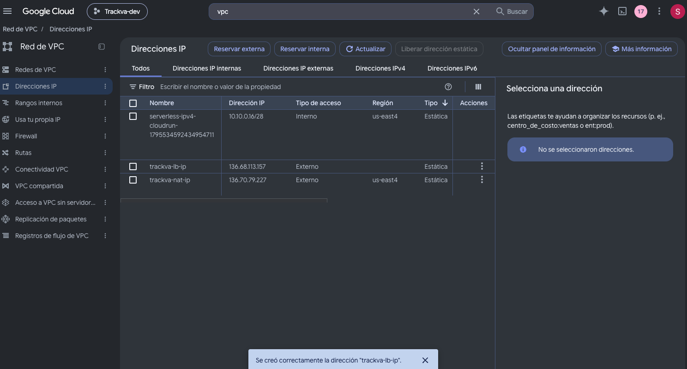

### 3.2 Registro DNS (Hostinger)

Conviene crearlo antes de armar el balanceador: el certificado solo se emite cuando el dominio
ya apunta a la IP.

| Tipo | Nombre | Apunta a | TTL |
|---|---|---|---|
| A | `app-dev` | `136.68.113.157` | 300 |

Comprobar: `dig +short app-dev.trackva.com.co` debe devolver esa IP.

**Captura — Registro A en el proveedor del dominio**

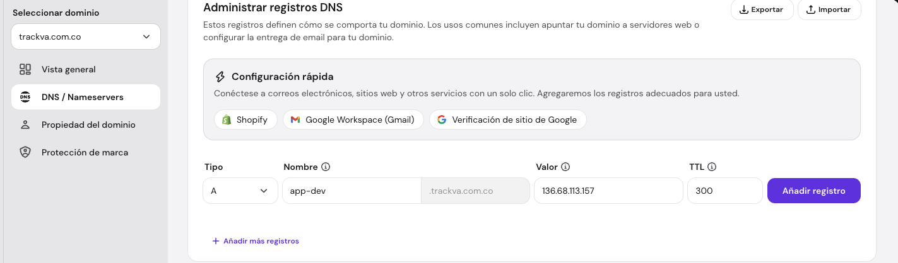

### 3.3 Balanceador (consola)

Servicios de red › Balanceo de cargas › **Crear balanceador de cargas**:

| Pregunta del asistente | Respuesta |
|---|---|
| Tipo | Balanceador de cargas de aplicaciones (HTTP/HTTPS) |
| Orientado al público o interno | Orientado al público (externo) |
| Implementación global o de una sola región | Ideal para cargas de trabajo globales |
| Generación | Balanceador de cargas de aplicaciones externo global |

Nombre del balanceador: `trackva-lb`.

**Frontend**

| Campo | Valor |
|---|---|
| Nombre | `trackva-lb-https` |
| Protocolo | HTTPS |
| Dirección IP | `trackva-lb-ip` |
| Puerto | `443` |
| Certificado | Crear certificado nuevo → nombre `trackva-dev-cert`, **administrado por Google**, dominio `app-dev.trackva.com.co` |
| Redireccionamiento de HTTP a HTTPS | **Activado** |

**Backend** — dos servicios de backend, cada uno con su grupo de extremos de red sin servidores (NEG):

| Campo | Backend de la web | Backend de la API |
|---|---|---|
| Nombre del servicio de backend | `trackva-web-backend` | `trackva-api-backend` |
| Tipo de backend | Grupo de extremos de red sin servidores | Grupo de extremos de red sin servidores |
| NEG nuevo · nombre | `trackva-web-neg` | `trackva-api-neg` |
| NEG · región | `us-east4` | `us-east4` |
| NEG · tipo | Cloud Run → servicio `trackva-web` | Cloud Run → servicio `trackva-api` |
| Cloud CDN | **Desactivado** | **Desactivado** |
| Política de Cloud Armor | **Ninguna** (se crea en el servicio 09) | **Ninguna** |
| Registro | Activado, tasa de muestreo `1` | Activado, tasa de muestreo `1` |

Cloud CDN desactivado porque la app sirve contenido por usuario y la API no debe quedar en caché.

**La consola adjuntó una política de Cloud Armor por defecto a cada backend**
(`default-security-policy-for-backend-service-trackva-{api,web}-backend`), con una sola regla:
limitar a 500 peticiones por minuto por IP. Son dos políticas cuando el diseño prevé una; cada
una se cobra aparte. Se quitaron de los backends y se borraron el mismo 24-nov, por comandos
y a pedido de Steven; la política propia llega en el servicio 09.

```bash
gcloud compute backend-services update trackva-api-backend --global --security-policy=""
gcloud compute backend-services update trackva-web-backend --global --security-policy=""
gcloud compute security-policies delete default-security-policy-for-backend-service-trackva-api-backend --quiet
gcloud compute security-policies delete default-security-policy-for-backend-service-trackva-web-backend --quiet
```

```text
NAME                 SECURITY_POLICY  ENABLE_CDN  REGISTRO
trackva-api-backend                   False       True
trackva-web-backend                   False       True
políticas restantes: ninguna
```

**Reglas de enrutamiento** — modo «Regla avanzada de host y ruta» (o «simple» con estas filas):

| Host | Ruta | Backend |
|---|---|---|
| `app-dev.trackva.com.co` | `/api/*` | `trackva-api-backend` |
| `app-dev.trackva.com.co` | lo demás | `trackva-web-backend` |
| Cualquier otro host | — | `trackva-web-backend` (predeterminado) |

Basta una regla explícita (`/api/*`); lo demás cae en el backend predeterminado. En el primer
intento había una tercera fila `/*` y la pantalla de revisión mostraba los dos backends
cruzados; se quitó antes de crear.

La API ya sirve todas sus rutas bajo `/api/v1`, así que el balanceador no reescribe nada.
(Su documentación en `/api/docs` está apagada con `NODE_ENV=production` desde el 27-nov-2026.) La web no tiene rutas propias bajo `/api`.

Revisar y **Crear**. El certificado tarda de 15 a 60 minutos en pasar a «Activo»; mientras
tanto el navegador muestra un error de certificado.

**Captura — Tipo de balanceador elegido en el asistente**

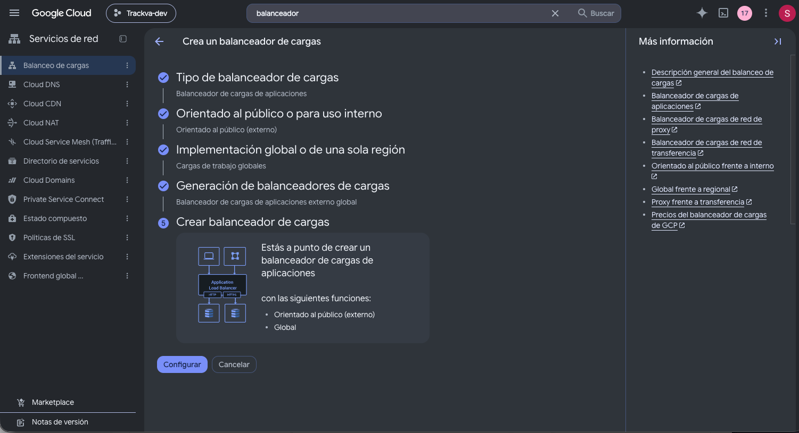

**Captura — Frontend HTTPS con la IP y el certificado**

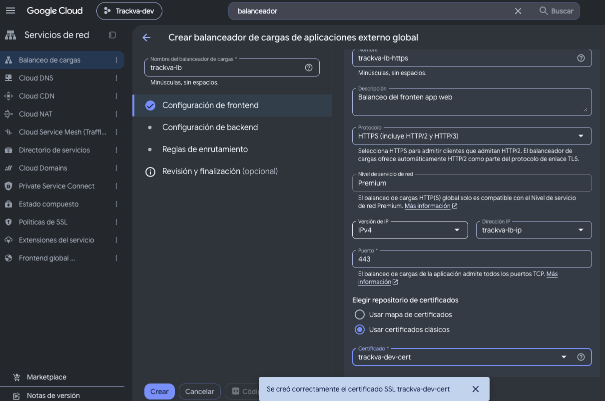

**Captura — Backend de la web con su grupo de extremos**

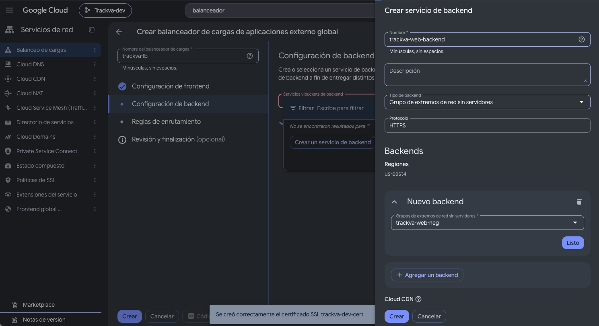

**Captura — Backend de la API con su grupo de extremos**

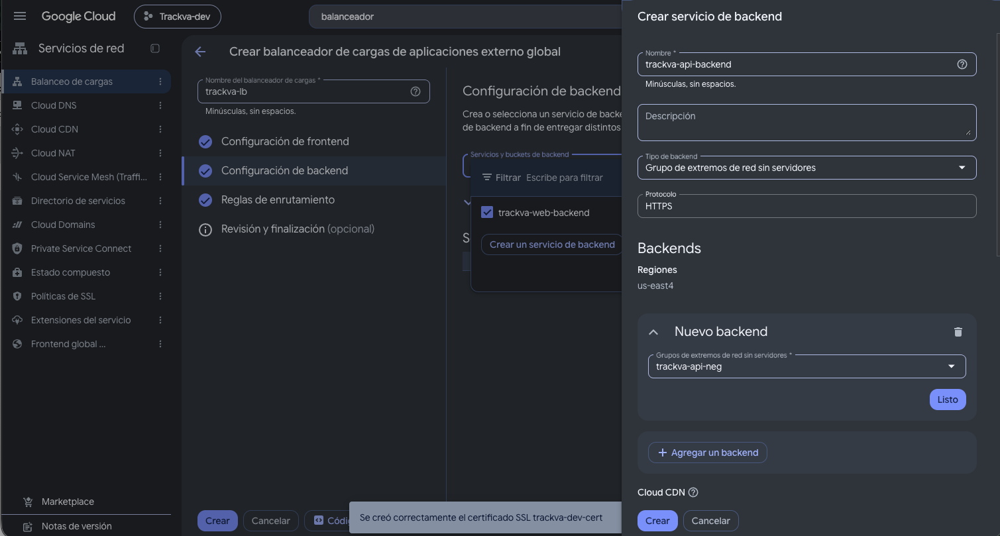

**Captura — Los dos servicios de backend**

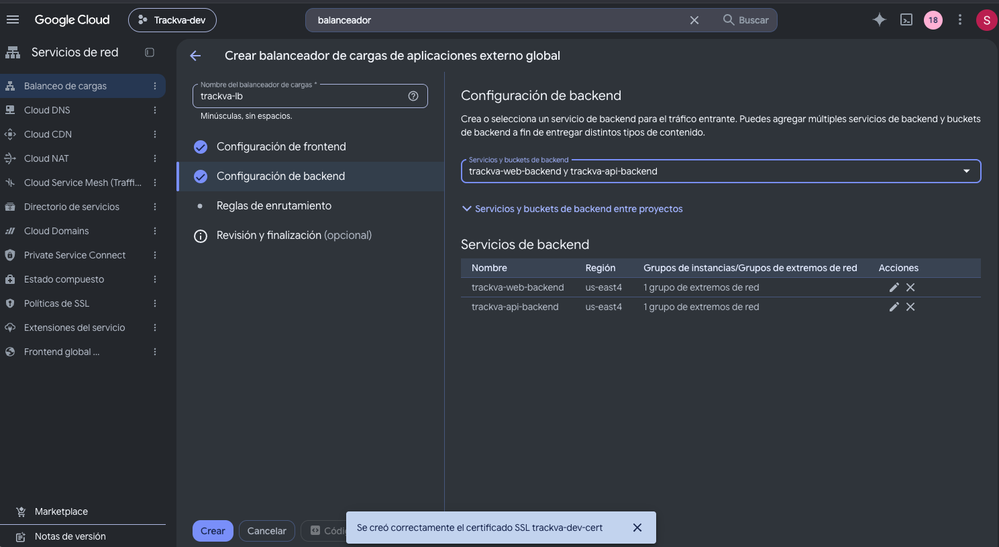

**Captura — Reglas de host y ruta (antes de quitar la fila redundante)**

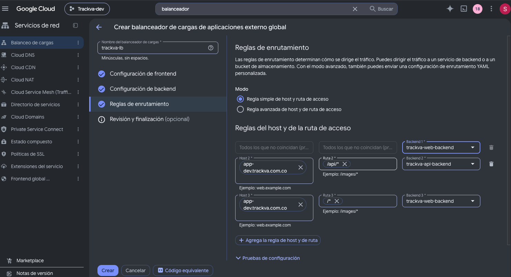

**Captura — Balanceador en creación: primero aparece el de redirección**

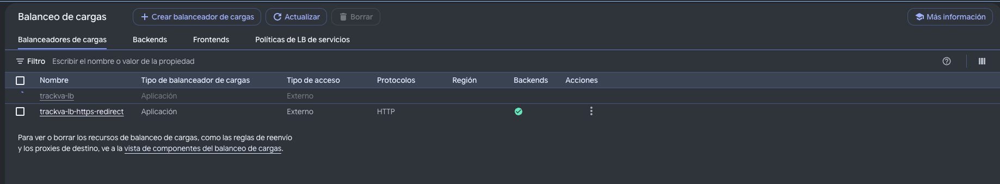

**Captura — Balanceador creado con sus dos backends**

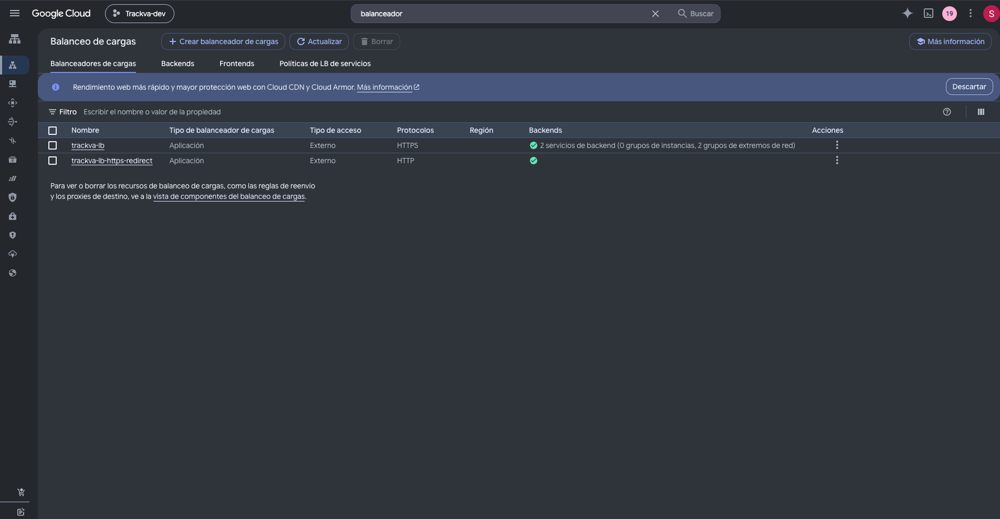

### 3.4 Ajustes fuera de Google Cloud

| Dónde | Qué |
|---|---|
| Supabase › Authentication › URL Configuration | Agregar `https://app-dev.trackva.com.co/**` a «Redirect URLs» (invitaciones, cambio de contraseña, verificación) |
| Google Maps Platform › Credenciales | **No hace falta y no se debe hacer así** (ver abajo) |

**Llave de Google Maps (revisada el 24-nov).** No se agregó el dominio, porque la llave no
tiene restricción de sitios: ya funciona en `app-dev.trackva.com.co`. Pero la revisión mostró
tres problemas:

| Hallazgo | Por qué importa |
|---|---|
| La web y la API usan **la misma llave** | La llave de la web viaja en el JavaScript, así que la llave del servidor es pública |
| No tiene restricción de aplicación (ni sitios ni IP) | Cualquiera que la copie del navegador puede usarla y el consumo se factura a la cuenta |
| Vive en el proyecto `lab-05-uao-512915` y permite 30 APIs de Maps | Es un proyecto de laboratorio del curso, no el de TrackVa; y la app usa pocas de esas APIs |

Una llave admite un solo tipo de restricción (sitios web **o** direcciones IP). Si se le pusiera
la de sitios, la API dejaría de poder geocodificar y calcular rutas, porque el servidor no envía
sitio de origen. La corrección son dos llaves:

| Llave | Restricción de aplicación | APIs |
|---|---|---|
| Navegador (`NEXT_PUBLIC_GOOGLE_MAPS_KEY`) | Sitios: `https://app-dev.trackva.com.co/*` y `http://localhost:3000/*` | Solo Maps JavaScript (y las que use el mapa) |
| Servidor (`GOOGLE_MAPS_SERVER_KEY`) | IP: `136.70.79.227` (la del NAT) | Solo Geocoding y Routes |

**Hecho el 24-nov, a pedido de Steven** (por comandos `gcloud`):

| Paso | Resultado |
|---|---|
| APIs de Maps habilitadas en `trackva-dev` | `maps-backend`, `geocoding-backend`, `routes`, `apikeys` |
| Llave «TrackVa dev · navegador (Maps JavaScript)» | Sitios `https://app-dev.trackva.com.co/*`, `http://localhost:3000/*`, `http://127.0.0.1:3000/*`; solo Maps JavaScript |
| Llave «TrackVa dev · servidor (Geocoding y Routes)» | Sin restricción de aplicación; solo Geocoding y Routes |
| Secreto `api-google-maps-server-key` | Versión 2 con la llave del servidor (es la `latest`) |
| API | Revisión `trackva-api-00006-q2r`, que carga la versión 2; `/api/v1/health` 200 |
| Web | Imagen `trackva-web:39e568d-maps2` con la llave del navegador; revisión `trackva-web-00002-jp7` |

**Por qué la llave del servidor no quedó restringida por IP.** Se creó así (IP del NAT
`136.70.79.227`), pero la subred tiene acceso privado a Google y con él las llamadas a las API
de Google no pasan por el NAT: Google no vería esa IP. Como no se pudo probar desde la red de
Cloud Run, se optó por lo seguro (decisión de Steven, «opción A»): restringirla solo por API.
No es una llave pública: vive en Secret Manager y solo la lee la cuenta de la API.

Comprobado desde fuera de la red:

```text
Geocoding con la llave del servidor        → OK
Mapa estático con la llave del servidor    → 403 (API no permitida)
Maps JavaScript con la llave del navegador y sitio app-dev → 200
```

`scripts/build-web.sh` toma ahora la llave del navegador de Google Cloud por su identificador
(`MAPS_BROWSER_KEY_ID` en `scripts/env.sh`) y acepta `TAG_SUFFIX` para recompilar el mismo
commit con otros valores.

Pendiente:

- Prueba funcional en la app: abrir el mapa de Despacho o de Recolectas en
  `https://app-dev.trackva.com.co` y geocodificar una dirección.
- La llave antigua («Maps Platform API Key», proyecto `lab-05-uao-512915`) sigue existiendo y
  sin restricciones. Ya no la usan ni develop ni el entorno local principal (ver abajo); falta
  borrarla o restringirla.

**Llaves para el desarrollo local (24-nov, a pedido de Steven).** Se crearon dos llaves más en
`trackva-dev` y se reemplazó la antigua en los archivos locales:

| Llave | Restricción | Dónde quedó |
|---|---|---|
| «TrackVa local · navegador (Maps JavaScript)» | Sitios `http://localhost:*/*`, `http://127.0.0.1:*/*`, `http://*.localhost:*/*`; solo Maps JavaScript | `trackva-web/.env.local` → `NEXT_PUBLIC_GOOGLE_MAPS_KEY` |
| «TrackVa local · servidor (Geocoding y Routes)» | Solo Geocoding y Routes | `trackva-api/.env` → `GOOGLE_MAPS_SERVER_KEY` |

Probadas: geocodificación `OK`, cálculo de rutas 200 y Maps JavaScript 200 desde
`localhost:3000`. Sus identificadores están en `scripts/env.sh` (`MAPS_LOCAL_*_KEY_ID`).

La llave antigua sigue en dos copias de trabajo que no se tocaron:
`.worktrees/trackva-web-demo/.env.local` y `.worktrees/trackva-api-commerce/.env`.

**Supabase (hecho el 24-nov, en el panel, con la sesión de Steven).** En el proyecto
`trackvaCourrier-Develop` › Authentication › URL Configuration se agregó
`https://app-dev.trackva.com.co/**` a «Redirect URLs» (quedan 2: esa y
`http://localhost:3000/reset-password`). Captura 10. El «Site URL» sigue en
`http://localhost:3000`: no se tocó, pero es el valor que usan las plantillas de correo cuando
no reciben una URL de redirección, así que conviene revisarlo.

**Captura — URL de redirección de develop en Supabase**

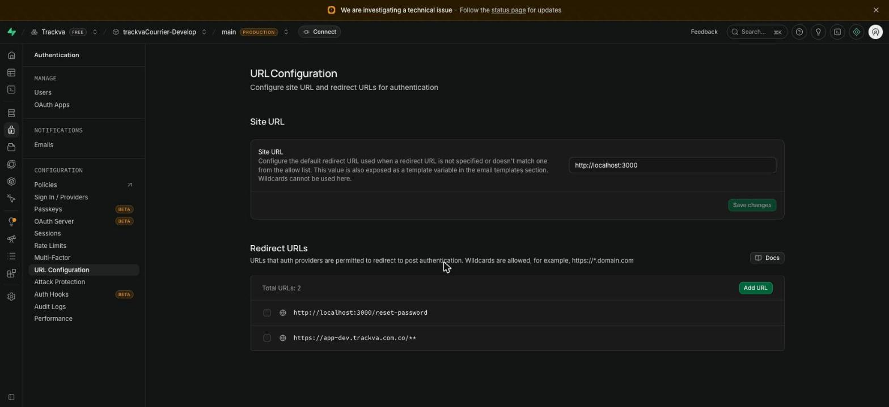

### 3.5 Cerrar Cloud Run (consola), solo cuando el dominio ya funcione

En `trackva-api` y en `trackva-web` › Redes › Ingress:
**Interno** + casilla **«Permitir el tráfico de balanceadores de cargas de aplicaciones externos»**.

Con eso las URL `run.app` dejan de responder desde internet (ADR-13).

En esa misma revisión:

| Servicio | Cambio adicional |
|---|---|
| `trackva-api` | `TRUST_PROXY` pasa de `1` a `2` (medido, ver sección 7). Decisión de Steven (24-nov): se aplica desde el pipeline (servicio 13), no a mano |
| `trackva-web` | Redes › «Enrutar todo el tráfico a la VPC» (quedó en «solo IP privadas» en el servicio 07) |

## 4. Verificación

```bash
source scripts/env.sh
gcloud compute addresses describe trackva-lb-ip --global --format="value(address,status)"
dig +short "$DEV_DOMAIN"
gcloud compute ssl-certificates describe trackva-dev-cert --global --format="yaml(managed.status,managed.domainStatus)"
gcloud compute url-maps describe trackva-lb --format="yaml(defaultService.basename(),hostRules,pathMatchers)"
curl -s -o /dev/null -w "http → %{http_code} %{redirect_url}\n" "http://$DEV_DOMAIN/"
curl -s "https://$DEV_DOMAIN/api/v1/health"
curl -s -o /dev/null -w "web /login → %{http_code}\n" "https://$DEV_DOMAIN/login"
```

Después de 3.5:

```bash
curl -s -o /dev/null -w "API por run.app → %{http_code}\n" https://trackva-api-1082495364.us-east4.run.app/api/v1/health   # esperado: 404
curl -s -o /dev/null -w "web por run.app → %{http_code}\n" https://trackva-web-1082495364.us-east4.run.app/login           # esperado: 404
```

Y la prueba que importa: iniciar sesión en `https://app-dev.trackva.com.co` con un usuario de dev.

Estado al crear (24-nov), leído con `gcloud`:

```text
url-map trackva-lb
  default: trackva-web-backend
  host ['app-dev.trackva.com.co'] → path-matcher-1 (default: trackva-web-backend)
      ['/api/*'] → trackva-api-backend

NAME                              IP_ADDRESS      PORT_RANGE  TARGET
trackva-lb-https                  136.68.113.157  443-443     trackva-lb-target-proxy
trackva-lb-https-forwarding-rule  136.68.113.157  80-80       trackva-lb-https-target-proxy      (redirección a HTTPS)

NAME                 NEG              CDN    REGISTRO
trackva-api-backend  trackva-api-neg  False  True
trackva-web-backend  trackva-web-neg  False  True

dig +short app-dev.trackva.com.co → 136.68.113.157
certificado trackva-dev-cert: PROVISIONING
```

Mientras se crea, la consola muestra `trackva-lb` en gris y solo `trackva-lb-https-redirect`
en verde: es el orden en que arma las piezas (unos 3 minutos). La redirección es un segundo
balanceador pequeño que la consola crea sola para el puerto 80.

Con el certificado activo (24-nov, 18:39 UTC):

```text
certificado trackva-dev-cert: ACTIVE · CN=app-dev.trackva.com.co · emisor Google Trust Services · vence 22-feb-2027
http://app-dev.trackva.com.co/                     → 301 https://app-dev.trackva.com.co:443/
https://…/api/v1/health                            → 200 {"status":"ok","service":"trackva-api"} (0,23 s)
https://…/api/v1/public/geo/divisions?country=CO…  → 200   (lee la base)
https://…/api/v1/auth/me (sin token)               → 401
https://…/login, /track, /register                 → 200
https://…/                                         → 307 /login?redirectTo=%2F
```

`/api/*` llega a la API y el resto a la web, con un solo certificado y un solo dominio.
El certificado se renueva solo mientras el DNS siga apuntando al balanceador.

Cierre de Cloud Run (3.5), hecho por Steven el 24-nov y verificado:

```text
trackva-api           ingress internal-and-cloud-load-balancing · salida all-traffic · revisión trackva-api-00006-q2r
trackva-web           ingress internal-and-cloud-load-balancing · salida all-traffic · revisión trackva-web-00003-4r9
trackva-integrations  ingress internal                          · salida all-traffic

404  https://trackva-api-1082495364.us-east4.run.app/api/v1/health
404  https://trackva-web-1082495364.us-east4.run.app/login
404  https://trackva-integrations-1082495364.us-east4.run.app/internal/health
200  https://app-dev.trackva.com.co/api/v1/health
200  https://app-dev.trackva.com.co/login
```

Nadie entra ya por las URL `run.app`: todo pasa por el balanceador (ADR-13). El NAT atiende a
los tres servicios con la IP `136.70.79.227`. Inicio de sesión y mapas confirmados por Steven.

Los caminos entre servicios siguen funcionando con el cierre:

```text
API → integraciones:   /api/v1/health/integrations → "status":"ok"
web → API (servidor):  registro del balanceador
   19:14:56  404  136.70.79.227  https://app-dev.trackva.com.co/api/v1/public/tracking/VERIFSSR777
```

La segunda línea es la consulta que hace la web al armar la página `/track/VERIFSSR777`: sale
por el NAT (`136.70.79.227`), entra por el balanceador y llega a la API, que responde 404 porque
el código no existe. Confirma que la web usa la IP fija, que es lo que necesita la regla 900 de
Cloud Armor.

## 5. Índice de capturas

| # | Qué muestra | Dónde | Archivo |
|---|---|---|---|
| 1 | IP global reservada | Red de VPC › Direcciones IP | `capturas/01-ip-global.png` |
| 2 | Registro A en Hostinger | Panel de DNS de Hostinger | `capturas/02-dns-hostinger.png` |
| 3 | Frontend HTTPS con IP y certificado | Balanceo de cargas › Crear › Frontend | `capturas/03-frontend.png` |
| 4 | Los dos backends con sus NEG | Crear › Backend | `capturas/04-backends.png` (y `04a`, `04b`) |
| 5 | Reglas de host y ruta | Crear › Reglas de enrutamiento | `capturas/05-reglas.png` (antes de quitar la fila `/*`) |
| 6 | Balanceador creado | Balanceo de cargas › `trackva-lb` | `capturas/06-balanceador.png` |
| 7 | Certificado en estado «Activo» | Balanceo de cargas › Certificados | `capturas/07-certificado-activo.png` (pendiente; el estado consta en la verificación) |
| 8 | Sesión iniciada en `https://app-dev.trackva.com.co` | Navegador | `capturas/08-app-en-dominio.png` (pendiente; Steven confirmó el inicio de sesión el 24-nov) |
| 9 | Ingress «Interno + balanceadores» en la API y la web | Cloud Run › Redes | `capturas/09-ingress-cerrado.png` (pendiente; el estado consta en la verificación) |
| 10 | URL de redirección de develop en Supabase | Supabase › Authentication › URL Configuration | `capturas/10-supabase-redirect-urls.jpg` |

## 6. Cómo deshacerlo

El balanceador es lo que cobra: borrarlo detiene ese gasto.

```bash
gcloud compute forwarding-rules list --global      # borrar las del balanceador (HTTPS y la de redirección HTTP)
gcloud compute target-https-proxies delete <nombre> --quiet
gcloud compute target-http-proxies delete <nombre> --quiet
gcloud compute url-maps delete trackva-lb --quiet   # y el mapa de la redirección, si existe
gcloud compute backend-services delete trackva-web-backend trackva-api-backend --global --quiet
gcloud compute network-endpoint-groups delete trackva-web-neg trackva-api-neg --region="$REGION" --quiet
gcloud compute ssl-certificates delete trackva-dev-cert --global --quiet
gcloud compute addresses delete trackva-lb-ip --global --quiet
```

Antes de borrarlo hay que devolver el ingress de Cloud Run a «Todo», o los servicios quedan inalcanzables.

## 7. Diferencias con el diseño y pendientes

- El diseño enruta `/webhooks/*` a integraciones. No se configura: hoy integraciones no recibe
  webhooks y los de canales de comercio entrarán por la API.
- El diseño usa `trackva.com.co`; develop usa el subdominio `app-dev.trackva.com.co`.
- **`TRUST_PROXY`: medido el 24-nov; hay que cambiarlo a `2`.** Se compararon los contadores
  del límite de peticiones (`x-ratelimit-remaining`) entrando directo por `run.app` y por el
  balanceador:

  ```text
  directo run.app:  28, 27, …, 26      (un contador)
  balanceador:      28, 27, 26*, 25    (otro contador distinto; * = con X-Forwarded-For falso)
  ```

  Por el balanceador la API atribuye todas las peticiones a una misma dirección que no es la
  del visitante: con `TRUST_PROXY=1` toma la IP del balanceador. **Todos los visitantes
  comparten un solo contador**, así que el límite de 30 por minuto del rastreo público sería
  para todo el mundo junto. Con `2` la API salta también el balanceador y cuenta al visitante.
  `2` solo es seguro con el ingress cerrado: entrando directo por `run.app` permitiría
  falsificar la IP. Por eso los dos cambios van en la misma revisión (3.5).
- **Queda un caso sin resolver, de código.** Cuando la web consulta la API desde el servidor
  (por ejemplo al renderizar `/track`), la petición sale de la web, pasa por el balanceador y
  llega con un salto más. La web y la API calculan la IP del visitante pensando en un Nginx
  delante (`trackva-web/src/lib/visitor-ip.ts`, `trackva-api/src/config/trust-proxy.config.ts`),
  no en esta topología. Hay que revisarlo en los dos repositorios antes de tener tráfico real.
  Mientras tanto, el límite por IP que cuenta bien es el de Cloud Armor (servicio 09), que es
  justo lo que prevé el ADR-11.
- **Documentación de la API pública (resuelto el 27-nov-2026).** `/api/docs` (Swagger)
  respondía 200 sin sesión, también con `NODE_ENV=production`. Desde `trackva-api` #126 solo se
  monta fuera de producción o con `API_DOCS_ENABLED=true`; develop no define la variable y
  `/api/docs` responde 404.
- La salida de la web ya va completa por la VPC (revisión `trackva-web-00003-4r9`).
