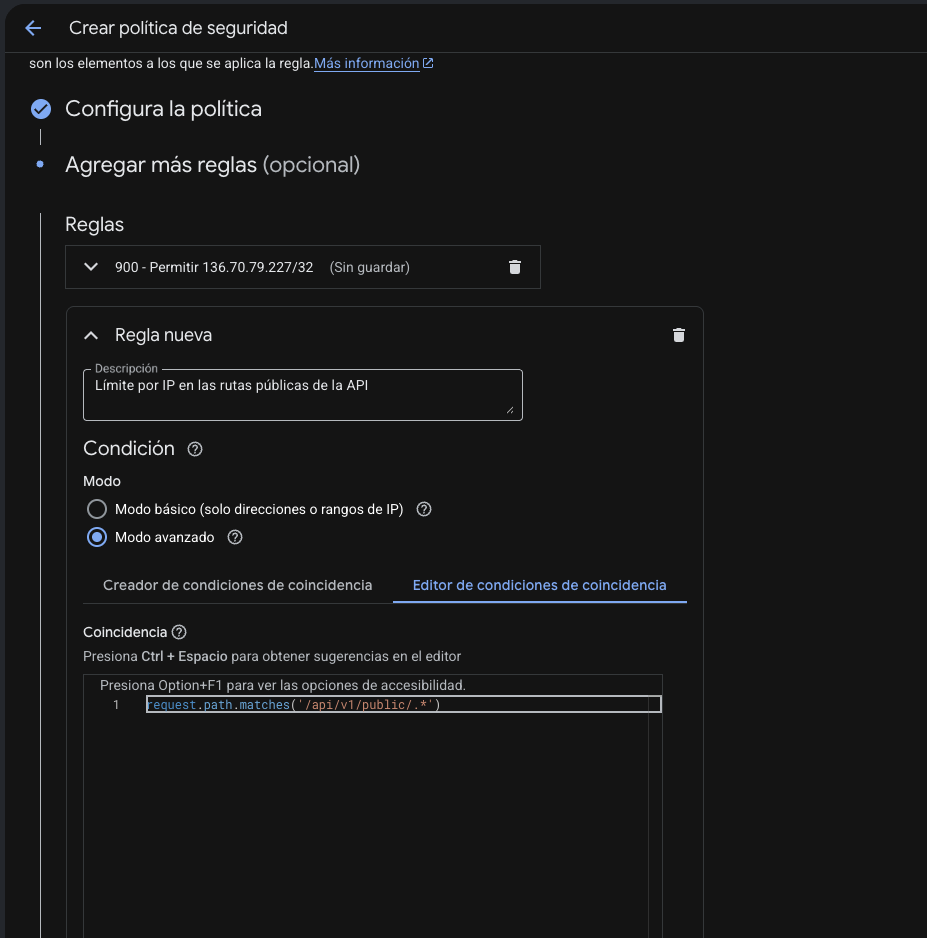
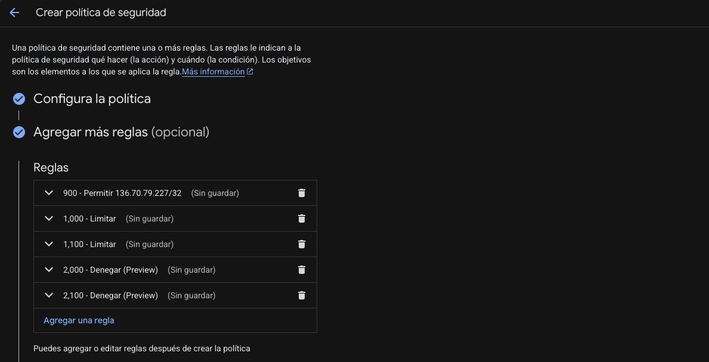
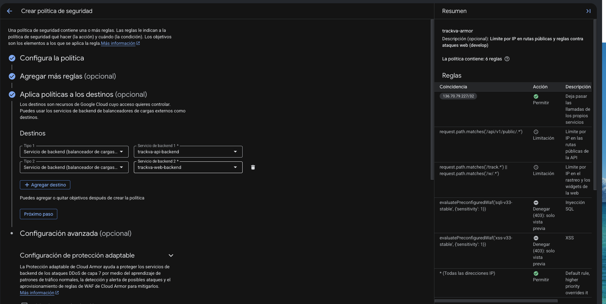
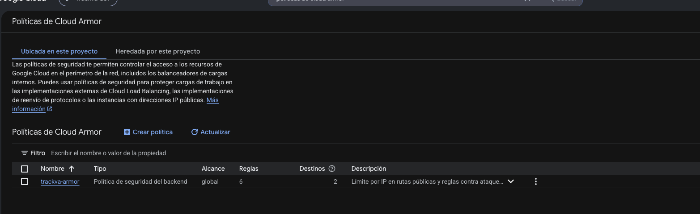

# 09 · Cloud Armor

| | |
|---|---|
| **Estado** | Configurado el 24-nov-2026. Reglas de ataques web en vista previa |
| **Proyecto** | `trackva-dev` |
| **Región** | global (se aplica en el balanceador) |
| **ADR del diseño** | ADR-11 |
| **Costo estimado** | ~US$9/mes (US$5 la política + US$1 por regla + US$0,75 por millón de peticiones) |

## 1. Para qué sirve en TrackVa

Es el filtro en el borde: revisa cada petición en el balanceador, antes de que llegue a Cloud
Run. Hace dos cosas: limita cuántas peticiones por minuto puede hacer una misma IP a las rutas
públicas (rastreo, widgets, cotización) y bloquea patrones de ataque web conocidos (inyección
SQL y XSS).

Es el límite por IP que sí cuenta bien: el de la API depende de leer correctamente la IP del
visitante, y detrás del balanceador hoy no lo hace (servicio 08, sección 7).

## 2. Requisitos previos

- Servicio 08: balanceador con `trackva-api-backend` y `trackva-web-backend`.
- **Cloud Run cerrado** (servicio 08, sección 3.5). Con las URL `run.app` abiertas, cualquiera
  se salta Cloud Armor entrando directo.
- **Web con toda su salida por la VPC** (misma revisión del cierre). Así las llamadas que la web
  hace a la API desde el servidor salen por la IP fija `136.70.79.227`, y la regla 900 puede
  reconocerlas.

## 3. Paso a paso

Seguridad de red › Políticas de Cloud Armor › **Crear política**.

### 3.1 Política

| Campo | Valor |
|---|---|
| Nombre | `trackva-armor` |
| Descripción | Límite por IP en rutas públicas y reglas contra ataques web (develop) |
| Tipo de política | Política de seguridad de backend |
| Alcance | Global |
| Acción de la regla predeterminada | **Permitir** |

### 3.2 Reglas

Todas en «Modo avanzado» (expresión), salvo la 900.

| Prioridad | Qué hace | Condición | Acción |
|---|---|---|---|
| `800` | Las rutas internas de la API no se exponen (agregada el 27-nov, servicio 14) | `request.path.startsWith('/api/v1/internal/')` | Denegar `404` |
| `900` | Deja pasar las llamadas de los propios servicios | Modo básico · rango de IP `136.70.79.227/32` | Permitir |
| `950` | El webhook de WhatsApp entra sin límite por IP ni reglas de ataques web (agregada el 27-nov, servicio 15) | `request.path == '/api/v1/public/whatsapp/webhook'` | Permitir |
| `1000` | Límite por IP en las rutas públicas de la API | `request.path.matches('/api/v1/public/.*')` | Limitar: `120` peticiones por `60` s, por IP; al exceder, denegar con `429` |
| `1100` | Límite por IP en el rastreo y los widgets de la web | `request.path.matches('/track.*') \|\| request.path.matches('/w/.*')` | Limitar: `120` por `60` s, por IP; al exceder, `429` |
| `2000` | Inyección SQL | `evaluatePreconfiguredWaf('sqli-v33-stable', {'sensitivity': 1})` | Denegar `403` · **marcar «Solo vista previa»** |
| `2100` | XSS | `evaluatePreconfiguredWaf('xss-v33-stable', {'sensitivity': 1})` | Denegar `403` · **marcar «Solo vista previa»** |

Por qué cada una:

- **800.** Las rutas internas solo las llaman Cloud Tasks y Cloud Scheduler por la URL `run.app`,
  que no pasa por el balanceador (servicio 14). Va antes de la 900 para que tampoco entren por la IP del NAT.
- **950.** Meta entrega los mensajes de todas las empresas a esa URL desde pocas IP: con la 1000
  un courier con mucho movimiento haría responder `429` a todos y Meta atrasaría los reintentos.
  Y el texto de un chat puede parecerse a un ataque para la 2000/2100. Lo que protege la ruta es
  la firma `X-Hub-Signature-256` que la API verifica (servicio 15).
- **900.** Cuando la web arma una página en el servidor (por ejemplo `/track/CODIGO`), consulta
  la API pasando por el balanceador, y todas esas consultas salen de una sola IP: la del NAT.
  Sin esta regla, el límite de la 1000 se aplicaría a la web entera como si fuera un solo
  visitante. El visitante sigue limitado por la regla 1100, que ve su IP real.
- **1000 y 1100.** 120 por minuto por IP es holgado para una persona y corta el raspado y la
  enumeración de códigos. La API mantiene además su propio límite (30 por minuto en rastreo).
- **2000 y 2100 en vista previa.** Las reglas de ataques web pueden confundir datos legítimos
  (direcciones, notas, CSV importados) con un ataque. En vista previa solo registran qué habrían
  bloqueado. Tras unos días de uso se revisan los registros y se pasan a bloquear.

**Captura — Regla en modo avanzado, con su expresión**



**Captura — Las cinco reglas antes de crear la política**



### 3.3 Destinos

En el último paso del asistente, «Aplicar la política a destinos»: agregar
`trackva-api-backend` y `trackva-web-backend`.

Una sola política para los dos backends: el diseño prevé una, y cada política se cobra aparte.

Equivalente por línea de comandos:

```bash
gcloud compute security-policies create trackva-armor --description="..."
gcloud compute security-policies rules create 900 --security-policy=trackva-armor \
  --src-ip-ranges=136.70.79.227/32 --action=allow
gcloud compute security-policies rules create 1000 --security-policy=trackva-armor \
  --expression="request.path.matches('/api/v1/public/.*')" --action=throttle \
  --rate-limit-threshold-count=120 --rate-limit-threshold-interval-sec=60 \
  --conform-action=allow --exceed-action=deny-429 --enforce-on-key=IP
gcloud compute security-policies rules create 2000 --security-policy=trackva-armor \
  --expression="evaluatePreconfiguredWaf('sqli-v33-stable', {'sensitivity': 1})" --action=deny-403 --preview
gcloud compute backend-services update trackva-api-backend --global --security-policy=trackva-armor
gcloud compute backend-services update trackva-web-backend --global --security-policy=trackva-armor
```

**Captura — Los dos backends como destinos y el resumen de reglas**



**Captura — Política creada: 6 reglas, 2 destinos**



## 4. Verificación

```bash
source scripts/env.sh
gcloud compute security-policies describe trackva-armor \
  --format="table(rules[].priority,rules[].action,rules[].preview,rules[].description)"
gcloud compute backend-services list --global --format="table(name,securityPolicy.basename())"

# Límite: 130 peticiones seguidas a una ruta pública; las últimas deben responder 429
for i in $(seq 1 130); do curl -s -o /dev/null -w "%{http_code}\n" "https://$DEV_DOMAIN/api/v1/public/geo/countries"; done | sort | uniq -c

# Regla de inyección SQL en vista previa: responde normal, pero queda registrada
curl -s -o /dev/null -w "%{http_code}\n" "https://$DEV_DOMAIN/api/v1/public/geo/divisions?country=CO&q=1'%20OR%20'1'='1"
gcloud logging read 'resource.type="http_load_balancer" AND jsonPayload.previewSecurityPolicy.name="trackva-armor"' --limit=5 --freshness=10m
```

Resultado del 24-nov:

```text
trackva-armor (CLOUD_ARMOR, global) → trackva-api-backend y trackva-web-backend

900         allow      136.70.79.227/32
1000        throttle   request.path.matches('/api/v1/public/.*')            120/60 s · excede: deny(429)
1100        throttle   request.path.matches('/track.*') || …('/w/.*')       120/60 s · excede: deny(429)
2000        deny(403)  evaluatePreconfiguredWaf('sqli-v33-stable', …)       vista previa
2100        deny(403)  evaluatePreconfiguredWaf('xss-v33-stable', …)        vista previa
2147483647  allow      *
```

| Prueba | Resultado |
|---|---|
| Tráfico normal: `/api/v1/health`, `/login`, `/track` | 200 |
| 170 peticiones en 52 s a `/api/v1/public/geo/countries` | 60 pasan · 60 las rechaza la API (su límite propio) · **50 las rechaza Cloud Armor** (regla 1000) |
| 140 peticiones a `/track` | 120 pasan · **20 las rechaza Cloud Armor** (regla 1100) |
| 30 peticiones a `/api/v1/health` (ruta no pública) | 30 pasan: las reglas de límite no la tocan |
| Petición con inyección SQL de prueba | Responde 200 (vista previa) y queda registrada: regla 2000, `owasp-crs-v030301-id942190-sqli` |

Registro del balanceador: 50 `denied_by_security_policy` por la regla 1000 y 20 por la 1100. El
límite se cuenta por IP del visitante (la clave del registro es la IP de origen).

**El límite de la API salta antes que el de Cloud Armor.** En `/api/v1/public/geo/countries` la
API corta a las 60 peticiones y Cloud Armor a las 120. El de la API, además, hoy lo comparten
todos los visitantes, porque con `TRUST_PROXY=1` la API cuenta la IP del balanceador (servicio
08, sección 7): durante la prueba esa ruta quedó limitada un minuto para cualquiera. Se corrige
con `TRUST_PROXY=2`, pendiente para el pipeline.

## 5. Índice de capturas

| # | Qué muestra | Dónde | Archivo |
|---|---|---|---|
| 1 | Las cinco reglas antes de crear | Crear política › Agregar más reglas | `capturas/01-reglas.png` |
| 1a | Regla en modo avanzado con su expresión | Crear política › Regla nueva | `capturas/01a-regla-avanzada.png` |
| 2 | Los dos backends como destinos y el resumen de reglas | Crear política › Destinos | `capturas/02-destinos.png` |
| 2b | Política creada: 6 reglas, 2 destinos | Políticas de Cloud Armor | `capturas/02b-politica-creada.png` |
| 3 | Prueba del límite: respuestas 429 | Terminal | `capturas/03-limite-429.png` (pendiente; consta en la verificación) |
| 4 | Petición registrada por la regla en vista previa | `trackva-armor` › Registros | `capturas/04-vista-previa.png` (pendiente; consta en la verificación) |

## 6. Cómo deshacerlo

```bash
gcloud compute backend-services update trackva-api-backend --global --security-policy=""
gcloud compute backend-services update trackva-web-backend --global --security-policy=""
gcloud compute security-policies delete trackva-armor --quiet
```

## 7. Diferencias con el diseño y pendientes

- El diseño cuenta 2 reglas (~US$7/mes). Aquí son 5 (~US$9/mes): se separan la API y la web, se
  agrega la excepción de los servicios propios y se separan inyección SQL y XSS.
- Las dos políticas que la consola creó sola al armar el balanceador se borraron el 24-nov.
- Pendiente tras unos días: revisar los registros de vista previa y pasar las reglas 2000 y
  2100 a bloquear.
