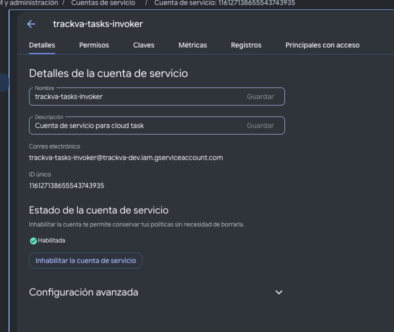
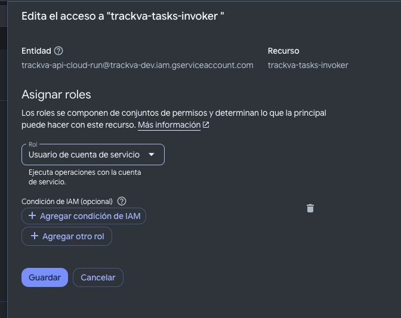
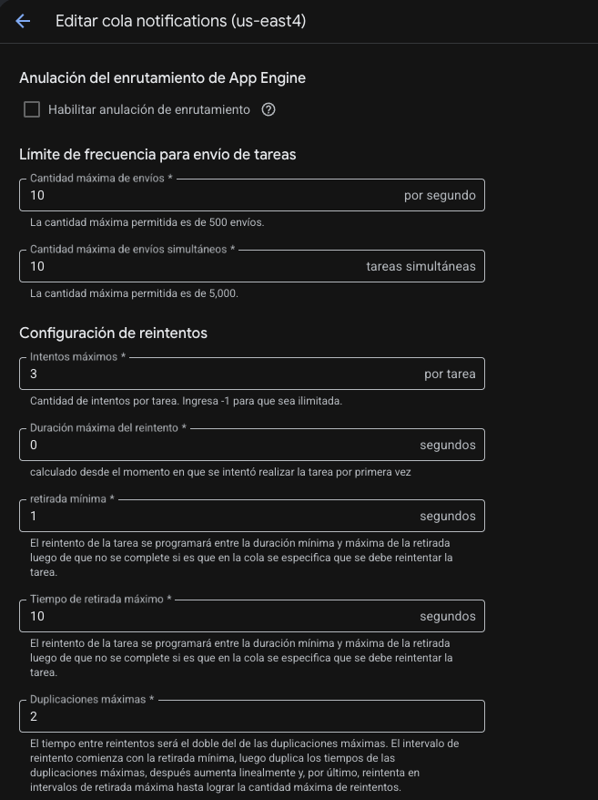
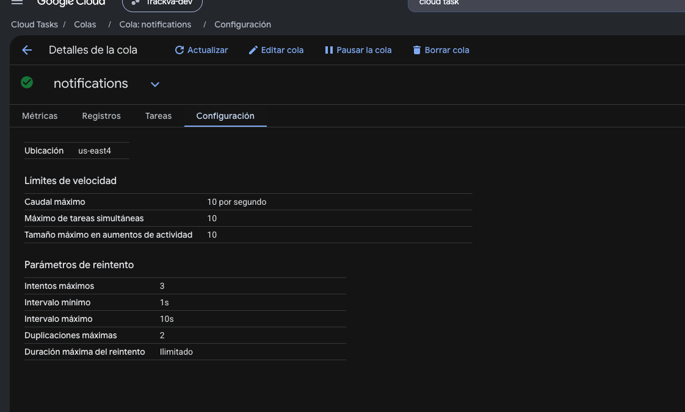
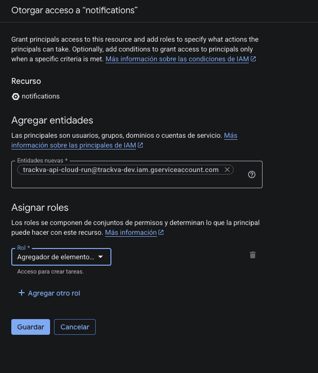
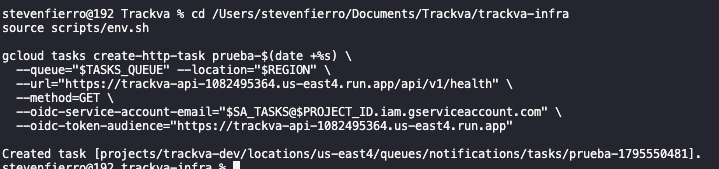

# 10 · Cloud Tasks

| | |
|---|---|
| **Estado** | Configurado el 24-nov-2026. La API encola desde el 27-nov (R-45, servicio 14) |
| **Proyecto** | `trackva-dev` |
| **Región** | `us-east4` |
| **ADR del diseño** | ADR-04, ADR-13 |
| **Costo estimado** | US$0 (el primer millón de operaciones al mes es gratis) |

## 1. Para qué sirve en TrackVa

Es la cola para el trabajo que no debe hacer esperar al usuario, empezando por el envío de
notificaciones. La API deja una tarea en la cola y responde de inmediato; Cloud Tasks llama
después a un punto de la API para ejecutarla, y reintenta si falla.

Reemplaza a BullMQ + Redis del diseño original: no hay un Redis que operar ni pagar (ADR-04).

**Lo que este paso deja listo y lo que no.** Se crean la cola, la identidad con la que Cloud
Tasks llama a la API y los permisos. La API **todavía no usa la cola**: el contrato
`TaskQueuePort` y su adaptador están planeados, no implementados (CLAUDE.md §12.0.bis). Las
notificaciones siguen saliendo con el mecanismo actual. La cola queda probada con una tarea de
prueba.

## 2. Requisitos previos

Servicios 00 (API de Cloud Tasks habilitada), 01 (cuenta de la API) y 06 (API desplegada).

## 3. Paso a paso

### 3.1 Cuenta con la que Cloud Tasks llama a la API

IAM y administración › Cuentas de servicio › **Crear cuenta de servicio**:

| Campo | Valor |
|---|---|
| Nombre | TrackVa tareas (Cloud Tasks) |
| ID | `trackva-tasks-invoker` (cambiar el que proponga la consola) |
| Descripción | Identidad con la que Cloud Tasks invoca a trackva-api |
| Roles en el proyecto | Ninguno |

Cloud Tasks firma cada llamada con un token OIDC a nombre de esta cuenta. La API comprobará
ese token (emisor, audiencia y cuenta) antes de ejecutar la tarea: así, aunque `/api/*` es
público, solo Cloud Tasks puede disparar el trabajo (ADR-13).

**Captura — Cuenta trackva-tasks-invoker creada**



### 3.2 Permiso para que la API use esa identidad

Cuentas de servicio › `trackva-tasks-invoker` › pestaña **Principales con acceso** ›
**Otorgar acceso**:

| Campo | Valor |
|---|---|
| Principal | `trackva-api-cloud-run@trackva-dev.iam.gserviceaccount.com` |
| Rol | Cuentas de servicio › **Usuario de cuenta de servicio** (`roles/iam.serviceAccountUser`) |

Sin esto, la API no puede crear tareas que lleven la firma de esa cuenta.

**Captura — La API como «Usuario de cuenta de servicio» sobre esa cuenta**



### 3.3 Cola

Cloud Tasks › **Crear cola de envío**:

| Campo | Valor |
|---|---|
| Nombre de la cola | `notifications` |
| Región | `us-east4 (Virginia del Norte)` |
| Cantidad máxima de envíos por segundo | `10` |
| Cantidad máxima de envíos simultáneos | `10` |
| Cantidad máxima de intentos | `3` |
| Retirada mínima | `1` s |
| Retirada máxima | `10` s |
| Duplicaciones máximas | `2` |

Tres intentos con espera creciente (1 s, 2 s, 4 s) es lo que pide el objetivo 3.2 del diseño.
Diez envíos simultáneos es el valor previsto para las notificaciones (CLAUDE.md §19.bis).

**Captura — Formulario de la cola con sus límites y reintentos**



**Captura — Cola notifications en ejecución**



### 3.4 Permiso para que la API encole

El permiso por cola no está en el detalle de la cola: se da desde la lista. Cloud Tasks › Colas ›
marcar `notifications` › **Mostrar panel de información** › **Agregar principal**:

| Campo | Valor |
|---|---|
| Principal | `trackva-api-cloud-run@trackva-dev.iam.gserviceaccount.com` |
| Rol | Cloud Tasks › **Agregador de elementos en cola de Cloud Tasks** (`roles/cloudtasks.enqueuer`) |

El permiso va en la cola, no en el proyecto: la API solo puede encolar ahí.

**Captura — Permiso de la API para agregar tareas a la cola**



### 3.5 Tarea de prueba (terminal)

Comprueba dos cosas: que la cola entrega y que Cloud Tasks puede llegar a la API aunque su
ingress esté cerrado a internet (entra por ser del mismo proyecto, ADR-13).

```bash
cd /Users/stevenfierro/Documents/Trackva/trackva-infra
source scripts/env.sh

gcloud tasks create-http-task prueba-$(date +%s) \
  --queue="$TASKS_QUEUE" --location="$REGION" \
  --url="https://trackva-api-1082495364.us-east4.run.app/api/v1/health" \
  --method=GET \
  --oidc-service-account-email="$SA_TASKS@$PROJECT_ID.iam.gserviceaccount.com" \
  --oidc-token-audience="https://trackva-api-1082495364.us-east4.run.app"
```

La tarea llama a `/api/v1/health`, que no hace nada: solo sirve para ver la entrega.

**Captura — Tarea de prueba creada desde la terminal**



## 4. Verificación

```bash
gcloud tasks queues describe "$TASKS_QUEUE" --location="$REGION" \
  --format="yaml(name.basename(),state,rateLimits,retryConfig)"
gcloud tasks queues get-iam-policy "$TASKS_QUEUE" --location="$REGION"
gcloud iam service-accounts get-iam-policy "$SA_TASKS@$PROJECT_ID.iam.gserviceaccount.com"
gcloud tasks list --queue="$TASKS_QUEUE" --location="$REGION"          # vacía = la tarea se entregó
gcloud logging read 'resource.type="cloud_run_revision" AND resource.labels.service_name="trackva-api"
  AND httpRequest.userAgent:"Google-Cloud-Tasks"' --limit=3 --freshness=10m \
  --format="value(timestamp,httpRequest.status,httpRequest.requestUrl)"
```

Estado al 24-nov:

```text
trackva-tasks-invoker@trackva-dev.iam.gserviceaccount.com   habilitada
   roles/iam.serviceAccountUser → trackva-api-cloud-run

cola notifications (us-east4)   state: RUNNING
   rateLimits:  maxDispatchesPerSecond 10 · maxConcurrentDispatches 10 · maxBurstSize 10
   retryConfig: maxAttempts 3 · minBackoff 1s · maxBackoff 10s · maxDoublings 2
   roles/cloudtasks.enqueuer → trackva-api-cloud-run
```

Tarea de prueba (3.5):

```text
$ gcloud tasks create-http-task prueba-… --queue=notifications …
Created task [projects/trackva-dev/locations/us-east4/queues/notifications/tasks/prueba-1795550481].

Registro de Cloud Run (trackva-api):
20:01:22  200  https://trackva-api-1082495364.us-east4.run.app/api/v1/health  Google-Cloud-Tasks

Tareas que quedan en la cola: ninguna
```

Cloud Tasks entregó la tarea al primer intento y la API respondió 200. Confirma el ADR-13: con
el ingress cerrado a internet (la misma URL responde 404 desde fuera), Cloud Tasks sí entra,
por ser tráfico del mismo proyecto. La cola no guarda registro propio de las entregas (no se
activó); la entrega se ve en los registros de Cloud Run.

## 5. Índice de capturas

| # | Qué muestra | Dónde | Archivo |
|---|---|---|---|
| 1 | Cuenta `trackva-tasks-invoker` creada | IAM y administración › Cuentas de servicio | `capturas/01-cuenta-invoker.png` (y `01b`) |
| 2 | Formulario de la cola con sus límites y reintentos | Cloud Tasks › Crear cola | `capturas/02-crear-cola.png` |
| 3 | Cola `notifications` en ejecución | Cloud Tasks | `capturas/03-cola.png` |
| 4 | Permiso de la API sobre la cola | Cloud Tasks › `notifications` › Permisos | `capturas/04-permiso-cola.png` |
| 5 | Tarea de prueba entregada | Terminal o Cloud Tasks › `notifications` › Registros | `capturas/05-tarea-prueba.png` |

## 6. Cómo deshacerlo

```bash
gcloud tasks queues delete "$TASKS_QUEUE" --location="$REGION" --quiet
gcloud iam service-accounts delete "$SA_TASKS@$PROJECT_ID.iam.gserviceaccount.com" --quiet
```

Una cola borrada no se puede volver a crear con el mismo nombre hasta pasados unos días.

## 7. Diferencias con el diseño y pendientes

- El diseño da por hecho que las notificaciones ya salen por Cloud Tasks. Falta el código:
  `TaskQueuePort`, el adaptador de Cloud Tasks, el punto interno que recibe la tarea y el guard
  que verifica el token OIDC. Hasta entonces la cola no recibe trabajo real.
- Cloud Scheduler (sondeo de transportadoras) sigue planeado; no se crea.
- El cargo diario de almacenamiento del WMS (`npm run wms:storage-charges`) necesita un
  disparador programado; es candidato a Cloud Scheduler cuando exista el punto interno.
