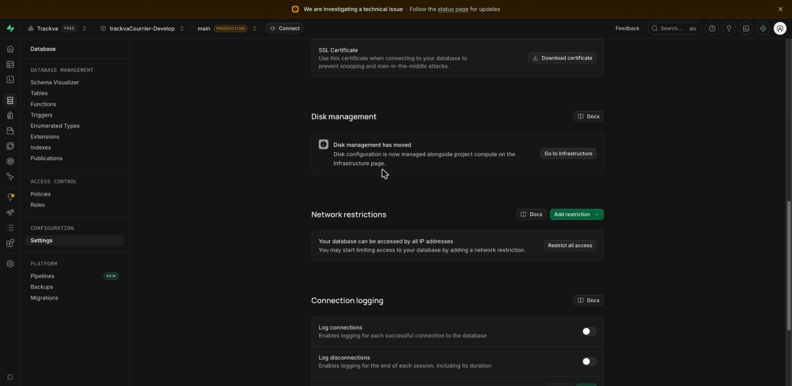
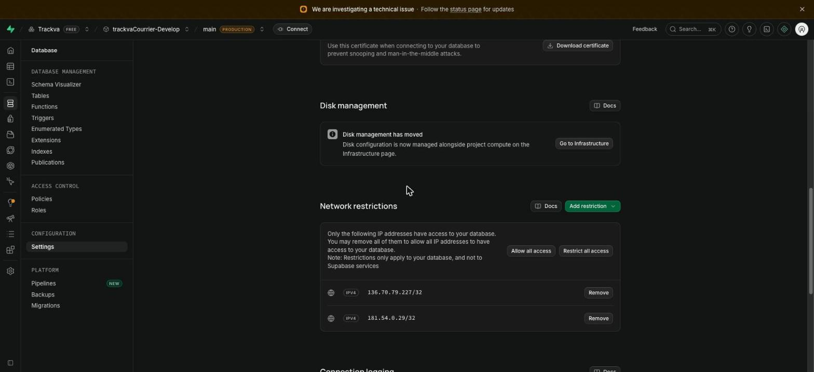

# 11 · Supabase: restricción de red de PostgreSQL

| | |
|---|---|
| **Estado** | Configurado el 24-nov-2026 |
| **Proyecto** | Supabase `trackvaCourrier-Develop` (fuera de Google Cloud) |
| **Región** | `us-east-1` (AWS) |
| **ADR del diseño** | ADR-12, ADR-03 |
| **Costo estimado** | US$0 |

## 1. Para qué sirve en TrackVa

Hoy la base de datos de develop acepta conexiones desde cualquier dirección de internet: lo
único que la protege es la contraseña. Con la restricción de red, PostgreSQL y su agrupador de
conexiones solo aceptan conexiones desde las direcciones autorizadas. Una contraseña robada
deja de servir desde cualquier otro lugar.

Es la razón por la que la API sale por una IP fija (servicio 04).

## 2. Requisitos previos

- Servicio 04 y 06: la API sale por `136.70.79.227` (comprobado en el servicio 06).
- Sesión en el panel de Supabase con permisos sobre el proyecto de dev.

## 3. Qué cubre y qué no

| Cubre | No cubre |
|---|---|
| Conexiones directas a PostgreSQL (puerto 5432) | Las API HTTPS de Supabase: autenticación, almacenamiento, REST |
| El agrupador de conexiones (puerto 6543), que es el que usa la API | El panel de Supabase y su editor SQL |

Lo que no cubre sigue protegido por las llaves y por las políticas RLS. Por eso el inicio de
sesión de los usuarios no se ve afectado: va por HTTPS, no por PostgreSQL.

## 4. Quién necesita conectarse a la base de dev

| Origen | Dirección | Para qué |
|---|---|---|
| API en Cloud Run | `136.70.79.227/32` | Todo el funcionamiento de develop |
| Equipo de desarrollo de Steven | Su IP pública del momento, `/32` | Migraciones de Prisma, cargas de catálogos, sembrado de QA y la API local cuando apunta a dev |

**La segunda es la que da trabajo.** La IP de una conexión de casa u oficina cambia cada cierto
tiempo. Cuando cambie, las migraciones y el QA contra dev fallarán con un error de conexión
hasta actualizarla en el panel. Lo mismo al trabajar desde otra red. También afecta a otras
sesiones de trabajo que usen la base de dev desde este equipo.

## 5. Paso a paso

Proyecto `trackvaCourrier-Develop` › Database › Settings › **Network restrictions** ›
**Add restriction**. Se agregan las dos direcciones del punto 4, en notación CIDR:

| CIDR | Nota |
|---|---|
| `136.70.79.227/32` | API de develop (NAT de Google Cloud) |
| `<IP pública del equipo>/32` | Desarrollo local; hay que actualizarla cuando cambie |

Guardar. El cambio tarda alrededor de un minuto en aplicarse.

En la misma pantalla está «Enforce SSL on incoming connections». Hoy está **desactivado**: la
base acepta también conexiones sin cifrar. Conviene activarlo; queda pendiente.

**Captura — Antes: la base aceptaba cualquier dirección**



**Captura — Después: solo las dos direcciones autorizadas**



## 6. Verificación

```bash
D=https://app-dev.trackva.com.co
curl -s "$D/api/v1/public/geo/divisions?country=CO&q=cali" | head -c 120     # la API sigue leyendo la base
```

Desde el equipo, con la IP autorizada: `npm run prisma:status` en `trackva-api` debe conectar.
Desde una red no autorizada (por ejemplo, compartiendo datos del teléfono): debe fallar la conexión.

Resultado del 24-nov, medio minuto después de guardar:

```text
Panel: «Only the following IP addresses have access to your database»
   IPV4  136.70.79.227/32
   IPV4  <IP pública del equipo>/32

API de develop:  /api/v1/public/geo/divisions?country=CO&q=palmira → 200 (tres veces)
                 /api/v1/public/tracking/VERIFRED11                → 404 (consultó la base)
Equipo local:    npm run prisma:status → «67 migrations found … Database schema is up to date!»
```

Los dos orígenes autorizados siguen conectando. **No se probó el caso contrario** (una red no
autorizada), porque no había otra red a mano: se comprueba compartiendo datos del teléfono y
corriendo `npm run prisma:status`, que debe fallar.

## 7. Índice de capturas

| # | Qué muestra | Dónde | Archivo |
|---|---|---|---|
| 1 | Antes: «Your database can be accessed by all IP addresses» | Database › Settings › Network restrictions | `capturas/01-antes-sin-restriccion.jpg` |
| 2 | Después: las dos direcciones autorizadas | La misma pantalla | `capturas/02-restricciones.jpg` |
| 3 | La app sigue funcionando tras el cambio | Navegador, `app-dev.trackva.com.co` | `capturas/03-app-funciona.png` (pendiente; consta en la verificación) |

## 8. Cómo deshacerlo

En la misma pantalla, borrar las restricciones. La base vuelve a aceptar conexiones de
cualquier dirección. Es inmediato y no pierde datos.

## 9. Diferencias con el diseño y pendientes

- El diseño dice que la IP del NAT es «la única autorizada». En develop se autoriza además el
  equipo de desarrollo; en producción sí debe quedar solo la del NAT, y las migraciones saldrán
  del pipeline.
- Si el pipeline (servicio 13) corre migraciones desde GitHub Actions, sus direcciones no son
  fijas: habrá que correrlas desde un trabajo de Cloud Run en la misma VPC.
