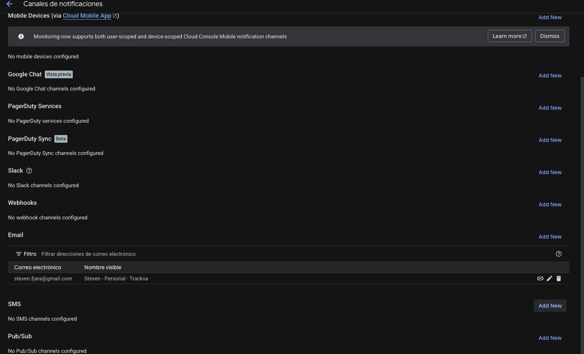
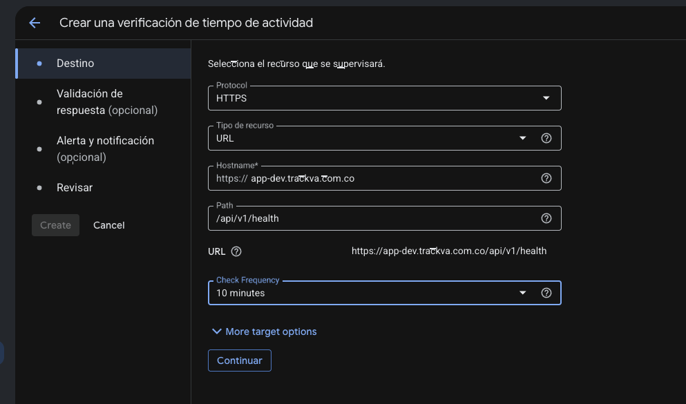
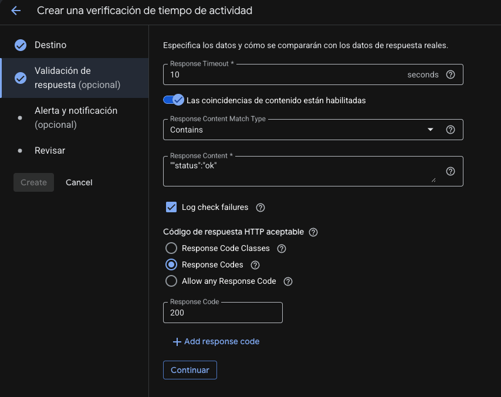
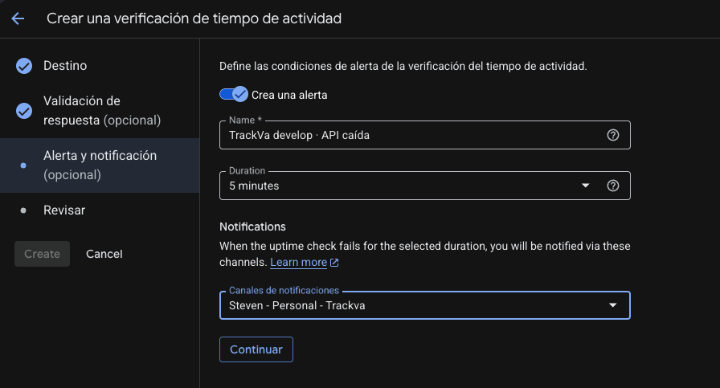
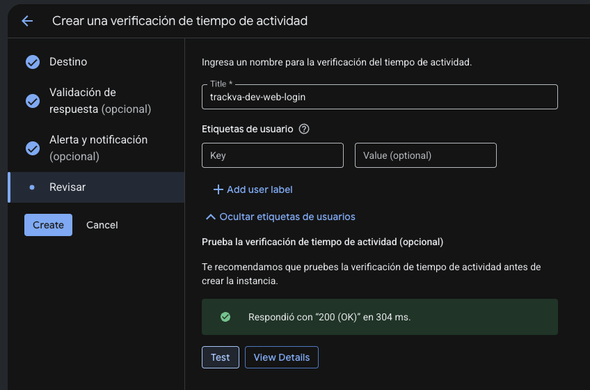
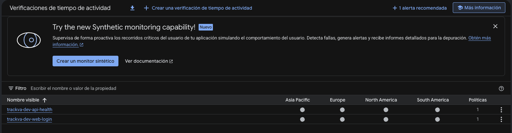
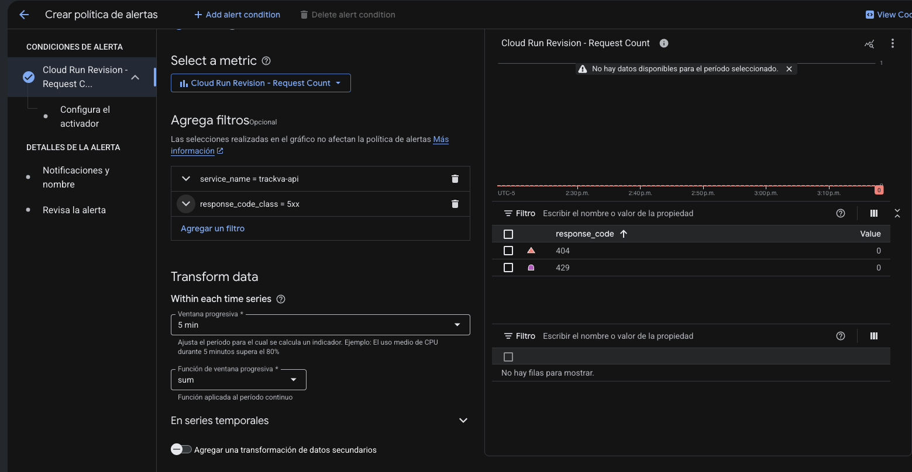
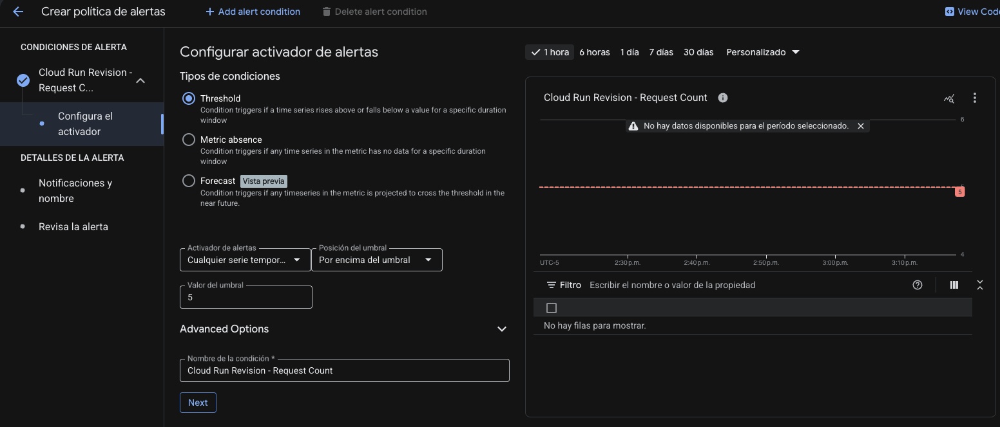
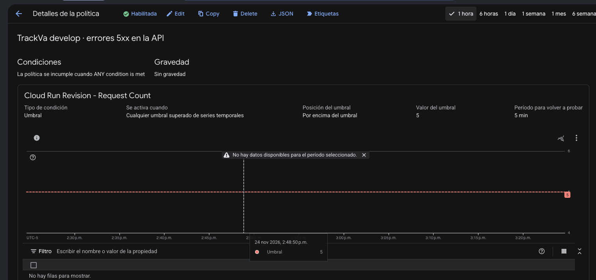

# 12 · Observabilidad

| | |
|---|---|
| **Estado** | Configurado el 24-nov-2026 |
| **Proyecto** | `trackva-dev` |
| **Región** | global |
| **ADR del diseño** | — (sección 6.2 del diseño: monitoreo y observabilidad) |
| **Costo estimado** | US$0 (las comprobaciones de disponibilidad y las alertas por correo son gratuitas a este volumen) |

## 1. Para qué sirve en TrackVa

Avisa cuando develop deja de responder o empieza a fallar, sin tener que estar mirando. Se apoya
en lo que Google Cloud ya recoge solo: los registros de los contenedores (Cloud Logging) y las
métricas de Cloud Run y del balanceador (Cloud Monitoring). Aquí se agrega lo que no viene por
defecto: una comprobación externa de disponibilidad y las alertas por correo.

| Pieza | Ya existe | Se agrega aquí |
|---|---|---|
| Registros de la API, la web e integraciones | Sí, en Cloud Logging, en JSON y con `X-Request-Id` | — |
| Métricas de Cloud Run y del balanceador | Sí, en Cloud Monitoring | — |
| Registros del balanceador y de Cloud Armor | Sí (se activaron en el servicio 08) | — |
| Comprobación de disponibilidad desde fuera | No | Sí |
| Avisos por correo | No | Sí |
| Errores de la app (Sentry) | La API ya envía con su DSN | — |

## 2. Requisitos previos

Servicio 08: el dominio `app-dev.trackva.com.co` responde.

## 3. Paso a paso

### 3.1 Canal de aviso

Monitoring › Alertas › **Editar canales de notificación** › Correo electrónico › **Agregar nuevo**:

| Campo | Valor |
|---|---|
| Dirección de correo | El correo personal de Steven |
| Nombre visible | `Steven - Personal - Trackva` |

**Captura — Canal de correo creado**



### 3.2 Comprobación de disponibilidad de la API

Monitoring › Comprobaciones de tiempo de actividad › **Crear comprobación**:

| Sección | Campo | Valor |
|---|---|---|
| Destino | Protocolo | HTTPS |
| | Tipo de recurso | URL |
| | Nombre de host | `app-dev.trackva.com.co` |
| | Ruta | `/api/v1/health` |
| | Frecuencia | 15 minutos (decisión de Steven; la guía proponía 5) |
| | Regiones | Global (o al menos 3) |
| Validación de la respuesta | Tiempo de espera | 10 segundos |
| | Coincidencia de contenido | Contiene `"status":"ok"` |
| | Códigos aceptados | 200 |
| Alertas y notificaciones | Crear una alerta | Sí · nombre `TrackVa develop · API caída` · duración 5 minutos · canal `TrackVa develop · avisos` |
| Revisión | Título | `trackva-dev-api-health` |

Antes de crear, pulsar **Probar**: debe responder 200.

Esta comprobación pasa por todo el camino real: DNS, certificado, balanceador, Cloud Armor y
la API. Si cualquiera de esos falla, avisa.

**Frecuencia y arranque en frío.** Con 15 minutos la comprobación no alcanza a mantener
despierta la API (Cloud Run apaga la instancia tras unos 15 minutos sin uso), así que seguirá
habiendo arranques en frío. Con 5 minutos casi desaparecerían, sin costo: las comprobaciones
son gratuitas a este volumen y Cloud Run solo cobra el tiempo en que atiende peticiones.
`/api/v1/health` no consulta la base ni cae en las reglas de límite de Cloud Armor.

**Captura — Destino de la comprobación de la API**



**Captura — Validación de la respuesta**



**Captura — Alerta asociada a la comprobación**



### 3.3 Comprobación de disponibilidad de la web

Igual que la anterior, cambiando:

| Campo | Valor |
|---|---|
| Ruta | `/login` |
| Coincidencia de contenido | Contiene `TrackVa` |
| Nombre de la alerta | `TrackVa develop · web caída` |
| Título | `trackva-dev-web-login` |

**Captura — Prueba de la comprobación de la web en verde**



**Captura — Las dos comprobaciones creadas**



### 3.4 Alerta de errores de la API

Monitoring › Alertas › **Crear política**:

| Campo | Valor |
|---|---|
| Métrica | Cloud Run Revision › Request Count (`run.googleapis.com/request_count`) |
| Filtros | `service_name = trackva-api` · `response_code_class = 5xx` |
| Agregación | Función de ventana `sum` de 5 minutos; en «series temporales», también `sum` sin agrupar |
| Condición | Por encima de `5` |
| Canal | `TrackVa develop · avisos` |
| Nombre | `TrackVa develop · errores 5xx en la API` |

Las respuestas 4xx no cuentan: son errores esperados del cliente (sesión vencida, datos
inválidos). Más de cinco respuestas 5xx en cinco minutos sí indica un fallo del servicio.

**Captura — Métrica, filtros y función de ventana**



**Captura — Umbral de la alerta**



**Captura — Política de errores 5xx creada**



### 3.5 Alertas de uso de los contenedores (por línea de comandos, 24-nov)

Cloud Run ya mide el uso de CPU, de memoria y la cantidad de instancias de cada servicio; se
ve en Cloud Run › el servicio › pestaña **Observabilidad**. Lo que se agrega aquí son los
avisos para saber cuándo aumentar recursos:

| Alerta | Condición | Qué significa | Qué aumentar |
|---|---|---|---|
| Memoria alta en Cloud Run | Percentil 99 de memoria por encima del 80 % durante 10 minutos, en cualquier servicio | El contenedor se acerca al límite; si lo pasa, Cloud Run lo reinicia | La memoria del servicio |
| CPU alta en Cloud Run | Percentil 99 de CPU por encima del 80 % durante 10 minutos, en cualquier servicio | Las peticiones se encolan dentro de la instancia | La CPU, o bajar las solicitudes simultáneas por instancia |
| La API está en su máximo de instancias | 3 instancias de `trackva-api` durante 10 minutos | Cloud Run ya no puede escalar más | El máximo de instancias |

Las tres se definen en [alertas/](alertas/) y se crean con un guion, que no repite las que ya
existen:

```bash
bash scripts/crear-alertas-uso.sh
```

```text
creada:    TrackVa develop · la API está en su máximo de instancias
creada:    TrackVa develop · CPU alta en Cloud Run
creada:    TrackVa develop · memoria alta en Cloud Run
```

El guion usa la API de Monitoring directamente, porque los comandos `gcloud alpha monitoring`
piden instalar componentes adicionales. Cada alerta lleva en su descripción qué hacer cuando
salta, y avisa por el mismo canal de correo.

Uso medido el 24-nov, en las 24 horas anteriores (incluye las ráfagas de prueba de Cloud Armor):

| Servicio | Memoria, pico | CPU, pico | Instancias a la vez, pico |
|---|---|---|---|
| `trackva-api` (1 GiB, 1 CPU) | 34 % | 37 % | 2 de 3 |
| `trackva-web` (512 MiB, 1 CPU) | 37 % | 23 % | 1 de 2 |
| `trackva-integrations` (512 MiB, 1 CPU) | 19 % | 9 % | 1 de 2 |

Hay margen en los tres. Como los servicios escalan a cero, solo hay datos mientras hay
instancias encendidas: por eso las alertas miran uso sostenido y no picos sueltos.

### 3.6 Alertas de las tareas internas (por línea de comandos, 27-nov)

Con R-45 se suman dos alertas por registro, en el mismo directorio y con el mismo script:
**tareas internas con error** (una respuesta 5xx en `/api/v1/internal/`) y **conciliación del
WMS con diferencias**. Detalle en el servicio 14. Quedan ocho alertas por correo.

## 4. Verificación

```bash
source scripts/env.sh
gcloud monitoring uptime list-configs \
  --format="table(displayName,httpCheck.path,period,monitoredResource.labels.host)"
```

Las políticas de alerta y los canales se revisan en la consola (Monitoring › Alertas): los
comandos de `gcloud` para leerlos piden instalar componentes adicionales.

Estado al 24-nov, leído de la API de Monitoring:

```text
COMPROBACIÓN trackva-dev-api-health | /api/v1/health | cada 900s | contenido: ""status":"ok"     ← comilla de más
COMPROBACIÓN trackva-dev-web-login  | /login         | cada 900s | contenido: TrackVa

POLÍTICA TrackVa develop · API caída               | activa | 1 canal
POLÍTICA TrackVa develop · web caída               | activa | 1 canal
POLÍTICA TrackVa develop · errores 5xx en la API   | activa | 1 canal
POLÍTICA TrackVa develop · memoria alta en Cloud Run              | activa | 1 canal | > 0,8 durante 600 s
POLÍTICA TrackVa develop · CPU alta en Cloud Run                  | activa | 1 canal | > 0,8 durante 600 s
POLÍTICA TrackVa develop · la API está en su máximo de instancias | activa | 1 canal | > 2,5 durante 600 s
   filtro: cloud_run_revision · service_name = "trackva-api" · request_count · response_code_class = "5xx"
   agregación: ALIGN_SUM 300 s + REDUCE_SUM · condición: > 5 durante 300 s

CANAL Steven - Personal - Trackva | email | activo
```

**Corrección del mismo día.** La comprobación de la API validaba `""status":"ok"`, con dos
comillas al inicio, y fallaba siempre aunque la API respondiera 200 (los registros decían
`content_mismatch: true`). Steven lo corrigió a `"status":"ok"`. El cambio tardó unos minutos en
llegar a todas las regiones:

```text
20:27–20:29 UTC   São Paulo, Oregón, Singapur   FALLA   (aún con el texto anterior)
20:32 UTC         Iowa, Bélgica                 OK      (ya con el texto corregido)
```

Las regiones que quedan en rojo pasan a verde en su siguiente ronda (cada 15 minutos). Si la
alerta «API caída» llegó a abrirse por esto, se cierra sola.

## 5. Índice de capturas

| # | Qué muestra | Dónde | Archivo |
|---|---|---|---|
| 1 | Canal de correo creado | Monitoring › Alertas › Canales de notificación | `capturas/01-canal-correo.png` |
| 2 | Formulario de la comprobación de la API con la prueba en verde | Comprobaciones de tiempo de actividad › Crear | `capturas/02-crear-comprobacion.png` (y `02b`, `02c`, `02d`) |
| 3 | Las dos comprobaciones en verde desde todas las regiones | Comprobaciones de tiempo de actividad | `capturas/03-comprobaciones.png` |
| 4 | Política de errores 5xx creada (y sus pasos en `04a`, `04b`) | Monitoring › Alertas | `capturas/04-politica-5xx.png` |
| 5 | Panel de métricas de `trackva-api` (peticiones, latencia, instancias) | Cloud Run › `trackva-api` › Observabilidad | `capturas/05-metricas-api.png` (pendiente) |

## 6. Cómo deshacerlo

Borrar las políticas, las comprobaciones y el canal desde las mismas pantallas, en ese orden.

## 7. Diferencias con el diseño y pendientes

- El diseño menciona alertas sobre peticiones bloqueadas por Cloud Armor; se deja para cuando
  las reglas de ataques web salgan de vista previa.
- La web no envía errores a Sentry ni eventos a PostHog: el código no los tiene todavía.
- No hay tablero propio: se usan los de Cloud Run y del balanceador que trae la consola.
